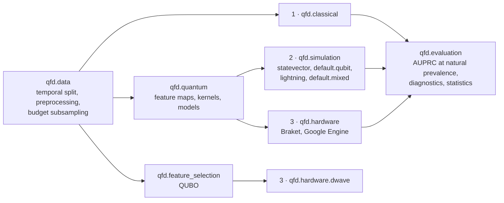

# qfd: Quantum Machine Learning for Fraud Detection

Master thesis project comparing classical and quantum machine learning for
fraud detection, built on [PennyLane](https://pennylane.ai).

The work is organised in three stages that share data handling, evaluation and
a device-agnostic quantum core:

| Stage | Package | What runs |
|-------|---------|-----------|
| 1. Classical | `qfd.classical` | Logistic regression, SVM, Random Forest, XGBoost, LightGBM, One-Class SVM, Isolation Forest, ECOD |
| 2. Simulation | `qfd.simulation` + `qfd.quantum` | Quantum kernel SVM, quantum one-class SVM, variational classifier on exact, shot-based or noisy simulators |
| 3. Hardware | `qfd.hardware` + `qfd.quantum` | The same quantum models on AWS Braket and Google Quantum Engine; QUBO feature selection on D-Wave |



## Setup

Requires [Miniconda](https://docs.conda.io/en/latest/miniconda.html) or Miniforge.

```bash
conda env create -f environment.yml
```

```bash
conda activate qfd
```

Optional hardware providers:

```bash
pip install -e ".[braket]"
```

```bash
pip install -e ".[google]"
```

```bash
pip install -e ".[dwave]"
```

Credentials go in `.env` (copy `.env.example`); the CLI loads it automatically.

```bash
pre-commit install --hook-type pre-commit --hook-type pre-push
```

## Data

The [ULB Credit Card Fraud dataset](https://www.kaggle.com/datasets/mlg-ulb/creditcardfraud)
is downloaded with a Kaggle API token. Create one under *API* at
<https://www.kaggle.com/settings/api> and set it in `.env`:

```bash
KAGGLE_API_TOKEN=<your token>
```

Then:

```bash
qfd download ulb
```

This writes `data/raw/creditcard.csv` and its SHA-256 (`creditcard.csv.sha256`).
Raw data is git-ignored. Smoke configs use synthetic data and need no download.

## Running experiments

Each experiment is a YAML file in `configs/<stage>/`:

```bash
qfd run configs/classical/smoke.yaml
```

```bash
qfd run configs/simulation/smoke.yaml
```

Results are appended to `results/<name>/<timestamp>/results.jsonl`, one line
per model and repetition.

Hardware runs cost money and are refused unless confirmed:

```bash
qfd run configs/hardware/braket_sv1_q4.yaml --allow-hardware
```

| Config | Purpose |
|--------|---------|
| `classical/ulb_baselines.yaml` | Unconstrained classical ceiling on ULB |
| `classical/ulb_matched.yaml` | Classical models on the quantum budget (q = 8, n = 500) |
| `simulation/ulb_kernels_q8.yaml` | Main quantum comparison, exact simulation |
| `simulation/ulb_noisy_q4.yaml` | Shots and depolarising noise |
| `hardware/braket_sv1_q4.yaml` | AWS Braket (SV1, swap the ARN for a QPU) |
| `hardware/google_engine_q4.yaml` | Google Quantum Engine |
| `hardware/dwave_qubo_selection.yaml` | QUBO feature selection on a D-Wave annealer |

## Development

```bash
pytest
```

```bash
pytest -m "not slow"
```

```bash
ruff check . && ruff format --check . && mypy
```

`pytest -m hardware` submits paid jobs and needs credentials.

## Project layout

```text
configs/            experiment YAML files per stage
data/               raw/ and processed/ data (git-ignored)
docs/               thesis knowledge base (ML, anomaly & fraud detection, QML, protocol)
notebooks/          exploration only
src/qfd/
  config.py         experiment configuration
  data/             loaders, temporal splits, subsampling, preprocessing
  classical/        stage 1: classical baselines
  quantum/          feature maps, kernels, quantum models (device-agnostic)
  simulation/       stage 2: local simulators
  hardware/         stage 3: Braket, Google Engine, D-Wave, cost guards
  feature_selection.py  QUBO feature selection
  evaluation/       metrics, kernel diagnostics, statistics
  registry.py       model name -> detector
  runner.py         experiment loop
  cli.py            `qfd` command
tests/              pytest suite
```

Coding conventions for humans and AI agents are in [AGENTS.md](AGENTS.md).
