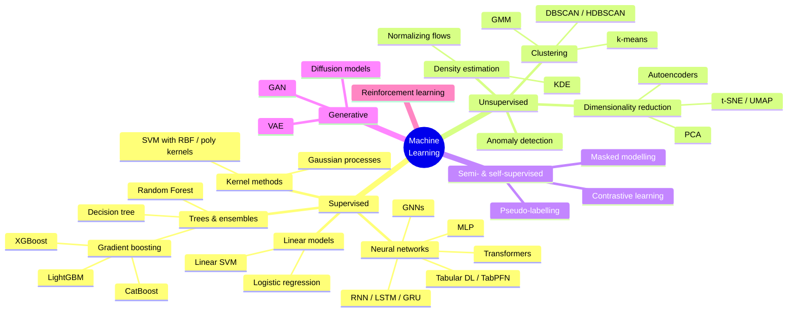
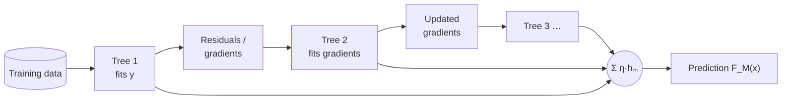
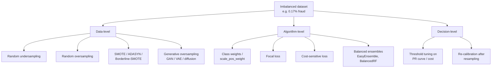
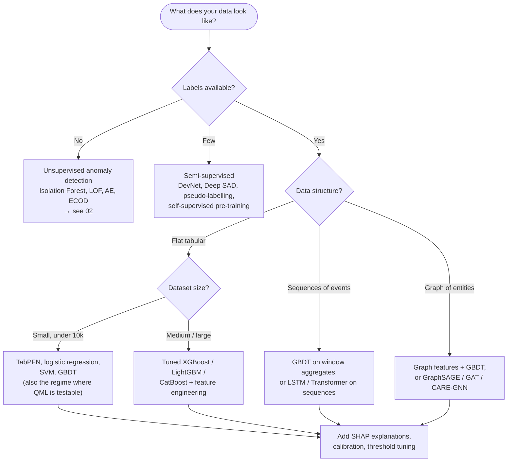

# 01 · State-of-the-art Machine Learning

> **Goal of this document:** give you a working map of the machine learning algorithms used today, with emphasis on the ones that matter for **tabular, imbalanced, temporal and relational data**, which is what fraud data looks like. Each family ends with a note on its relevance to fraud and to QML.

---

## Table of contents

1. [The landscape at a glance](#1-the-landscape-at-a-glance)
2. [Learning paradigms](#2-learning-paradigms)
3. [Core concepts you must master](#3-core-concepts-you-must-master)
4. [Classical algorithms](#4-classical-algorithms)
5. [Tree ensembles — the tabular champions](#5-tree-ensembles--the-tabular-champions)
6. [Deep learning](#6-deep-learning)
7. [Learning from imbalanced data](#7-learning-from-imbalanced-data)
8. [Explainability](#8-explainability)
9. [Choosing an algorithm](#9-choosing-an-algorithm)
10. [Tooling](#10-tooling)
11. [Bridge to QML](#11-bridge-to-qml)
12. [References](#12-references)

---

## 1. The landscape at a glance

---

## 2. Learning paradigms

| Paradigm               | Data available                 | Objective                                                | Fraud-detection example                                                         |
| ---------------------- | ------------------------------ | -------------------------------------------------------- | ------------------------------------------------------------------------------- |
| **Supervised**         | $(x_i, y_i)$ pairs             | Learn $f: x \mapsto y$                                   | Classify a transaction as fraud / genuine from historical labelled transactions |
| **Unsupervised**       | Only $x_i$                     | Discover structure (clusters, density, low-dim manifold) | Flag transactions in low-density regions; cluster merchants                     |
| **Semi-supervised**    | Few labelled + many unlabelled | Use unlabelled data to improve the supervised model      | Thousands of confirmed frauds, millions of unreviewed transactions              |
| **Self-supervised**    | Unlabelled, with pretext tasks | Learn representations (e.g. predict masked features)     | Pre-train a transaction encoder on all history, fine-tune on fraud labels       |
| **Reinforcement**      | Interactions + rewards         | Learn a policy                                           | Adaptive alert-budget allocation; adversarial fraudster simulation              |
| **Online / streaming** | Data arrives over time         | Update the model incrementally                           | Daily model refresh under concept drift                                         |

Fraud detection is usually **supervised with severe class imbalance**, combined with **unsupervised anomaly detection** for patterns not yet seen. See [02 · Anomaly Detection](02-anomaly-detection.md) and [03 · Fraud Detection](03-fraud-detection.md).

---

## 3. Core concepts you must master

### 3.1 Empirical risk minimization

Almost every supervised algorithm minimizes a regularized empirical risk:

$$
\hat{f} = \arg\min_{f \in \mathcal{F}} \; \frac{1}{n}\sum_{i=1}^{n} \ell\big(f(x_i), y_i\big) + \lambda\, \Omega(f)
$$

- $\ell$: loss (log-loss for classification, squared error for regression, hinge for SVM)
- $\Omega$: regularizer (L2 / L1 norm, tree depth, dropout…)
- $\mathcal{F}$: hypothesis class (linear functions, trees, neural nets, **quantum circuits**)

### 3.2 Bias–variance trade-off and generalization

- **Bias:** error from too simple a hypothesis class (underfitting).
- **Variance:** error from sensitivity to the particular training set (overfitting).
- Rare classes make variance much worse: with 400 frauds, a flexible model can memorise every one of them.

### 3.3 Validation

- **k-fold cross-validation**: fine for i.i.d. data.
- **Stratified k-fold**: keeps the class ratio in each fold. Required for imbalanced data.
- **Time-based (out-of-time) split**: train on the past, test on the future. **Mandatory for fraud**, because random splits leak future information (see [03 §8](03-fraud-detection.md#8-evaluation)).
- **Nested CV**: tune hyperparameters inside, estimate performance outside.

### 3.4 Probability calibration

A model that outputs 0.9 should be right about 90 % of the time. Tree ensembles and undersampled models are often mis-calibrated. Fix it with Platt scaling (sigmoid) or isotonic regression. Calibration matters whenever a score drives a business decision (block / review / approve).

### 3.5 Feature engineering vs representation learning

- **Tabular data:** hand-crafted features (aggregations, ratios, time-window counts) still beat learned representations most of the time.
- **Sequential / graph / text data:** learned representations (RNNs, Transformers, GNNs) win.

---

## 4. Classical algorithms

### 4.1 Logistic regression

$$
P(y=1 \mid x) = \sigma(w^\top x + b) = \frac{1}{1 + e^{-(w^\top x + b)}}
$$

- Trained with log-loss + L1/L2 regularization.
- **Pros:** fast, convex, calibrated, fully interpretable (coefficients = log-odds), accepted by regulators.
- **Cons:** linear decision boundary unless you engineer interactions.
- **Fraud role:** the **mandatory baseline**. Still used in production scorecards.

### 4.2 Support Vector Machines and the kernel trick

The soft-margin SVM solves

$$
\min_{w,b,\xi} \; \frac{1}{2}\|w\|^2 + C\sum_i \xi_i \quad \text{s.t.} \quad y_i(w^\top \phi(x_i) + b) \ge 1 - \xi_i,\; \xi_i \ge 0
$$

Its dual depends on the data only through inner products, so we can replace them with a **kernel**:

$$
k(x, x') = \langle \phi(x), \phi(x') \rangle, \qquad f(x) = \sum_i \alpha_i y_i\, k(x_i, x) + b
$$

Common kernels: linear, polynomial $(x^\top x' + c)^d$, RBF $\exp(-\gamma\|x-x'\|^2)$.

- **Pros:** strong theory (margin bounds), works well in medium dimensions, a convex problem.
- **Cons:** $O(n^2)$–$O(n^3)$ training, so it does not scale past roughly $10^5$ samples. Sensitive to feature scaling and $C, \gamma$.
- **Why it matters for you:** **quantum kernel methods** (QSVM) keep exactly this framework and replace $k$ with a kernel evaluated on a quantum computer, $k(x,x') = |\langle \psi(x) | \psi(x') \rangle|^2$. Know SVMs well. See [§11](#11-bridge-to-qml).

### 4.3 k-Nearest Neighbours

Predicts by majority vote / averaging over the $k$ closest training points.

- Simple and non-parametric, but slow at inference and hurt by the curse of dimensionality.
- The **distance-based idea** is the root of several anomaly detectors (kNN distance, LOF).

### 4.4 Naive Bayes

$P(y \mid x) \propto P(y)\prod_j P(x_j \mid y)$, assuming conditional independence of features. Very fast, a weak baseline on correlated tabular data.

### 4.5 Decision trees (CART)

Recursive axis-aligned splits that minimise impurity (Gini or entropy):

$$
\text{Gini}(S) = 1 - \sum_c p_c^2
$$

- **Pros:** interpretable, handles mixed types and missing values, captures non-linear interactions with no scaling needed.
- **Cons:** high variance on its own, which is why trees are almost always used in **ensembles**.

---

## 5. Tree ensembles — the tabular champions

### 5.1 Bagging and Random Forest

**Random Forest** (Breiman, 2001): train $B$ deep trees on bootstrap samples, each split considering a random subset of features, then average.

- Reduces variance with little bias increase.
- Robust and needs little tuning. Provides out-of-bag error and feature importances.
- A strong fraud baseline, and the parent of **Isolation Forest** ([02 §5.3](02-anomaly-detection.md#53-isolation-based-methods)).

### 5.2 Gradient Boosting

Builds an additive model stage-wise, each new tree fitting the negative gradient of the loss:

$$
F_m(x) = F_{m-1}(x) + \eta\, h_m(x), \qquad h_m \approx \arg\min_h \sum_i \Big( -\frac{\partial \ell(y_i, F_{m-1}(x_i))}{\partial F_{m-1}(x_i)} - h(x_i) \Big)^2
$$

XGBoost adds a second-order (Newton) approximation and explicit regularization on leaf weights.

### 5.3 The three production GBDT libraries

| Library                                   | Key ideas                                                                                       | When to prefer it                                               |
| ----------------------------------------- | ----------------------------------------------------------------------------------------------- | --------------------------------------------------------------- |
| **XGBoost** (Chen & Guestrin, 2016)       | Second-order boosting, L1/L2 on leaves, sparsity-aware splits, `scale_pos_weight` for imbalance | The default reference implementation; widest ecosystem          |
| **LightGBM** (Ke et al., 2017)            | Histogram binning, leaf-wise growth, GOSS sampling, EFB feature bundling                        | Large datasets, speed-critical training                         |
| **CatBoost** (Prokhorenkova et al., 2018) | Ordered boosting (no target leakage), native categorical encoding, symmetric trees              | Many high-cardinality categoricals (merchant ID, MCC, country…) |

### 5.4 Why trees still win on tabular data

Large benchmarks (Grinsztajn et al., 2022; Shwartz-Ziv & Armon, 2022) consistently find that **well-tuned GBDTs match or beat deep learning on medium-sized tabular data**, because:

1. Tabular targets are often **irregular functions** of the features; neural nets have a bias toward smooth solutions.
2. Tabular data has many **uninformative features**, and trees ignore them naturally.
3. Features are **not rotation-invariant** (each column has its own meaning), while MLPs are.

> **Consequence for your thesis:** any quantum model on fraud data must be compared against a **tuned XGBoost / LightGBM / CatBoost**, not only against logistic regression or an untuned MLP. That baseline is the one reviewers will ask about.

---

## 6. Deep learning

### 6.1 Multilayer Perceptron (MLP)

$$
h^{(l+1)} = \sigma\big(W^{(l)} h^{(l)} + b^{(l)}\big)
$$

Trained with back-propagation and SGD/Adam. Needs feature scaling and categorical embeddings, plus regularization (dropout, weight decay, early stopping). The closest classical analogue of a **variational quantum classifier**.

### 6.2 Autoencoders and VAEs

- **Autoencoder:** encoder $g_\phi$ compresses $x$ to $z$, decoder $f_\theta$ reconstructs $\hat{x}$. Trained on reconstruction loss $\|x - \hat{x}\|^2$.
- **Variational autoencoder (VAE):** probabilistic latent $z \sim q_\phi(z\mid x)$, trained on the ELBO:

$$
\mathcal{L}_{\text{ELBO}} = \mathbb{E}_{q_\phi(z|x)}[\log p_\theta(x|z)] - \mathrm{KL}\big(q_\phi(z|x)\,\|\,p(z)\big)
$$

- **Fraud role:** train on genuine transactions only; a high reconstruction error flags an anomaly ([02 §5.5](02-anomaly-detection.md#55-reconstruction-based-methods)).

### 6.3 Recurrent networks (RNN, LSTM, GRU)

Process sequences step by step, keeping a hidden state. LSTM/GRU gates mitigate vanishing gradients. In fraud they model a **card's transaction history** as a sequence (Jurgovsky et al., 2018).

### 6.4 Transformers and attention

$$
\mathrm{Attention}(Q,K,V) = \mathrm{softmax}\!\left(\frac{QK^\top}{\sqrt{d_k}}\right)V
$$

- The dominant architecture for sequences (NLP, time series, event streams).
- In finance they are used as **transaction-sequence encoders** and, more recently, as pre-trained foundation models over payment histories.

### 6.5 Deep learning for tabular data

| Model                                                    | Idea                                                                                                                            | Notes                                                                                                                                   |
| -------------------------------------------------------- | ------------------------------------------------------------------------------------------------------------------------------- | --------------------------------------------------------------------------------------------------------------------------------------- |
| **TabNet** (Arik & Pfister, 2021)                        | Sequential attention selects features at each decision step                                                                     | Interpretable masks; in independent benchmarks rarely beats GBDT                                                                        |
| **FT-Transformer** (Gorishniy et al., 2021)              | Each feature becomes a token, then a standard Transformer                                                                       | Strong DL baseline for tabular                                                                                                          |
| **SAINT** (Somepalli et al., 2021)                       | Row + column attention, contrastive pre-training                                                                                | Helps in semi-supervised settings                                                                                                       |
| **TabPFN** (Hollmann et al., 2023; v2 in _Nature_, 2025) | Transformer pre-trained on millions of synthetic datasets; does **in-context learning**, with no gradient training on your data | State of the art on **small** tabular datasets (≈ ≤10k rows); relevant for downsampled fraud subsets like those used in QML experiments |

### 6.6 Graph Neural Networks (GNNs)

Fraud is relational: cards, merchants, devices, IPs and accounts form a graph. GNNs learn node representations through **message passing**:

$$
h_v^{(l+1)} = \sigma\Big( W^{(l)} \cdot \mathrm{AGG}\big(\{h_u^{(l)} : u \in \mathcal{N}(v)\} \cup \{h_v^{(l)}\}\big) \Big)
$$

| Model                                                          | Aggregation                                                          |
| -------------------------------------------------------------- | -------------------------------------------------------------------- |
| **GCN** (Kipf & Welling, 2017)                                 | Normalised sum over neighbours                                       |
| **GraphSAGE** (Hamilton et al., 2017)                          | Sampled neighbours, mean/LSTM/pool aggregator; inductive             |
| **GAT** (Veličković et al., 2018)                              | Attention weights over neighbours                                    |
| **CARE-GNN** (Dou et al., 2020), **PC-GNN** (Liu et al., 2021) | Fraud-specific: robust to camouflaged fraudsters and class imbalance |

Typical fraud uses: detecting fraud rings, money-laundering chains (Elliptic Bitcoin dataset), collusive merchants.

### 6.7 Generative models

| Model                 | Mechanism                             | Use in fraud                                                                    |
| --------------------- | ------------------------------------- | ------------------------------------------------------------------------------- |
| **GAN**               | Generator vs discriminator game       | Oversample the minority class; AnoGAN-style anomaly scoring                     |
| **VAE**               | Latent-variable likelihood            | Anomaly scoring, synthetic data                                                 |
| **Normalizing flows** | Invertible maps with exact likelihood | Density-based anomaly detection                                                 |
| **Diffusion models**  | Learn to reverse a noising process    | High-fidelity synthetic tabular data (TabDDPM); privacy-preserving data sharing |

---

## 7. Learning from imbalanced data

Fraud rates are typically **0.1 % – 2 %**. Standard training then optimises for the majority class.

**SMOTE** (Chawla et al., 2002) creates synthetic minority points by interpolation:

$$
x_{\text{new}} = x_i + \lambda\,(x_{nn} - x_i), \quad \lambda \sim U(0,1)
$$

**Focal loss** (Lin et al., 2017) down-weights easy examples:

$$
\mathrm{FL}(p_t) = -\alpha_t (1 - p_t)^\gamma \log(p_t)
$$

**Practical rules:**

- Resample **only the training fold**, never validation/test.
- Undersampling distorts probabilities. Re-calibrate (Dal Pozzolo et al., 2015).
- For GBDTs, class weights + threshold tuning is often as good as SMOTE and simpler.
- QML papers often **balance the dataset to 50/50 and train on a few hundred points** because of simulation cost. Results on such subsets do not transfer to realistic prevalence, so always report results at the true prevalence as well.

---

## 8. Explainability

Fraud decisions affect customers, so they must be explainable: to investigators, to auditors, and under the GDPR (Art. 22 on automated decisions) and the EU AI Act.

| Method                                  | Type                                | Notes                                                         |
| --------------------------------------- | ----------------------------------- | ------------------------------------------------------------- |
| Coefficients (logistic regression)      | Global, intrinsic                   | Simplest, regulator-friendly                                  |
| Feature importance (gain / permutation) | Global                              | Permutation importance is more reliable than gain             |
| **SHAP** (Lundberg & Lee, 2017)         | Local + global, Shapley-value based | `TreeSHAP` is exact and fast for GBDTs; the industry standard |
| **LIME** (Ribeiro et al., 2016)         | Local surrogate model               | Model-agnostic, less stable                                   |
| Counterfactuals                         | Local                               | "The transaction would be approved if the amount were < €300" |
| Attention / GNN explainers              | Model-specific                      | GNNExplainer for graph models                                 |

Explainability of quantum models is an open research topic, which makes it a possible thesis angle.

---

## 9. Choosing an algorithm

---

## 10. Tooling

| Purpose                              | Library                                                                 |
| ------------------------------------ | ----------------------------------------------------------------------- |
| Classical ML, preprocessing, metrics | `scikit-learn`                                                          |
| Gradient boosting                    | `xgboost`, `lightgbm`, `catboost`                                       |
| Imbalanced learning                  | `imbalanced-learn`                                                      |
| Deep learning                        | `PyTorch` (+ `Lightning`), `JAX`                                        |
| Tabular DL                           | `pytorch-tabular`, `rtdl`, `tabpfn`                                     |
| Graph learning                       | `PyTorch Geometric`, `DGL`                                              |
| Anomaly detection                    | `PyOD`, `DeepOD`                                                        |
| Explainability                       | `shap`, `lime`                                                          |
| Hyperparameter tuning                | `Optuna`                                                                |
| Experiment tracking                  | `MLflow`, `Weights & Biases`                                            |
| QML (covered in doc 04)              | `PennyLane`, `Qiskit` + `qiskit-machine-learning`, `TensorFlow Quantum` |

---

## 11. Bridge to QML

Most QML models are quantum versions of a classical model in this document. Knowing the classical one tells you which baseline to beat and which theory to borrow.

| Classical model      | Quantum counterpart                                                        | Key idea                                                                                                         | Key caveat                                                                                                                              |
| -------------------- | -------------------------------------------------------------------------- | ---------------------------------------------------------------------------------------------------------------- | --------------------------------------------------------------------------------------------------------------------------------------- |
| Kernel SVM           | **Quantum kernel / QSVM** (Havlíček et al., 2019; Schuld & Killoran, 2019) | A feature map $x \mapsto \lvert\psi(x)\rangle$ in a $2^q$-dimensional Hilbert space; kernel = state fidelity     | **Exponential concentration**: kernel values collapse toward a constant as qubits grow (Thanasilp et al., 2024). Needs bandwidth tuning |
| MLP                  | **Variational Quantum Classifier (VQC) / Quantum Neural Network**          | Parameterised circuit $U(\theta)$ + measurement, trained with a classical optimiser and the parameter-shift rule | **Barren plateaus** (McClean et al., 2018): gradients vanish exponentially with width/depth                                             |
| Autoencoder          | **Quantum autoencoder** (Romero et al., 2017)                              | Compress a quantum state into fewer qubits                                                                       | Classical data must first be encoded                                                                                                    |
| GAN                  | **QGAN**                                                                   | Quantum generator and/or discriminator                                                                           | Training stability, small scale                                                                                                         |
| GNN                  | **Quantum GNN / Quantum graph kernels**                                    | Graph structure encoded in Hamiltonians or circuit topology                                                      | Very early stage                                                                                                                        |
| Feature selection    | **QUBO / QAOA / quantum annealing**                                        | Formulate subset selection as an Ising problem                                                                   | Classical heuristics are strong competitors                                                                                             |
| Random Forest / GBDT | No established quantum equivalent                                          | —                                                                                                                | GBDT is the baseline to beat                                                                                                            |

**Things to keep in mind from the start:**

1. **Qubit budget = feature budget.** Current simulators and hardware handle roughly 4–30 qubits for ML experiments, so you will reduce dimensionality (PCA, feature selection). Apply the same reduction to the classical baselines for a fair comparison.
2. **Dataset size.** Quantum kernel matrices cost $O(n^2)$ circuit evaluations, which limits experiments to small $n$. TabPFN and SVM are the fair classical comparisons in that regime.
3. **Benchmarking is subtle.** Bowles, Ahmed & Schuld (2024) show that in many published QML comparisons, simple classical models match or beat the quantum ones once both are tuned properly. Design your protocol so this criticism cannot be made of your results.

---

## 12. References

**Classical ML & ensembles**

- Breiman, L. (2001). Random Forests. _Machine Learning_, 45, 5–32.
- Chen, T., & Guestrin, C. (2016). XGBoost: A Scalable Tree Boosting System. _KDD_.
- Ke, G. et al. (2017). LightGBM: A Highly Efficient Gradient Boosting Decision Tree. _NeurIPS_.
- Prokhorenkova, L. et al. (2018). CatBoost: unbiased boosting with categorical features. _NeurIPS_.
- Hastie, T., Tibshirani, R., & Friedman, J. (2009). _The Elements of Statistical Learning_ (2nd ed.). Springer. — **core textbook**
- Bishop, C. M. (2006). _Pattern Recognition and Machine Learning_. Springer. — **core textbook**

**Tabular deep learning**

- Grinsztajn, L., Oyallon, E., & Varoquaux, G. (2022). Why do tree-based models still outperform deep learning on typical tabular data? _NeurIPS Datasets & Benchmarks_.
- Shwartz-Ziv, R., & Armon, A. (2022). Tabular data: Deep learning is not all you need. _Information Fusion_, 81.
- Arik, S. Ö., & Pfister, T. (2021). TabNet: Attentive Interpretable Tabular Learning. _AAAI_.
- Gorishniy, Y. et al. (2021). Revisiting Deep Learning Models for Tabular Data. _NeurIPS_.
- Hollmann, N. et al. (2023). TabPFN: A Transformer That Solves Small Tabular Classification Problems in a Second. _ICLR_.
- Hollmann, N. et al. (2025). Accurate predictions on small data with a tabular foundation model. _Nature_, 637.

**Deep learning, sequences, graphs**

- Goodfellow, I., Bengio, Y., & Courville, A. (2016). _Deep Learning_. MIT Press. — **core textbook**
- Vaswani, A. et al. (2017). Attention Is All You Need. _NeurIPS_.
- Kipf, T. N., & Welling, M. (2017). Semi-Supervised Classification with Graph Convolutional Networks. _ICLR_.
- Hamilton, W. L., Ying, R., & Leskovec, J. (2017). Inductive Representation Learning on Large Graphs. _NeurIPS_.
- Veličković, P. et al. (2018). Graph Attention Networks. _ICLR_.
- Dou, Y. et al. (2020). Enhancing Graph Neural Network-based Fraud Detectors against Camouflaged Fraudsters. _CIKM_.

**Imbalance & explainability**

- Chawla, N. V. et al. (2002). SMOTE: Synthetic Minority Over-sampling Technique. _JAIR_, 16.
- Lin, T.-Y. et al. (2017). Focal Loss for Dense Object Detection. _ICCV_.
- Dal Pozzolo, A. et al. (2015). Calibrating Probability with Undersampling for Unbalanced Classification. _IEEE SSCI_.
- Lundberg, S. M., & Lee, S.-I. (2017). A Unified Approach to Interpreting Model Predictions. _NeurIPS_.
- Ribeiro, M. T., Singh, S., & Guestrin, C. (2016). "Why Should I Trust You?" Explaining the Predictions of Any Classifier. _KDD_.

**QML bridge**

- Havlíček, V. et al. (2019). Supervised learning with quantum-enhanced feature spaces. _Nature_, 567.
- Schuld, M., & Killoran, N. (2019). Quantum Machine Learning in Feature Hilbert Spaces. _Physical Review Letters_, 122.
- McClean, J. R. et al. (2018). Barren plateaus in quantum neural network training landscapes. _Nature Communications_, 9.
- Thanasilp, S. et al. (2024). Exponential concentration in quantum kernel methods. _Nature Communications_, 15.
- Bowles, J., Ahmed, S., & Schuld, M. (2024). Better than classical? The subtle art of benchmarking quantum machine learning models. _arXiv:2403.07059_.
- Schuld, M., & Petruccione, F. (2021). _Machine Learning with Quantum Computers_ (2nd ed.). Springer. — **core QML textbook**
