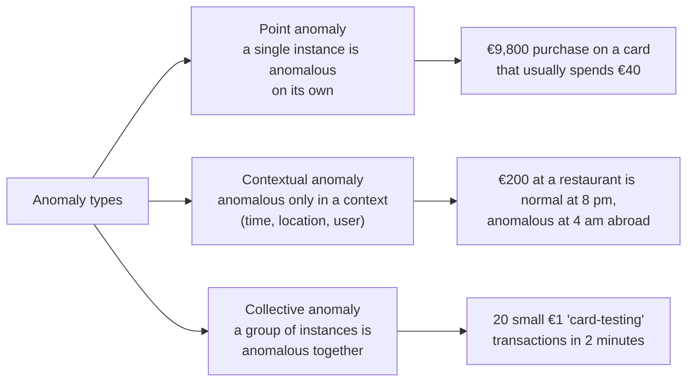
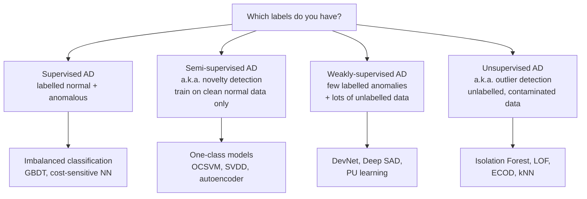
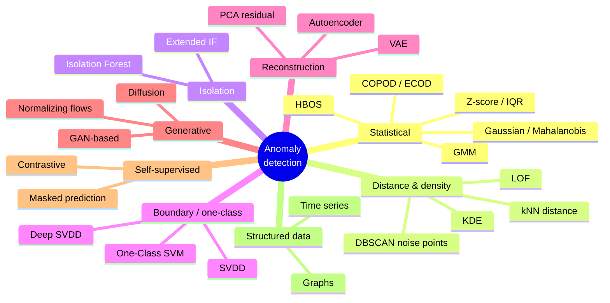
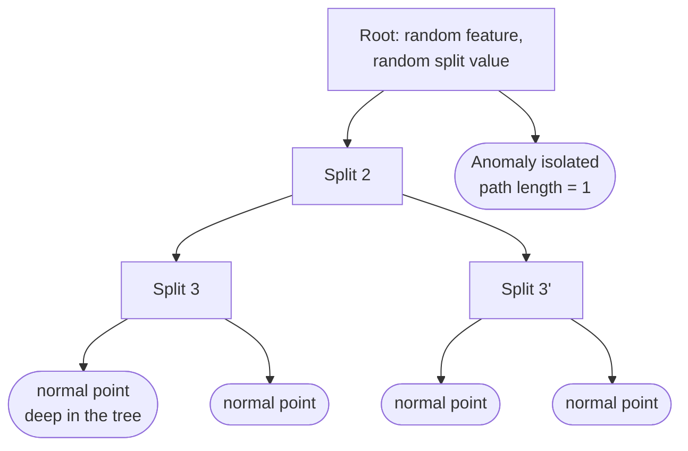
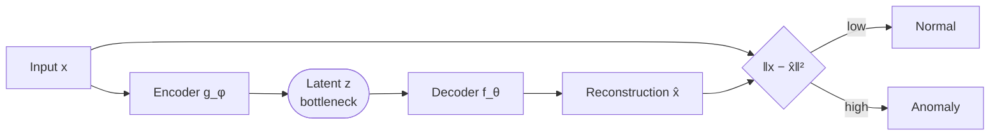

# 02 · Anomaly Detection

> **Goal of this document:** understand what anomaly detection (AD) is, which problem settings exist, the main families of algorithms with their assumptions and formulas, and how to evaluate them. Fraud detection ([03](03-fraud-detection.md)) is the most important applied case of AD.

---

## Table of contents

1. [What is an anomaly?](#1-what-is-an-anomaly)
2. [Types of anomalies](#2-types-of-anomalies)
3. [Problem settings](#3-problem-settings)
4. [Scores, thresholds and contamination](#4-scores-thresholds-and-contamination)
5. [Taxonomy of methods](#5-taxonomy-of-methods)
6. [Method comparison](#6-method-comparison)
7. [Key challenges](#7-key-challenges)
8. [Evaluation](#8-evaluation)
9. [A typical AD pipeline](#9-a-typical-ad-pipeline)
10. [Tooling](#10-tooling)
11. [Bridge to QML](#11-bridge-to-qml)
12. [References](#12-references)

---

## 1. What is an anomaly?

An **anomaly** (or *outlier*, *novelty*, *deviation*) is an observation that differs so much from the rest of the data that it was probably **generated by a different mechanism**. This is the classic statistical view from Hawkins (1980).

In probabilistic terms: let normal data come from a distribution $P_N$ with density $p_N(x)$. Anomalies are points in **low-density regions** of $P_N$:

$$
\mathcal{A} = \{\, x \in \mathcal{X} \;:\; p_N(x) \le \tau \,\}, \qquad \tau \ge 0
$$

Almost every AD method approximates this in one of a few ways: by estimating density, distance, isolation ease, distance from a learned boundary, or reconstruction error.

**Anomaly detection ≠ rare-class classification**, although they overlap:

| | Anomaly detection | Imbalanced classification |
|-|-------------------|---------------------------|
| Anomalies at training time | None or few, often unlabelled | Labelled, though rare |
| Assumption | Anomalies are *different from normal* | Positives are *similar to each other* |
| New, unseen anomaly types | Can be detected | Usually missed |
| Typical algorithms | Isolation Forest, LOF, OCSVM, autoencoders | GBDT, logistic regression with class weights |

Fraud detection uses **both**. See [03 §6](03-fraud-detection.md#6-detection-approaches).

---

## 2. Types of anomalies



(Chandola, Banerjee & Kumar, 2009.)

- **Point anomalies** are what most algorithms detect directly.
- **Contextual anomalies** need contextual features (time of day, customer profile, country). In practice you turn them into point anomalies through **feature engineering**.
- **Collective anomalies** need sequence or graph models, or aggregate features over windows.

---

## 3. Problem settings



| Setting | Training data | Typical name | Typical fraud scenario |
|---------|---------------|--------------|-------------------------|
| Supervised | $\{(x_i, y_i)\}$ both classes labelled | — | Mature card-fraud system with chargeback labels |
| Semi-supervised | Only verified normal $x$ | **Novelty detection** / one-class | New product with no fraud seen yet |
| Weakly / partially supervised | Few labelled anomalies + unlabelled | PU learning, Deep SAD | Investigators confirmed 50 cases out of millions |
| Unsupervised | Unlabelled, *contaminated* data | **Outlier detection** | Exploratory analysis, new fraud patterns |

> **Terminology warning:** in AD literature "semi-supervised" often means *trained on normal data only*. That is not the usual ML meaning (few labels + many unlabelled). State which one you mean in the thesis.

Han et al. (ADBench, 2022) found that even **a few labelled anomalies (≈1 % of them)** give semi-/weakly-supervised methods a large advantage over purely unsupervised ones.

---

## 4. Scores, thresholds and contamination

Most detectors output a continuous **anomaly score** $s(x)$ (higher means more anomalous). A decision needs a **threshold** $t$:

$$
\hat{y}(x) = \mathbb{1}[\, s(x) > t \,]
$$

Ways to choose $t$:

1. **Contamination rate** $\nu$: flag the top $\nu$ fraction of points (the `contamination` parameter in scikit-learn / PyOD).
2. **Alert budget**: flag the top $k$ per day, because investigators can review only $k$ cases. This is the most realistic option in fraud.
3. **Statistical rule**: e.g. $\mu + 3\sigma$ of the scores, or extreme value theory (SPOT).
4. **Labelled validation set**: optimise F1, the cost, or recall at a fixed precision.

Scores from different detectors are on different scales. Normalise them (z-score, rank, or a probability conversion) before combining detectors in an ensemble.

---

## 5. Taxonomy of methods



### 5.1 Statistical methods

**Univariate z-score:** $z = (x - \mu)/\sigma$, flag $|z| > 3$. Simple, but it ignores correlations.

**Mahalanobis distance** (multivariate Gaussian):

$$
D_M(x) = \sqrt{(x - \mu)^\top \Sigma^{-1} (x - \mu)}
$$

Under Gaussianity, $D_M^2 \sim \chi^2_d$, which gives a principled threshold. Use a robust covariance estimate (Minimum Covariance Determinant) so that the outliers themselves do not distort $\Sigma$.

**Gaussian Mixture Model:** score $= -\log p(x)$ with $p(x) = \sum_k \pi_k \mathcal{N}(x \mid \mu_k, \Sigma_k)$. Handles multi-modal normal behaviour.

**HBOS** (Histogram-Based Outlier Score): per-feature histograms, assumes independence. Very fast.

**COPOD / ECOD** (Li et al., 2020; 2022): use empirical (copula / cumulative) distribution functions to estimate tail probabilities per dimension, then aggregate them. **No hyperparameters**, fast, strong in benchmarks, and a good first baseline.

### 5.2 Distance- and density-based methods

**kNN distance:** $s(x) = d\big(x, \text{NN}_k(x)\big)$, the distance to the $k$-th nearest neighbour (or the mean distance to the $k$ nearest).

**Local Outlier Factor** (Breunig et al., 2000) compares a point's local density with that of its neighbours:

$$
\mathrm{LOF}_k(x) = \frac{1}{|N_k(x)|}\sum_{o \in N_k(x)} \frac{\mathrm{lrd}_k(o)}{\mathrm{lrd}_k(x)}
$$

where $\mathrm{lrd}$ is the local reachability density. $\mathrm{LOF} \approx 1$ means inlier; $\mathrm{LOF} \gg 1$ means outlier.

- Detects **local** anomalies in data with clusters of different density.
- $O(n^2)$ naive cost, and sensitive to $k$ and to the distance metric.

### 5.3 Isolation-based methods

**Isolation Forest** (Liu, Ting & Zhou, 2008): anomalies are *few and different*, so random axis-aligned splits **isolate them in fewer steps**.



Anomaly score for a point $x$ in a sample of size $n$:

$$
s(x, n) = 2^{-\frac{\mathbb{E}[h(x)]}{c(n)}}, \qquad c(n) = 2H(n-1) - \frac{2(n-1)}{n}
$$

where $h(x)$ is the path length and $H(i) \approx \ln i + 0.5772$. $s \to 1$ means anomaly, $s \le 0.5$ means normal.

- **Pros:** linear time, low memory, works with sub-sampling (256 points per tree), little tuning.
- **Cons:** axis-parallel splits create artefacts (fixed by **Extended Isolation Forest**); weaker on local anomalies.
- A **very common baseline in fraud detection**.

### 5.4 Boundary / one-class methods

**One-Class SVM** (Schölkopf et al., 2001) separates the data from the origin in feature space with maximum margin:

$$
\min_{w, \xi, \rho} \; \frac{1}{2}\|w\|^2 + \frac{1}{\nu n}\sum_i \xi_i - \rho \quad \text{s.t.} \quad \langle w, \phi(x_i)\rangle \ge \rho - \xi_i,\; \xi_i \ge 0
$$

$\nu \in (0,1]$ upper-bounds the fraction of outliers and lower-bounds the fraction of support vectors. Decision: $f(x) = \mathrm{sign}\big(\sum_i \alpha_i k(x_i, x) - \rho\big)$.

**Support Vector Data Description** (Tax & Duin, 2004) finds the smallest hypersphere enclosing the data:

$$
\min_{R, c, \xi} \; R^2 + C\sum_i \xi_i \quad \text{s.t.} \quad \|\phi(x_i) - c\|^2 \le R^2 + \xi_i
$$

With an RBF kernel, OCSVM and SVDD are equivalent.

> **Why this matters for your thesis:** OCSVM / SVDD are **kernel methods**, so you can plug in a **quantum kernel** directly. A quantum one-class SVM is among the most natural QML anomaly detectors (see [§11](#11-bridge-to-qml)).

**Deep SVDD** (Ruff et al., 2018) learns a neural mapping $\phi_W$ that pulls normal data toward a centre $c$:

$$
\min_W \; \frac{1}{n}\sum_i \|\phi_W(x_i) - c\|^2 + \frac{\lambda}{2}\|W\|_F^2
$$

Score $= \|\phi_W(x) - c\|^2$. **Deep SAD** (Ruff et al., 2020) extends it with a few labelled anomalies, which are pushed *away* from $c$.

### 5.5 Reconstruction-based methods

Idea: learn a compressed model of **normal** data. Anomalies are reconstructed poorly.

**PCA:** project onto the top $k$ principal components; score = reconstruction error

$$
s(x) = \|x - V_k V_k^\top x\|^2
$$

**Autoencoder:** score = $\|x - f_\theta(g_\phi(x))\|^2$. Train on normal data (semi-supervised) or on all data, relying on anomalies being rare (unsupervised).

**VAE:** score = negative ELBO or reconstruction probability.



- **Pros:** non-linear, handles high-dimensional data.
- **Cons:** a very expressive AE may reconstruct anomalies too ("identity shortcut"); the threshold is not obvious.
- Autoencoders are widely used in fraud on transaction features. **DAGMM** (Zong et al., 2018) combines an AE with a GMM in the latent space.

### 5.6 Generative methods

| Method | Anomaly score |
|--------|---------------|
| **AnoGAN** (Schlegl et al., 2017) | Residual + discriminator loss after finding the best latent code |
| **GANomaly** (Akcay et al., 2018) | Latent-space reconstruction error |
| **Normalizing flows** | Exact $-\log p(x)$ |
| **Diffusion models** | Denoising error / likelihood |

Note: deep generative models can assign **higher likelihood to out-of-distribution data** (Nalisnick et al., 2019), so likelihood alone is not a reliable anomaly score.

### 5.7 Self-supervised methods

Train on a **pretext task** using normal data only (predict transformations, contrastive learning, masked feature prediction). Anomalies perform badly on that task. Examples: GOAD, NeuTraL AD, and internal contrastive learning for tabular data (ICL; Shenkar & Wolf, 2022).

### 5.8 Structured data

- **Time series:** forecasting residuals (ARIMA, LSTM, Transformer), matrix profile, spectral residual, reconstruction (LSTM-AE). Point vs sub-sequence anomalies.
- **Graphs:** anomalous nodes, edges or sub-graphs. Methods: structural features (degree, PageRank, egonet features as in OddBall), GNN autoencoders (DOMINANT), and fraud-specific GNNs (CARE-GNN). See [01 §6.6](01-ml-state-of-the-art.md#66-graph-neural-networks-gnns).

---

## 6. Method comparison

| Method | Core assumption | Train cost | Handles local anomalies | High-dim | Main hyperparameters | Good first choice when… |
|--------|-----------------|-----------|---------------------------|----------|-------------|-------------------------|
| Z-score / IQR | Unimodal, independent features | $O(n)$ | ✗ | ✗ | threshold | Quick univariate checks |
| Mahalanobis / MCD | Gaussian normal class | $O(nd^2)$ | ✗ | ~ | — | Low-dim, elliptical data |
| GMM | Mixture of Gaussians | $O(nkd^2)$ | ~ | ~ | $k$ | Multi-modal normal behaviour |
| HBOS | Independent features | $O(n)$ | ✗ | ✓ | bins | Very large data, speed |
| ECOD / COPOD | Anomalies in distribution tails | $O(nd)$ | ✗ | ✓ | none | **Parameter-free baseline** |
| kNN distance | Anomalies far from neighbours | $O(n^2)$ | ~ | ✗ | $k$ | Small/medium data |
| LOF | Local density differs | $O(n^2)$ | ✓ | ✗ | $k$ | Clusters with varying density |
| **Isolation Forest** | Anomalies are easy to isolate | $O(t\,\psi \log \psi)$ | ~ | ✓ | trees, sub-sample | **Default baseline, scales well** |
| **One-Class SVM** | Normal data has compact support in feature space | $O(n^2)$–$O(n^3)$ | ✓ (RBF) | ~ | $\nu$, kernel | Medium data, clean normal set; **quantum-kernel ready** |
| PCA residual | Normal data lies near a linear subspace | $O(nd^2)$ | ✗ | ✓ | $k$ | Correlated features |
| Autoencoder | Normal data lies on a learnable manifold | GPU, epochs | ~ | ✓ | architecture | Large, high-dim data |
| Deep SVDD / SAD | Normal data maps to a compact hypersphere | GPU, epochs | ~ | ✓ | architecture | Deep one-class; Deep SAD with few labels |

---

## 7. Key challenges

1. **No ground truth.** Unsupervised methods are hard to tune and to evaluate. You need at least a small labelled validation set.
2. **Contamination.** "Normal" training data often contains anomalies, which biases the model.
3. **Curse of dimensionality.** Distances concentrate in high dimensions, so distance-based scores lose contrast. Use feature selection, PCA or subspace methods. (Quantum kernels suffer a closely related concentration effect.)
4. **Masking and swamping.** Clustered anomalies hide each other (masking); anomalies make normal points look anomalous (swamping).
5. **Heterogeneous features.** Mixing categorical and numeric features complicates distance metrics.
6. **Threshold selection.** The score-to-decision step is often decided by business constraints, not by the model.
7. **Interpretability.** "Why is this an anomaly?" Use SHAP on the detector, or per-feature contributions (ECOD, HBOS).
8. **Concept drift.** Normal behaviour changes over time (seasonality, new products), so models need retraining.
9. **No universal winner.** ADBench (Han et al., 2022) evaluated 30 algorithms on 57 datasets and found **no method statistically dominant across datasets**. Always benchmark several.

---

## 8. Evaluation

With labels (at least on a test set):

| Metric | Definition | Use |
|--------|-----------|-----|
| **ROC-AUC** | Area under TPR vs FPR | Threshold-free ranking quality. Can look optimistic under heavy imbalance |
| **PR-AUC / Average Precision** | Area under precision vs recall | **Preferred when anomalies are rare** (Saito & Rehmsmeier, 2015). Random baseline = prevalence |
| **Precision@k** | Precision among the top $k$ scores | Matches an alert budget |
| **Recall@FPR** | Recall at a fixed false-positive rate | Operational constraint |
| **F1 at a chosen threshold** | Harmonic mean of P and R | Single-number summary; depends on the threshold |

Without labels: internal criteria (score stability, IREOS, excess-mass / mass-volume curves), but these are weak. Make labelled evaluation the target.

Good practice:

- Report **mean ± std over several random seeds / splits**.
- Use **critical-difference diagrams** (Friedman + Nemenyi / Wilcoxon) when comparing many methods on many datasets.
- Fix the **contamination / threshold policy** before looking at test results.

---

## 9. A typical AD pipeline

```mermaid
flowchart LR
    RAW[("Raw data")] --> PRE["Preprocessing<br/>cleaning, encoding,<br/>scaling"]
    PRE --> FE["Feature engineering<br/>context → point anomalies<br/>window aggregates"]
    FE --> RED["Dimensionality reduction<br/>PCA / selection<br/>(qubit budget for QML)"]
    RED --> TRAIN["Fit detector(s)<br/>on normal or<br/>unlabelled data"]
    TRAIN --> SCORE["Anomaly scores s(x)"]
    SCORE --> NORM["Score normalisation<br/>+ ensemble"]
    NORM --> THR["Threshold<br/>contamination / budget / cost"]
    THR --> OUT["Alerts"]
    OUT --> REV["Human review"]
    REV -- "labels" --> EVAL["Evaluation &<br/>retraining"]
    EVAL --> TRAIN
```



---

## 10. Tooling

| Library | Contents |
|---------|----------|
| `scikit-learn` | `IsolationForest`, `LocalOutlierFactor`, `OneClassSVM`, `EllipticEnvelope` |
| **`PyOD`** (Zhao et al., 2019) | 40+ detectors with a unified API (ECOD, COPOD, HBOS, LOF, IForest, OCSVM, AE, VAE, Deep SVDD…). **Start here.** |
| `DeepOD` | Deep AD for tabular and time series (Deep SAD, DevNet, ICL, NeuTraL…) |
| `ADBench` | Benchmark code + 57 datasets |
| `PyGOD` | Graph outlier detection |
| `alibi-detect` | Outlier, adversarial and drift detection |
| `river` | Online / streaming AD (Half-Space Trees, online IF) |

Minimal PyOD example:

```python
from pyod.models.ecod import ECOD
from pyod.models.iforest import IForest
from sklearn.metrics import average_precision_score, roc_auc_score

for name, det in {"ECOD": ECOD(), "IForest": IForest(random_state=0)}.items():
    det.fit(X_train)                        # unlabelled / normal-only data
    scores = det.decision_function(X_test)  # higher = more anomalous
    print(name,
          "ROC-AUC", round(roc_auc_score(y_test, scores), 3),
          "PR-AUC",  round(average_precision_score(y_test, scores), 3))
```

---

## 11. Bridge to QML

| Classical AD method | Quantum version / literature | Notes |
|---------------------|------------------------------|-------|
| One-Class SVM / SVDD | **Quantum kernel OCSVM** | Same convex optimisation; kernel matrix from state fidelities on a quantum device or simulator. The most direct path to a QML anomaly detector |
| Kernel density / kNN | Quantum kernel density, quantum distance estimation (swap test) | Swap test estimates $\lvert\langle\psi\lvert\phi\rangle\rvert^2$ |
| PCA residual | Quantum PCA (Lloyd, Mohseni & Rebentrost, 2014), quantum AD via density matrices (Liu & Rebentrost, 2018) | Needs fault-tolerant hardware and QRAM; theoretical for now |
| Autoencoder | **Quantum autoencoder** (Romero et al., 2017), hybrid quantum–classical AEs | Reconstruction fidelity as the anomaly score |
| GAN-based AD | Quantum GAN anomaly detection (Herr et al., 2021) | Small-scale proofs of concept |
| Isolation Forest | No direct quantum analogue | Strong classical baseline to beat |
| Feature selection for AD | QUBO / quantum annealing | Choose $q$ features out of $d$ to fit the qubit budget |

**Things to watch:**

- One-class methods need only **normal** data for training. That fits the small training sets QML can handle and matches a realistic fraud scenario.
- High-dimensional concentration hurts **both** classical distances and quantum kernels. Bandwidth / scaling hyperparameters are critical in both cases (Shaydulin & Wild, 2022; Canatar et al., 2023).

---

## 12. References

**Surveys and benchmarks**
- Chandola, V., Banerjee, A., & Kumar, V. (2009). Anomaly detection: A survey. *ACM Computing Surveys*, 41(3). — **start here**
- Aggarwal, C. C. (2017). *Outlier Analysis* (2nd ed.). Springer. — **core textbook**
- Ruff, L. et al. (2021). A Unifying Review of Deep and Shallow Anomaly Detection. *Proceedings of the IEEE*, 109(5).
- Pang, G., Shen, C., Cao, L., & van den Hengel, A. (2021). Deep Learning for Anomaly Detection: A Review. *ACM Computing Surveys*, 54(2).
- Han, S. et al. (2022). ADBench: Anomaly Detection Benchmark. *NeurIPS Datasets & Benchmarks*.
- Hawkins, D. M. (1980). *Identification of Outliers*. Chapman & Hall.

**Algorithms**
- Breunig, M. M. et al. (2000). LOF: Identifying Density-Based Local Outliers. *SIGMOD*.
- Liu, F. T., Ting, K. M., & Zhou, Z.-H. (2008). Isolation Forest. *ICDM*.
- Hariri, S., Kind, M. C., & Brunner, R. J. (2021). Extended Isolation Forest. *IEEE TKDE*, 33(4).
- Schölkopf, B. et al. (2001). Estimating the Support of a High-Dimensional Distribution. *Neural Computation*, 13(7).
- Tax, D. M. J., & Duin, R. P. W. (2004). Support Vector Data Description. *Machine Learning*, 54.
- Ruff, L. et al. (2018). Deep One-Class Classification. *ICML*.
- Ruff, L. et al. (2020). Deep Semi-Supervised Anomaly Detection. *ICLR*.
- Zong, B. et al. (2018). Deep Autoencoding Gaussian Mixture Model for Unsupervised Anomaly Detection. *ICLR*.
- Schlegl, T. et al. (2017). Unsupervised Anomaly Detection with Generative Adversarial Networks to Guide Marker Discovery. *IPMI*.
- Li, Z. et al. (2020). COPOD: Copula-Based Outlier Detection. *ICDM*.
- Li, Z. et al. (2022). ECOD: Unsupervised Outlier Detection Using Empirical Cumulative Distribution Functions. *IEEE TKDE*.
- Pang, G., Shen, C., & van den Hengel, A. (2019). Deep Anomaly Detection with Deviation Networks. *KDD*.
- Shenkar, T., & Wolf, L. (2022). Anomaly Detection for Tabular Data with Internal Contrastive Learning. *ICLR*.
- Nalisnick, E. et al. (2019). Do Deep Generative Models Know What They Don't Know? *ICLR*.

**Evaluation and tooling**
- Saito, T., & Rehmsmeier, M. (2015). The Precision-Recall Plot Is More Informative than the ROC Plot When Evaluating Binary Classifiers on Imbalanced Datasets. *PLOS ONE*, 10(3).
- Zhao, Y., Nasrullah, Z., & Li, Z. (2019). PyOD: A Python Toolbox for Scalable Outlier Detection. *JMLR*, 20.

**Quantum anomaly detection**
- Liu, N., & Rebentrost, P. (2018). Quantum machine learning for quantum anomaly detection. *Physical Review A*, 97.
- Lloyd, S., Mohseni, M., & Rebentrost, P. (2014). Quantum principal component analysis. *Nature Physics*, 10.
- Romero, J., Olson, J. P., & Aspuru-Guzik, A. (2017). Quantum autoencoders for efficient compression of quantum data. *Quantum Science and Technology*, 2(4).
- Herr, D., Obert, B., & Rosenkranz, M. (2021). Anomaly detection with variational quantum generative adversarial networks. *Quantum Science and Technology*, 6(4).
- Shaydulin, R., & Wild, S. M. (2022). Importance of Kernel Bandwidth in Quantum Machine Learning. *Physical Review A*, 106.
- Canatar, A. et al. (2023). Bandwidth Enables Generalization in Quantum Kernel Models. *Transactions on Machine Learning Research*.
