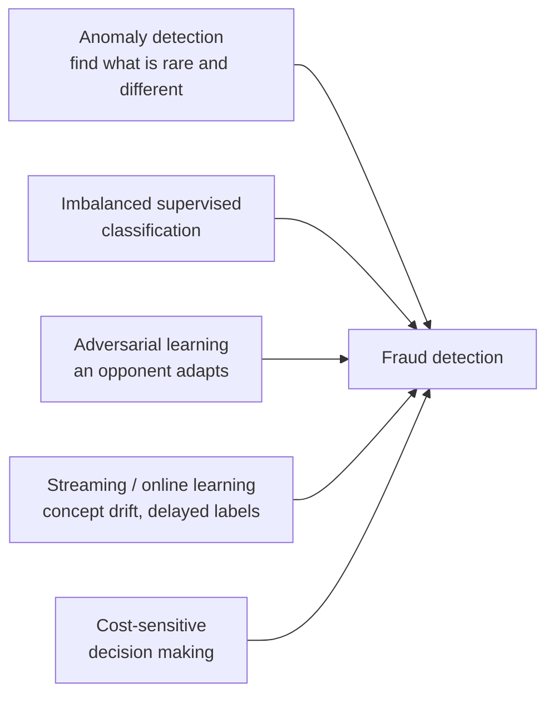
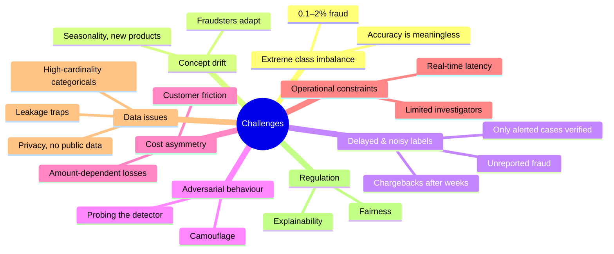
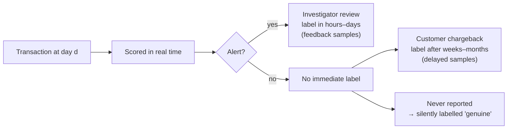
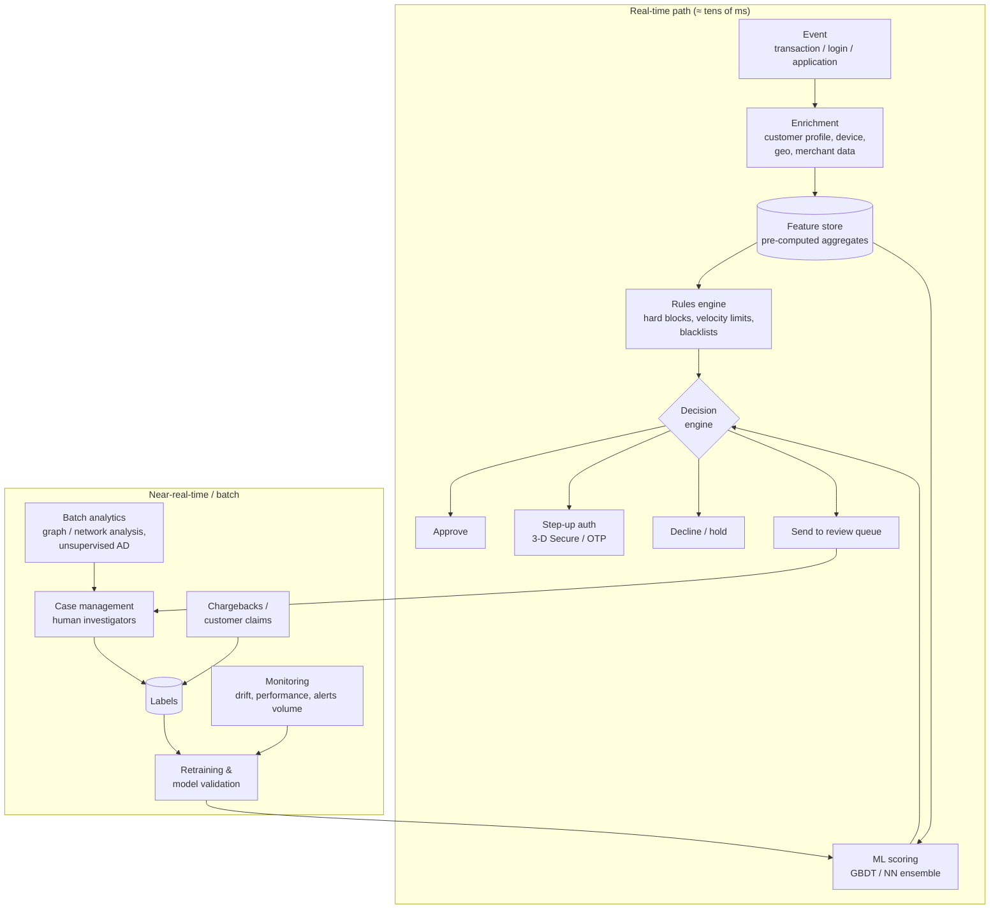
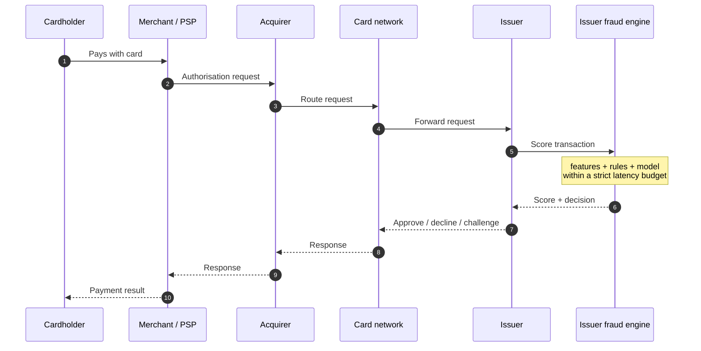
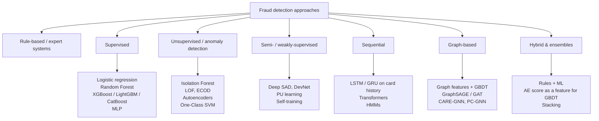
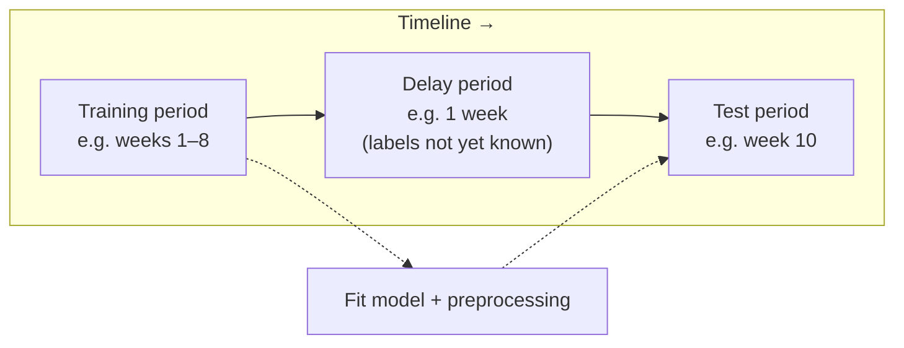
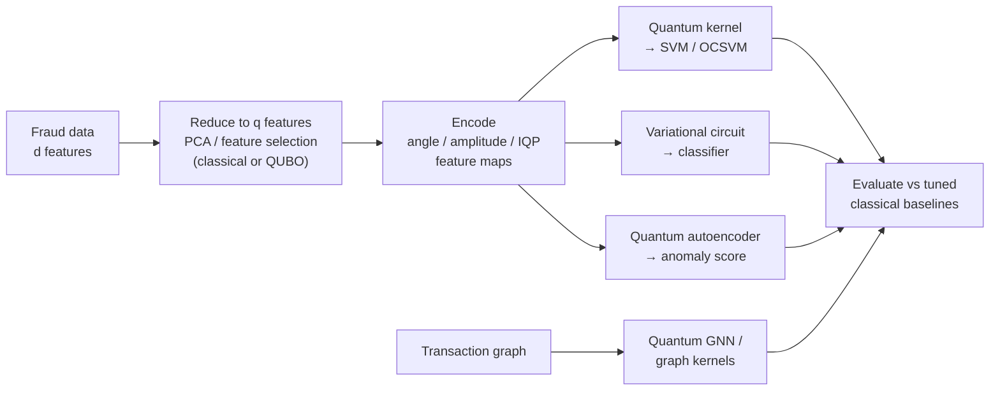

# 03 · Fraud Detection

> **Goal of this document:** understand fraud detection as a problem: what fraud is, why it is harder than generic anomaly detection, how real systems are built, which features and models work, how to evaluate them correctly, which public datasets exist, and where Quantum Machine Learning can realistically contribute.
>
> Prerequisites: [01 · ML state of the art](01-ml-state-of-the-art.md) and [02 · Anomaly detection](02-anomaly-detection.md).

---

## Table of contents

1. [What is fraud detection?](#1-what-is-fraud-detection)
2. [Types of fraud](#2-types-of-fraud)
3. [Why fraud detection is hard](#3-why-fraud-detection-is-hard)
4. [How a real fraud detection system works](#4-how-a-real-fraud-detection-system-works)
5. [Feature engineering](#5-feature-engineering)
6. [Detection approaches](#6-detection-approaches)
7. [Handling imbalance and cost](#7-handling-imbalance-and-cost)
8. [Evaluation](#8-evaluation)
9. [Public datasets](#9-public-datasets)
10. [Explainability, fairness and regulation](#10-explainability-fairness-and-regulation)
11. [Where QML fits](#11-where-qml-fits)
12. [Thesis checklist](#12-thesis-checklist)
13. [References](#13-references)

---

## 1. What is fraud detection?

**Fraud** is deliberate deception to obtain an unlawful gain, such as money, goods, services or credentials. **Fraud detection** is the task of identifying fraudulent events (transactions, applications, claims, accounts) among legitimate ones, ideally **before** the loss happens.

Formally, given an event $x_t$ observed at time $t$ (together with the history available up to $t$), we want a score

$$
s(x_t) \approx P\big(y_t = \text{fraud} \mid x_t, \mathcal{H}_{<t}\big)
$$

and a decision policy (approve / challenge / block / send to review) that **minimises expected loss** under operational constraints such as the alert budget, latency and customer friction.

### Fraud detection as anomaly detection, and how it differs



Fraud detection inherits AD's core idea (fraud is rare and deviates from normal behaviour) but adds four complications:

1. **An adversary.** Fraudsters actively imitate normal behaviour ("camouflage") and adapt to the detector.
2. **Labels exist, but late and noisy.** Chargebacks and investigations provide labels, delayed by days to months.
3. **Errors have asymmetric, amount-dependent costs.** Missing a €5,000 fraud costs much more than missing a €5 one. Blocking a good customer costs goodwill.
4. **It runs in production.** Real-time latency limits, alert budgets and regulation all apply.

Not all fraud is anomalous: an account takeover where the fraudster behaves like the victim may look normal. Not all anomalies are fraud either: a customer on holiday spends unusually. This is why **supervised models on behavioural features** dominate in practice, with unsupervised AD as a complement.

---

## 2. Types of fraud

| Domain | Fraud type | Description | Typical signals |
|--------|------------|-------------|-----------------|
| **Payment cards** | Card-not-present (CNP) | Stolen card data used online | New device / IP, shipping ≠ billing address, high velocity |
| | Card-present / skimming / counterfeit | Cloned card used at a POS / ATM | Geographic impossibility, fallback to magstripe |
| | Card testing | Many tiny transactions to validate stolen cards | Bursts of €0–€1 authorisations on one merchant |
| **Banking** | Account takeover (ATO) | Criminal gains access to a real account | New device, password reset, change of payee, unusual login time |
| | Authorised push payment (APP) scam | Victim is tricked into sending money | New payee, large first transfer, signs of a coached customer |
| | Money mules | Accounts used to move illicit funds | Fast in-and-out flows, many counterparties |
| **Identity** | Synthetic identity | A fake identity built from real + invented data | Thin credit file, shared phone/address across applicants |
| | Application fraud | False information on loan / account applications | Inconsistent fields, velocity of applications |
| **AML** | Money laundering | Placement → layering → integration of illicit funds | Structuring under thresholds, circular flows, graph patterns |
| **Crypto** | Illicit transactions, scams, mixers | Laundering through blockchains | Graph topology, mixing services |
| **Insurance** | Claims fraud | Exaggerated or staged claims | Networks of claimants, repairers, doctors |
| **E-commerce / platforms** | Fake reviews, promo abuse, fake accounts | Platform manipulation | Graph of accounts / devices, behavioural sequences |
| **Telecom** | SIM swap, subscription, IRSF | Abuse of telco services | Unusual call destinations, SIM change before banking activity |

Most academic and QML work targets **credit-card transaction fraud**, because good public datasets exist ([§9](#9-public-datasets)).

---

## 3. Why fraud detection is hard



### 3.1 Class imbalance

In the ULB credit-card dataset, frauds are **0.172 %** of transactions. A model that predicts "genuine" for everything reaches **99.83 % accuracy** and catches nothing. You need imbalance-aware training ([§7](#7-handling-imbalance-and-cost)) and metrics ([§8](#8-evaluation)).

### 3.2 Concept drift

The joint distribution $P_t(x, y)$ changes over time:

- **Virtual drift:** $P_t(x)$ changes (new merchants, holiday season).
- **Real drift:** $P_t(y \mid x)$ changes (fraudsters switch strategy once a pattern gets blocked).

Consequences: models degrade within weeks to months, evaluation must be **out-of-time**, and retraining policies (sliding window, ensembles of models trained on different periods) are part of the system (Gama et al., 2014; Dal Pozzolo et al., 2015).

### 3.3 Verification latency and selection bias



- **Feedback labels** (from alerts) arrive quickly but are a **biased** sample: they cover only what the current model flagged.
- **Delayed labels** (chargebacks) are more representative but arrive late.
- Some fraud is **never labelled**, which creates label noise.

Dal Pozzolo et al. (2018) model this *alert–feedback interaction* explicitly by training separate classifiers on feedback and delayed samples and aggregating them.

### 3.4 Adversarial behaviour

Fraudsters probe the system (card testing), split amounts to stay under rules, and use stolen but "clean" devices and accounts. In graphs they **camouflage** by connecting to many legitimate nodes, which degrades naive GNNs (Dou et al., 2020).

---

## 4. How a real fraud detection system works

### 4.1 Layered architecture



### 4.2 Card authorisation flow



Fraud scoring happens at several points: the merchant/PSP side (e.g. Stripe Radar, Adyen RevenueProtect), the card network, and the issuer.

### 4.3 Rules vs ML

| | Expert rules | Machine learning |
|-|--------------|------------------|
| Example | "Decline if > 5 transactions in 10 min on a new device" | GBDT on 300+ features |
| Strengths | Transparent, instant to deploy, encode regulatory and known patterns | Captures complex interactions, higher detection rate at the same FPR |
| Weaknesses | Brittle, easy to evade, many false positives, hard to maintain | Needs labels, drifts, needs explanation |
| In practice | **Both**: rules for hard constraints and fast reaction to new attacks, ML for ranking |

---

## 5. Feature engineering

On real transaction data, **feature engineering contributes more to performance than the choice of algorithm**. Raw transactions carry little signal on their own. Behaviour relative to history is what matters.

### 5.1 Feature families

| Family | Examples | Captures |
|--------|----------|----------|
| **Transaction** | amount, currency, MCC, channel (POS/online), entry mode, hour | Event itself |
| **Temporal** | is_night, is_weekend, time since last transaction | Contextual anomalies |
| **Customer aggregates (RFM / velocity)** | # transactions and mean amount in last 1h / 1d / 7d / 30d; ratio amount / customer mean | Deviation from the customer's own behaviour |
| **Merchant / terminal aggregates** | Terminal fraud rate over a past window, # distinct cards per terminal | Compromised terminals / merchants |
| **Geographic** | Distance from home, distance from previous transaction, travel speed | Impossible travel |
| **Device / digital** | New device, device fingerprint age, IP risk, # accounts per device | ATO, bots |
| **Graph** | Degree, PageRank, connected-component size, shared devices / addresses | Fraud rings, mules |
| **Periodic (von Mises)** | Customer's usual transaction time-of-day as a circular distribution (Bahnsen et al., 2016) | Unusual timing |
| **Learned embeddings** | Sequence encoders (LSTM / Transformer) over card history | Complex behavioural patterns |

### 5.2 Example: rolling customer features (point-in-time correct)

```python
import pandas as pd

def add_customer_windows(df: pd.DataFrame, windows=(1, 7, 30)) -> pd.DataFrame:
    """For each transaction, aggregate only the customer's *past* transactions."""
    df = df.sort_values("tx_datetime").set_index("tx_datetime")
    g = df.groupby("customer_id")["amount"]
    for w in windows:
        roll = g.rolling(f"{w}D", closed="left")   # 'left' excludes the current tx
        df[f"cust_n_tx_{w}d"]   = roll.count().reset_index(level=0, drop=True)
        df[f"cust_avg_amt_{w}d"] = roll.mean().reset_index(level=0, drop=True)
    df["amt_over_avg_30d"] = df["amount"] / df["cust_avg_amt_30d"]
    return df.reset_index()
```

For **terminal risk** features based on fraud labels, also apply a **delay period** (for example, ignore the last 7 days), because those labels are not yet known at decision time (Le Borgne et al., 2022).

### 5.3 Leakage traps

| Trap | Why it is wrong | Fix |
|------|-----------------|-----|
| Random train/test split | Future transactions of the same card or fraud campaign end up in training | **Out-of-time split** |
| Aggregates that include the current or future transactions | Information unavailable at decision time | `closed="left"`, strict point-in-time joins |
| Fraud-label-based features without delay | Uses labels not yet known | Delay window |
| Same card / customer in train and test | Model memorises identities | Group-aware or time-based split |
| Fitting scalers / PCA / SMOTE on the full dataset | Test statistics leak into training | Fit preprocessing on training data only, inside a pipeline |

---

## 6. Detection approaches



| Approach | When it works best | Typical performance notes |
|----------|-------------------|---------------------------|
| **GBDT + engineered features** | Labelled tabular transactions | **Industry workhorse and the strongest general baseline** |
| Random Forest | Robust baseline, little tuning | Slightly below GBDT, very stable |
| Logistic regression | Interpretability required, baseline | Competitive only with strong feature engineering |
| MLP / tabular DL | Large datasets, embeddings of categoricals | Rarely beats GBDT on its own; useful in ensembles |
| LSTM / Transformer on sequences | Long, rich histories per card | Captures behaviour; best combined with aggregate features (Jurgovsky et al., 2018) |
| GNNs | Relational fraud: rings, mules, AML, review fraud | Clear gains where graph structure exists (Elliptic, YelpChi, Amazon) |
| Unsupervised AD | No / few labels, new fraud types, AML | Lower precision than supervised; valuable for novel patterns and as extra features |
| Hybrid | Production systems | Unsupervised scores used **as features** in a supervised model often help |

---

## 7. Handling imbalance and cost

The general techniques are in [01 §7](01-ml-state-of-the-art.md#7-learning-from-imbalanced-data). Fraud-specific points:

### 7.1 Cost-sensitive learning

A cost matrix for transaction $i$ with amount $a_i$:

| | Predicted fraud | Predicted genuine |
|-|-----------------|-------------------|
| **Actual fraud** | $C_a$ (investigation cost) | $a_i$ (lost amount) |
| **Actual genuine** | $C_a$ (+ friction cost) | $0$ |

Example-dependent cost-sensitive methods (Bahnsen et al., 2014–2016) minimise total cost directly. A simple, effective variant is to **weight samples by amount** in GBDT training and choose the threshold that minimises cost on a validation period.

**Savings** relative to doing nothing:

$$
\text{Savings} = \frac{\text{Cost}_{\text{no model}} - \text{Cost}_{\text{model}}}{\text{Cost}_{\text{no model}}}
$$

### 7.2 Resampling under drift

- Undersampling the majority class per time window is common and fast. It also enables the **small, balanced datasets** used in QML experiments. Remember to re-calibrate and to evaluate at the **true prevalence**.
- SMOTE on fraud data can create unrealistic synthetic frauds. Check that it actually helps on an out-of-time validation set.

---

## 8. Evaluation

### 8.1 Why accuracy and ROC-AUC are not enough

With prevalence $\pi = 0.2\%$, even a 1 % false-positive rate on 1 M genuine transactions creates **10,000 false alerts**, which no team can review. ROC curves hide this because FPR is normalised by the huge negative class. **Precision-oriented metrics** show it.

| Metric | Formula / meaning | Why use it |
|--------|-------------------|-----------|
| Precision | $\frac{TP}{TP+FP}$ | Fraction of alerts that are real fraud (investigator efficiency) |
| Recall (detection rate) | $\frac{TP}{TP+FN}$ | Fraction of fraud caught |
| **PR-AUC / Average Precision** | Area under precision–recall curve | **Main threshold-free metric**; random baseline = $\pi$ |
| ROC-AUC | Area under TPR–FPR curve | Report it for comparability with literature, but not alone |
| **Precision@k / Card Precision@k** | Precision among the top $k$ alerts per day (per card) | Matches the investigator budget (Dal Pozzolo et al., 2015; Le Borgne et al., 2022) |
| Recall @ fixed FPR (e.g. 0.1 %) | Operational point | Business-relevant comparison |
| F1 / F$_\beta$ | Harmonic mean, $\beta>1$ weights recall | Single threshold summary |
| Matthews Correlation Coefficient | Balanced correlation of predictions | Robust single number under imbalance |
| **Cost / Savings** | See [§7.1](#71-cost-sensitive-learning) | What the business actually cares about |
| Value detected | $\sum$ amounts of caught frauds | Amount-weighted recall |

### 8.2 Validation protocol



- **Out-of-time split**, never random.
- Include a **delay period** between train and test to mimic verification latency.
- Use **prequential / rolling evaluation** (train on $[t-w, t)$, test on $[t, t+\Delta)$, slide) to measure robustness to drift.
- Tune hyperparameters on a **validation period that precedes the test period**.
- Report **mean ± std over multiple periods and seeds**, and use statistical tests when claiming one model beats another.
- When a dataset has no meaningful timestamps (e.g. some QML benchmark subsets), say so explicitly and use stratified repeated CV.

---

## 9. Public datasets

Real fraud data is confidential, so public datasets are few and each has caveats.

| Dataset | Domain | Size | Fraud rate | Features | Notes |
|---------|--------|------|-----------|----------|-------|
| **ULB Credit Card Fraud** (Kaggle, Dal Pozzolo et al., 2015) | Card transactions, European cardholders, 2 days in Sept 2013 | 284,807 tx | 492 frauds (**0.172 %**) | `Time`, `Amount`, `V1–V28` (PCA-transformed, anonymised) | **The most-used benchmark, including in QML.** PCA features fit qubit budgets well, but prevent domain feature engineering |
| **IEEE-CIS Fraud Detection** (Kaggle 2019, Vesta) | E-commerce CNP transactions | ~590k train tx | ~3.5 % | ~430 columns: transaction + identity/device, many missing | Realistic and messy; strong feature-engineering benchmark |
| **PaySim** (Lopez-Rojas et al., 2016) | Mobile money, synthetic from real logs | ~6.4 M tx | ~0.13 % | Type, amount, balances before/after | Synthetic; balance fields make it easy to "solve" — be careful |
| **Bank Account Fraud (BAF)** (Jesus et al., NeurIPS 2022) | Bank account opening applications | 6 variants × 1 M | ~1 % | 30 features incl. protected attributes | Realistic, temporal, designed for **fairness** and bias evaluation |
| **Elliptic** (Weber et al., 2019) | Bitcoin transaction graph (AML) | 203,769 nodes, 234,355 edges | ~2 % illicit, ~21 % licit, rest unknown | 166 node features, 49 time steps | **Graph** benchmark; Elliptic++ (2023) adds wallet-level data |
| **IBM AML synthetic** (Altman et al., NeurIPS 2023) | Bank transfers, synthetic | Several sizes (small → large) | Low, configurable (HI / LI variants) | Transfers with laundering patterns | Graph / temporal AML benchmark |
| **Sparkov simulated transactions** (Kaggle) | Card transactions, simulated | ~1.8 M tx | ~0.5 % | Customer, merchant, category, location, time | Full raw fields, so you can practise feature engineering |
| **Le Borgne & Bontempi simulator** (2022 handbook) | Card transactions, simulated | Configurable | Configurable | Customers, terminals, fraud scenarios | Code-generated; ideal for controlled experiments and drift studies |
| **YelpChi / Amazon** (Dou et al., 2020) | Review / user fraud graphs | ~45k / ~12k nodes | ~14.5 % / ~9.5 % | Multi-relation graphs | Standard GNN fraud benchmarks |

**Recommendation for a QML thesis:** use **ULB Credit Card** as the main benchmark for comparability with prior QML work, plus at least one **more realistic dataset** (BAF, IEEE-CIS or the simulator) to test whether conclusions hold. Elliptic is the natural choice if the thesis goes in a quantum-graph direction.

---

## 10. Explainability, fairness and regulation

| Topic | What it means for a fraud model |
|-------|----------------------------------|
| **GDPR Art. 22** | Individuals have rights regarding solely automated decisions with legal or similarly significant effects, which drives the need for explanation and human review |
| **EU AI Act** (Reg. 2024/1689) | Credit-scoring systems are high-risk, but Annex III explicitly **excludes AI systems used to detect financial fraud** from that category. Transparency, data governance and general obligations still matter, and AML/KYC rules apply |
| **PSD2 SCA & Transaction Risk Analysis** | PSPs can skip strong customer authentication for remote card payments if their fraud rate stays below reference thresholds (0.13 % ≤ €100, 0.06 % ≤ €250, 0.01 % ≤ €500 under the RTS, Reg. 2018/389). Better models directly reduce customer friction |
| **AML directives / AMLA** | Suspicious activity must be reported; models must be auditable |
| **Model risk management** | Banks validate models independently (documentation, back-testing, monitoring), e.g. under ECB / EBA guidelines |
| **Fairness** | Fraud models can disproportionately decline certain groups (age, nationality). BAF was created to study this |
| **Explainability tools** | SHAP for GBDTs; reason codes for investigators. For quantum models this is still an open problem |

---

## 11. Where QML fits

### 11.1 Why fraud detection is a popular QML testbed

- It is **binary classification / anomaly detection** on **tabular** data, which maps directly to QSVM, VQC and quantum one-class models.
- The ULB dataset is **already PCA-reduced**, so selecting the top $q$ components gives a natural $q$-qubit encoding.
- High industrial interest: banks and quantum companies (IBM, Intesa Sanpaolo, JPMorgan, HSBC, Pasqal and others) have published or announced proofs of concept.
- Quantum feature maps might in principle capture correlations that are hard to model classically. This is a hypothesis to test, not an established result.

### 11.2 Known QML approaches to fraud



| Work | Approach | Takeaway |
|------|----------|----------|
| Grossi et al. (2022), *IEEE TQE* (IBM + Intesa Sanpaolo) | Quantum annealing / QUBO **feature selection** + QSVM on card data | Hybrid pipelines; feature selection is a practical place for quantum methods |
| Kyriienko & Magnusson (2022), arXiv:2208.01203 | **Unsupervised** quantum kernel one-class SVM for fraud | Quantum OCSVM competitive with classical on small samples |
| Innan et al. (2024), *Quantum Machine Intelligence* | **Quantum GNN** for financial fraud | Early graph-based QML results |
| Herman et al. (2023), *Nature Reviews Physics*; Egger et al. (2020), *IEEE TQE* | Surveys of quantum computing for finance | Context, roadmap and realistic expectations |

The full literature review, with more papers and an assessment of each, is in [05 · QML for Anomaly & Fraud Detection](05-qml-fraud-literature-review.md).

### 11.3 Critical caveats to address in the thesis

1. **Scale mismatch.** Experiments usually use a few hundred to a few thousand balanced samples and 2–20 features, while production systems use millions of rows and hundreds of features. State the regime clearly.
2. **Strong baselines.** Compare against tuned GBDT, SVM-RBF, logistic regression, Isolation Forest / OCSVM, and TabPFN **on the same reduced features and the same subsamples**.
3. **Prevalence.** Train balanced if you must, but **evaluate at realistic prevalence** with PR-AUC and precision@k.
4. **Noise and shots.** Report results on noiseless simulation, shot-noise simulation, noisy simulation and (if possible) real hardware, separately.
5. **Concentration and trainability.** Track kernel-value variance and gradient variance as the number of qubits grows (exponential concentration, barren plateaus).
6. **Dequantization.** For some quantum models a classical algorithm can simulate or approximate the same function class efficiently. Discuss whether yours is classically simulable.
7. **Reproducibility.** Fix seeds, publish code, record simulator / hardware versions and transpiler settings.

### 11.4 Candidate research directions

- Quantum-kernel **one-class SVM** vs classical OCSVM / Isolation Forest for **unsupervised** fraud detection at realistic prevalence.
- Effect of **feature maps and bandwidth** on quantum kernel performance for fraud data.
- **QUBO-based feature selection** (annealing / QAOA) feeding classical or quantum classifiers.
- **Hybrid** models: a quantum kernel / circuit score as an extra feature to a GBDT.
- **Robustness to concept drift** of quantum vs classical models under out-of-time evaluation.
- **Quantum graph models** on Elliptic or IBM AML data.

---

## 12. Thesis checklist

- [ ] I can explain the difference between anomaly detection, imbalanced classification and fraud detection.
- [ ] I have reproduced a **classical baseline suite** (LogReg, RF, XGBoost/LightGBM, IForest, OCSVM, AE) on ULB with an out-of-time split.
- [ ] My metrics are **PR-AUC, precision@k, recall@FPR and ROC-AUC**, reported with mean ± std.
- [ ] Preprocessing (scaling, PCA, resampling) is fit on training data only, inside a pipeline.
- [ ] I have a fixed **feature budget** $q$ and apply the same reduced features to classical and quantum models.
- [ ] I evaluate at the **true fraud prevalence**, even if I train on balanced subsets.
- [ ] I have read the core references: Chandola 2009, Ruff 2021, Dal Pozzolo 2015 & 2018, Le Borgne 2022 handbook, Grinsztajn 2022, Havlíček 2019, Bowles 2024.
- [ ] I have a second, more realistic dataset to test whether my conclusions generalise.

---

## 13. References

**Fraud detection — foundations and practice**
- Bolton, R. J., & Hand, D. J. (2002). Statistical Fraud Detection: A Review. *Statistical Science*, 17(3).
- Dal Pozzolo, A. et al. (2014). Learned lessons in credit card fraud detection from a practitioner perspective. *Expert Systems with Applications*, 41(10).
- Dal Pozzolo, A. et al. (2015). Calibrating Probability with Undersampling for Unbalanced Classification. *IEEE SSCI*. — origin of the ULB dataset
- Dal Pozzolo, A. et al. (2018). Credit Card Fraud Detection: A Realistic Modeling and a Novel Learning Strategy. *IEEE TNNLS*, 29(8).
- Le Borgne, Y.-A., Siblini, W., Lebichot, B., & Bontempi, G. (2022). *Reproducible Machine Learning for Credit Card Fraud Detection — Practical Handbook*. Université Libre de Bruxelles. Free online at <https://fraud-detection-handbook.github.io/fraud-detection-handbook/> — **highly recommended, hands-on**
- Bahnsen, A. C. et al. (2016). Feature engineering strategies for credit card fraud detection. *Expert Systems with Applications*, 51.
- Jurgovsky, J. et al. (2018). Sequence classification for credit-card fraud detection. *Expert Systems with Applications*, 100.
- Hilal, W., Gadsden, S. A., & Yawney, J. (2022). Financial Fraud: A Review of Anomaly Detection Techniques and Recent Advances. *Expert Systems with Applications*, 193.
- Gama, J. et al. (2014). A survey on concept drift adaptation. *ACM Computing Surveys*, 46(4).

**Graph-based fraud detection**
- Weber, M. et al. (2019). Anti-Money Laundering in Bitcoin: Experimenting with Graph Convolutional Networks for Financial Forensics. *KDD Workshop on Anomaly Detection in Finance*.
- Dou, Y. et al. (2020). Enhancing Graph Neural Network-based Fraud Detectors against Camouflaged Fraudsters. *CIKM*.
- Liu, Y. et al. (2021). Pick and Choose: A GNN-based Imbalanced Learning Approach for Fraud Detection. *WWW*.
- Altman, E. et al. (2023). Realistic Synthetic Financial Transactions for Anti-Money Laundering Models. *NeurIPS Datasets & Benchmarks*.

**Datasets**
- Lopez-Rojas, E., Elmir, A., & Axelsson, S. (2016). PaySim: A financial mobile money simulator for fraud detection. *EMSS*.
- Jesus, S. et al. (2022). Turning the Tables: Biased, Imbalanced, Dynamic Tabular Datasets for ML Evaluation. *NeurIPS Datasets & Benchmarks*.
- Kaggle: *Credit Card Fraud Detection* (ULB), *IEEE-CIS Fraud Detection*.

**QML and finance**
- Grossi, M. et al. (2022). Mixed Quantum–Classical Method for Fraud Detection With Quantum Feature Selection. *IEEE Transactions on Quantum Engineering*, 3.
- Kyriienko, O., & Magnusson, E. B. (2022). Unsupervised quantum machine learning for fraud detection. *arXiv:2208.01203*.
- Innan, N. et al. (2024). Financial fraud detection using quantum graph neural networks. *Quantum Machine Intelligence*, 6.
- Herman, D. et al. (2023). Quantum computing for finance. *Nature Reviews Physics*, 5.
- Egger, D. J. et al. (2020). Quantum Computing for Finance: State-of-the-Art and Future Prospects. *IEEE Transactions on Quantum Engineering*, 1.
- Bowles, J., Ahmed, S., & Schuld, M. (2024). Better than classical? The subtle art of benchmarking quantum machine learning models. *arXiv:2403.07059*.

**Regulation**
- Regulation (EU) 2016/679 (GDPR), Art. 22.
- Regulation (EU) 2024/1689 (AI Act), Annex III.
- Commission Delegated Regulation (EU) 2018/389 (PSD2 RTS on SCA), Art. 18–19.
