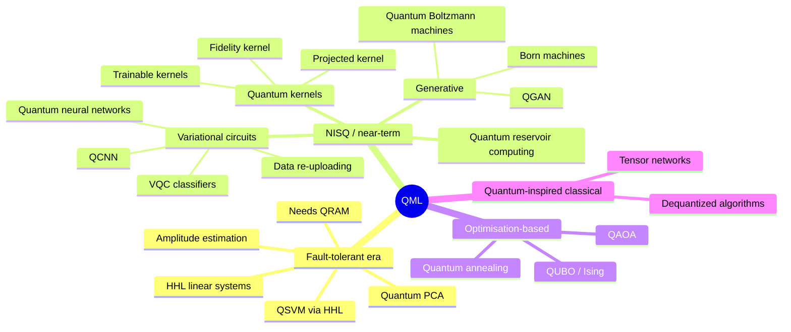
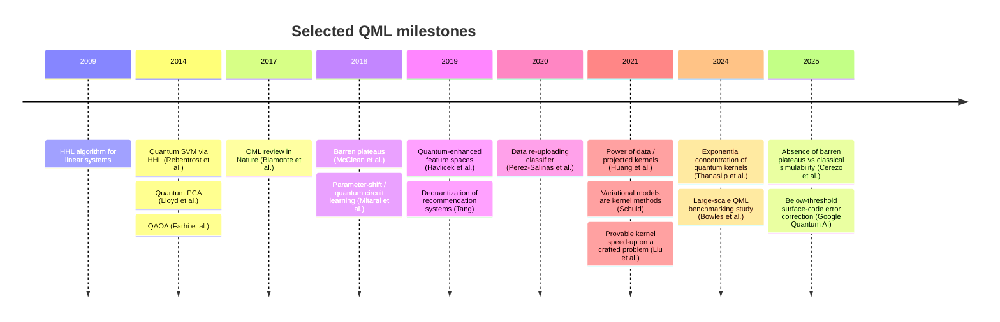
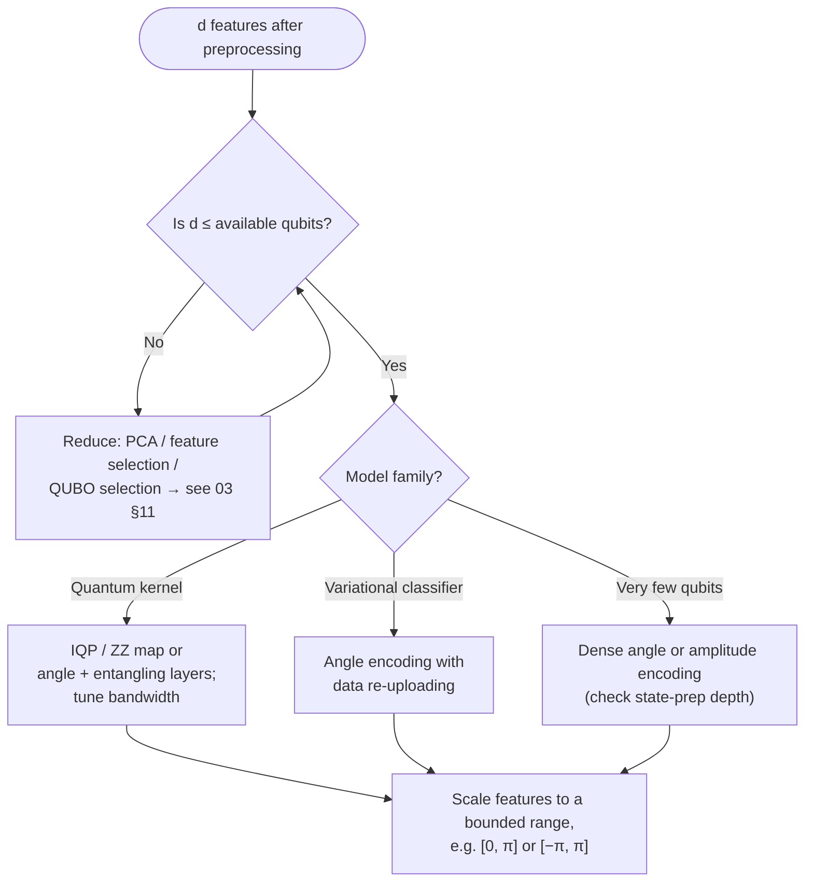
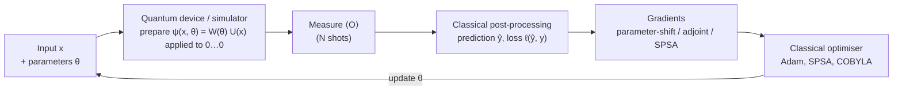
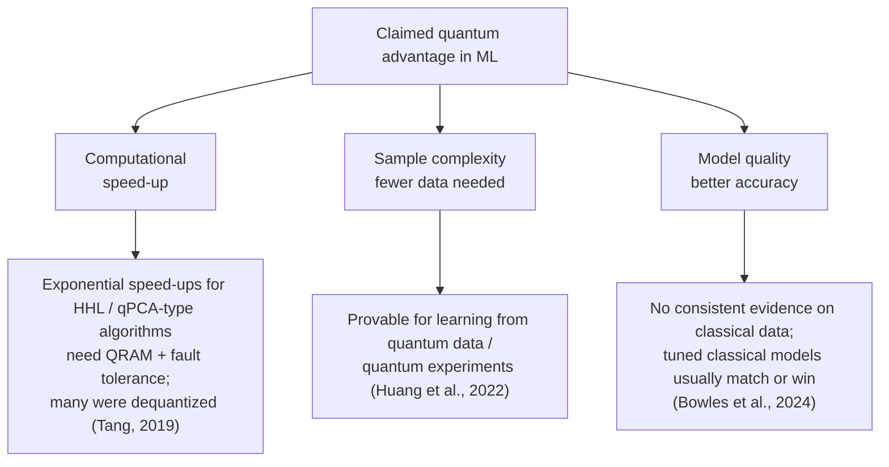

# 04 · Quantum Computing & QML Foundations

> **Goal of this document:** give you the quantum computing and Quantum Machine Learning (QML) background needed to design, run and critically evaluate QML experiments on fraud data. It covers the formalism (states, gates, measurement), the hardware reality (NISQ, noise), how classical data gets into a quantum computer, the two main QML model families (**variational circuits** and **quantum kernels**), their known limitations (barren plateaus, concentration, dequantization), and the software stack.
>
> Prerequisites: linear algebra (complex vector spaces, inner products, eigenvalues, tensor products) and [01 · ML state of the art](01-ml-state-of-the-art.md), especially kernels (§4.2) and neural networks (§6.1).

---

## Table of contents

1. [The QML landscape](#1-the-qml-landscape)
2. [Qubits and quantum states](#2-qubits-and-quantum-states)
3. [Gates and circuits](#3-gates-and-circuits)
4. [Measurement, expectation values and shots](#4-measurement-expectation-values-and-shots)
5. [Hardware and the NISQ era](#5-hardware-and-the-nisq-era)
6. [Encoding classical data](#6-encoding-classical-data)
7. [Variational quantum algorithms and quantum neural networks](#7-variational-quantum-algorithms-and-quantum-neural-networks)
8. [Quantum kernel methods](#8-quantum-kernel-methods)
9. [Other QML models](#9-other-qml-models)
10. [Quantum advantage in ML: what is known](#10-quantum-advantage-in-ml-what-is-known)
11. [Simulation cost and experiment budgeting](#11-simulation-cost-and-experiment-budgeting)
12. [Software stack](#12-software-stack)
13. [Implications for a fraud-detection thesis](#13-implications-for-a-fraud-detection-thesis)
14. [Glossary](#14-glossary)
15. [References](#15-references)

---

## 1. The QML landscape

QML is usually split by **where the data comes from** and **where it is processed** (Aïmeur, Brassard & Gambs; Schuld & Petruccione):

|                    | Classical algorithm                                         | Quantum algorithm                                                       |
| ------------------ | ----------------------------------------------------------- | ----------------------------------------------------------------------- |
| **Classical data** | Classical ML                                                | **Your thesis**: fraud transactions processed by quantum circuits       |
| **Quantum data**   | ML to analyse quantum experiments (e.g. calibrating qubits) | Learning directly from quantum states (where provable advantages exist) |





---

## 2. Qubits and quantum states

### 2.1 A single qubit

A qubit is a unit vector in $\mathbb{C}^2$:

$$
|\psi\rangle = \alpha|0\rangle + \beta|1\rangle, \qquad \alpha, \beta \in \mathbb{C}, \quad |\alpha|^2 + |\beta|^2 = 1
$$

with computational basis $|0\rangle = (1,0)^\top$, $|1\rangle = (0,1)^\top$. Up to an irrelevant global phase, every pure qubit state is a point on the **Bloch sphere**:

$$
|\psi\rangle = \cos\tfrac{\theta}{2}\,|0\rangle + e^{i\varphi}\sin\tfrac{\theta}{2}\,|1\rangle
$$

Notation (Dirac): $|\psi\rangle$ is a column vector ("ket"), $\langle\psi| = |\psi\rangle^\dagger$ a row vector ("bra"), $\langle\phi|\psi\rangle$ the inner product, $|\psi\rangle\langle\psi|$ the outer product (a projector).

### 2.2 Many qubits and entanglement

$q$ qubits live in the tensor product space $(\mathbb{C}^2)^{\otimes q} \cong \mathbb{C}^{2^q}$:

$$
|\psi\rangle = \sum_{b \in \{0,1\}^q} c_b\, |b\rangle, \qquad \sum_b |c_b|^2 = 1
$$

- The state needs $2^q$ complex amplitudes to describe classically. This is the source of both the potential power and the simulation cost ([§11](#11-simulation-cost-and-experiment-budgeting)).
- A **product state** factorises: $|\psi\rangle = |\psi_1\rangle \otimes \cdots \otimes |\psi_q\rangle$, needing only $O(q)$ parameters.
- An **entangled** state does not factorise, e.g. the Bell state $|\Phi^+\rangle = \tfrac{1}{\sqrt{2}}(|00\rangle + |11\rangle)$.

> Entanglement is necessary but not sufficient for being hard to simulate: circuits with limited or structured entanglement (low bond dimension, Clifford circuits) can be simulated efficiently.

### 2.3 Mixed states and density matrices

Noise and partial information are described by a **density matrix**:

$$
\rho = \sum_i p_i\, |\psi_i\rangle\langle\psi_i|, \qquad \rho \succeq 0, \quad \mathrm{Tr}\,\rho = 1
$$

- Pure state: $\rho = |\psi\rangle\langle\psi|$, $\mathrm{Tr}\,\rho^2 = 1$. Mixed state: $\mathrm{Tr}\,\rho^2 < 1$.
- **Reduced density matrix** of a subsystem: partial trace, $\rho_A = \mathrm{Tr}_B\,\rho_{AB}$. Projected quantum kernels use these ([§8.3](#83-projected-quantum-kernels)).
- **Fidelity** between pure states: $F = |\langle\psi|\phi\rangle|^2$. This is exactly the standard quantum kernel.

---

## 3. Gates and circuits

Quantum operations on closed systems are **unitary** matrices $U$ ($U^\dagger U = I$), so they are reversible and preserve norms.

### 3.1 Single-qubit gates

| Gate       | Matrix                                                   | Effect                                                         |
| ---------- | -------------------------------------------------------- | -------------------------------------------------------------- |
| Pauli-X    | $\begin{pmatrix}0&1\\1&0\end{pmatrix}$                   | Bit flip, $\lvert0\rangle \leftrightarrow \lvert1\rangle$      |
| Pauli-Y    | $\begin{pmatrix}0&-i\\i&0\end{pmatrix}$                  | Bit + phase flip                                               |
| Pauli-Z    | $\begin{pmatrix}1&0\\0&-1\end{pmatrix}$                  | Phase flip                                                     |
| Hadamard H | $\tfrac{1}{\sqrt2}\begin{pmatrix}1&1\\1&-1\end{pmatrix}$ | $\lvert0\rangle \mapsto \lvert+\rangle$, creates superposition |
| S, T       | $\mathrm{diag}(1, i)$, $\mathrm{diag}(1, e^{i\pi/4})$    | Phase gates                                                    |
| Rotations  | $R_P(\theta) = e^{-i\theta P/2}$, $P \in \{X,Y,Z\}$      | **Parameterised** gates, the basic building block of QML       |

For example $R_Y(\theta) = \begin{pmatrix}\cos\frac\theta2 & -\sin\frac\theta2 \\ \sin\frac\theta2 & \cos\frac\theta2\end{pmatrix}$, so $R_Y(\theta)|0\rangle = \cos\frac\theta2|0\rangle + \sin\frac\theta2|1\rangle$.

### 3.2 Two-qubit gates

- **CNOT** (CX): flips the target if the control is $|1\rangle$. $\mathrm{CNOT}\,(H \otimes I)\,|00\rangle = |\Phi^+\rangle$.
- **CZ**: applies Z to the target if the control is $|1\rangle$ (symmetric).
- **Parameterised entanglers**: $R_{ZZ}(\theta) = e^{-i\theta Z\otimes Z/2}$, used in IQP / ZZ feature maps.

$\{$ single-qubit rotations, CNOT $\}$ is **universal**: any unitary can be approximated (at a cost that is generally exponential in $q$ for arbitrary unitaries).

### 3.3 Circuit notation

```text
          ┌─────────┐      ┌──────────┐ ░ ┌─┐
q_0: ─────┤ RY(x0)  ├──■───┤ RY(θ0)   ├─░─┤M├
          ├─────────┤┌─┴─┐ ├──────────┤ ░ └╥┘
q_1: ─────┤ RY(x1)  ├┤ X ├─┤ RY(θ1)   ├─░──╫─
          └─────────┘└───┘ └──────────┘ ░  ║
         data encoding  entangle  trainable   measure
```

Key circuit metrics:

| Metric                   | Why it matters                                                         |
| ------------------------ | ---------------------------------------------------------------------- |
| **Width** $q$ (qubits)   | Feature budget; classical simulation cost $\sim 2^q$                   |
| **Depth**                | Noise accumulates with depth; barren plateaus worsen with depth        |
| **Two-qubit gate count** | Two-qubit gates dominate hardware error                                |
| **Connectivity**         | Hardware supports only some qubit pairs; transpilation adds SWAP gates |

---

## 4. Measurement, expectation values and shots

### 4.1 Born rule

Measuring $|\psi\rangle$ in the computational basis gives outcome $b$ with probability

$$
P(b) = |\langle b|\psi\rangle|^2 = \mathrm{Tr}\big(\rho\, |b\rangle\langle b|\big)
$$

and the state collapses. You **cannot read out the amplitudes** directly. Everything you learn comes from repeated sampling.

### 4.2 Expectation values (the model output)

QML models usually output the expectation of an **observable** $O$ (a Hermitian matrix, e.g. $Z_0$):

$$
\langle O \rangle_\psi = \langle\psi|O|\psi\rangle = \mathrm{Tr}(\rho\, O) \in [\lambda_{\min}, \lambda_{\max}]
$$

For $O = Z$ the range is $[-1, 1]$, which maps naturally to a binary classifier (e.g. fraud if $\langle Z_0 \rangle < 0$).

### 4.3 Shot noise

On hardware (or a shot-based simulator) you estimate expectations from $N$ shots. For $\langle Z \rangle$:

$$
\mathrm{Std}\big[\widehat{\langle Z\rangle}\big] = \sqrt{\frac{1 - \langle Z\rangle^2}{N}}, \qquad \text{for a probability } p:\; \mathrm{Std}[\hat p] = \sqrt{\frac{p(1-p)}{N}}
$$

- Error decreases only as $1/\sqrt{N}$: 1,000 shots gives ≈ 3 % precision, 10,000 shots ≈ 1 %.
- This interacts badly with **concentration** ([§7.4](#74-barren-plateaus), [§8.4](#84-exponential-concentration)): if kernel values or gradients are exponentially small, you need exponentially many shots to resolve them.

> **For your experiments:** always report whether results are _exact statevector_, _finite-shot_, _noisy simulation_ or _hardware_. They can differ substantially.

---

## 5. Hardware and the NISQ era

**NISQ** (Noisy Intermediate-Scale Quantum, Preskill 2018): devices with tens to a few thousand physical qubits, **no full error correction**, and limited circuit depth before noise dominates.

### 5.1 Main hardware platforms

| Platform          | Examples                      | Strengths                                           | Weaknesses                                        |
| ----------------- | ----------------------------- | --------------------------------------------------- | ------------------------------------------------- |
| Superconducting   | IBM, Google, Rigetti, IQM     | Fast gates, mature cloud access, large qubit counts | Short coherence, limited connectivity, cryogenics |
| Trapped ions      | Quantinuum, IonQ              | High gate fidelity, all-to-all connectivity         | Slower gates, scaling                             |
| Neutral atoms     | Pasqal, QuEra, Atom Computing | Many qubits, reconfigurable geometry, analog mode   | Slower cycles, still maturing for digital gates   |
| Photonic          | Xanadu, PsiQuantum, Quandela  | Room-temperature components, networking             | Probabilistic gates, loss                         |
| Quantum annealers | D-Wave                        | Thousands of qubits for QUBO / Ising                | Not gate-based; only optimisation problems        |

### 5.2 Noise

| Noise source       | Description                                                                                        |
| ------------------ | -------------------------------------------------------------------------------------------------- |
| $T_1$ (relaxation) | $\lvert1\rangle$ decays to $\lvert0\rangle$                                                        |
| $T_2$ (dephasing)  | Loss of phase coherence                                                                            |
| Gate errors        | Imperfect unitaries; two-qubit error rates typically around $10^{-3}$–$10^{-2}$ on current devices |
| Readout errors     | Misclassified measurement outcomes                                                                 |
| Crosstalk          | Operations on one qubit disturb neighbours                                                         |

Noise channels are modelled as CPTP maps on $\rho$, e.g. depolarising: $\mathcal{E}(\rho) = (1-p)\rho + p\, \tfrac{I}{2^q}$. Deep noisy circuits drift toward the maximally mixed state, which flattens kernels and gradients (**noise-induced barren plateaus**, Wang et al., 2021).

### 5.3 Error mitigation vs error correction

- **Error mitigation** (NISQ, no extra qubits): readout mitigation, zero-noise extrapolation (ZNE), probabilistic error cancellation (PEC), dynamical decoupling, twirling. These reduce bias at the cost of more shots (Temme, Bravyi & Gambetta, 2017).
- **Error correction** (fault-tolerant era): encode logical qubits in many physical qubits (surface codes, qLDPC codes). Google reported below-threshold surface-code operation in 2024–25, and several vendors publish roadmaps toward early fault-tolerant machines later this decade. For a master thesis in 2026–27, assume **NISQ hardware plus simulators**.

---

## 6. Encoding classical data

To process a feature vector $x \in \mathbb{R}^d$, you need a **feature map** (embedding) $x \mapsto |\psi(x)\rangle = U(x)|0\rangle^{\otimes q}$. This choice largely determines what the model can learn, and it is often **the most important design decision** in a QML experiment.

### 6.1 Encoding strategies

| Encoding                                           | Map                                                                                                                                | Qubits                 | Depth             | Notes                                                                                                                     |
| -------------------------------------------------- | ---------------------------------------------------------------------------------------------------------------------------------- | ---------------------- | ----------------- | ------------------------------------------------------------------------------------------------------------------------- |
| **Basis**                                          | bits of $x$ → $\lvert b\rangle$                                                                                                    | # bits                 | $O(1)$            | Only for binary / discretised data                                                                                        |
| **Angle**                                          | $\bigotimes_j R_Y(x_j)\lvert0\rangle$                                                                                              | $d$                    | $O(1)$            | Product state; the induced kernel is $\prod_j \cos^2\!\big(\tfrac{x_j - x'_j}{2}\big)$, which is **classically trivial**  |
| **Dense angle**                                    | 2 features per qubit ($R_Y$, then $R_Z$)                                                                                           | $\lceil d/2 \rceil$    | $O(1)$            | Halves qubit count                                                                                                        |
| **Amplitude**                                      | $\lvert\psi\rangle = \sum_i \tfrac{x_i}{\lVert x\rVert}\lvert i\rangle$                                                            | $\lceil\log_2 d\rceil$ | $O(d)$ in general | Exponentially compact, but state preparation is expensive and the norm $\lVert x\rVert$ is lost unless added as a feature |
| **IQP / ZZ feature map** (Havlíček et al., 2019)   | $U(x) = \big[U_Z(x) H^{\otimes q}\big]^L$, with $U_Z(x) = \exp\!\big(i\sum_j \phi_j(x) Z_j + i\sum_{j<k}\phi_{jk}(x) Z_j Z_k\big)$ | $d$                    | $O(L d^2)$        | Entangling; conjectured hard to simulate classically. Qiskit uses $\phi_{jk} = (\pi - x_j)(\pi - x_k)$                    |
| **Data re-uploading** (Pérez-Salinas et al., 2020) | Alternate encoding $S(x)$ and trainable blocks $W(\theta)$, $L$ times                                                              | as low as 1            | $O(L)$            | Repetition enlarges the set of learnable functions                                                                        |
| **Hamiltonian / time-evolution**                   | $e^{-i H(x) t}$                                                                                                                    | problem-specific       | varies            | Used in quantum reservoir computing and projected kernels                                                                 |

### 6.2 Choosing an encoding



### 6.3 Encodings as Fourier series

With Pauli-rotation encodings, the model output is a **truncated Fourier series** in the inputs (Schuld, Sweke & Meyer, 2021):

$$
f_\theta(x) = \sum_{\omega \in \Omega} c_\omega(\theta)\, e^{i\,\omega \cdot x}
$$

- The **frequency spectrum** $\Omega$ is fixed by the encoding: encoding a feature $L$ times with $R_P(x)$ gives integer frequencies $\{-L, \dots, L\}$.
- The trainable part only chooses the **coefficients** $c_\omega$.
- Practical consequences: feature **scaling acts like a bandwidth** (it stretches the frequencies), and one encoding layer per feature gives only very low-frequency functions, which is why re-uploading helps.

---

## 7. Variational quantum algorithms and quantum neural networks

### 7.1 The hybrid quantum–classical loop

A **variational quantum algorithm** (VQA, Cerezo et al., 2021) uses a parameterised quantum circuit (PQC) as a model and a classical optimiser to train it:



### 7.2 Variational quantum classifier (VQC)

$$
f_\theta(x) = \langle 0|\, U^\dagger(x)\, W^\dagger(\theta)\; O\; W(\theta)\, U(x)\,|0\rangle, \qquad \hat y = \mathrm{sign}\big(f_\theta(x) + b\big)
$$

Trained by minimising e.g. binary cross-entropy (after mapping $f_\theta \in [-1,1]$ to a probability) or a squared loss over the training set.

**Ansatz (circuit architecture) choices:**

| Ansatz                       | Description                                                                                                              | Trade-off                                                   |
| ---------------------------- | ------------------------------------------------------------------------------------------------------------------------ | ----------------------------------------------------------- |
| Hardware-efficient           | Layers of single-qubit rotations + native entanglers (e.g. `StronglyEntanglingLayers`, `RealAmplitudes`, `EfficientSU2`) | Easy to run; prone to barren plateaus when deep             |
| Problem-inspired / symmetric | Respects symmetries of the data                                                                                          | Better inductive bias; must be designed                     |
| QCNN (Cong et al., 2019)     | Convolution + pooling layers, $O(\log q)$ depth                                                                          | Avoids barren plateaus; efficiently simulable in many cases |
| Re-uploading                 | Interleaved encoding and trainable layers                                                                                | More expressive per qubit                                   |

### 7.3 Computing gradients: the parameter-shift rule

For a gate $e^{-i\theta P/2}$ with $P$ a Pauli operator, the exact derivative of an expectation value is (Mitarai et al., 2018; Schuld et al., 2019):

$$
\frac{\partial f}{\partial \theta} = \frac{1}{2}\Big[ f\big(\theta + \tfrac{\pi}{2}\big) - f\big(\theta - \tfrac{\pi}{2}\big) \Big]
$$

- Two circuit evaluations per parameter, so $2P$ circuits per gradient for $P$ parameters. That is expensive on hardware.
- On simulators use **adjoint** or **backprop** differentiation (much faster).
- **SPSA** estimates the full gradient with 2 evaluations regardless of $P$, but noisily. It is popular on hardware.

### 7.4 Barren plateaus

For many random-like PQCs the gradient variance vanishes **exponentially** with the number of qubits (McClean et al., 2018):

$$
\mathrm{Var}_\theta\!\left[\partial_{\theta_k} C(\theta)\right] \in O\big(b^{-q}\big), \quad b > 1
$$

so the loss landscape is flat almost everywhere, and estimating a gradient direction needs exponentially many shots.

| Cause                                                   | Reference                               | Mitigation                   |
| ------------------------------------------------------- | --------------------------------------- | ---------------------------- |
| Deep, highly expressive circuits                        | McClean et al. 2018; Holmes et al. 2022 | Shallow / structured ansätze |
| Global cost functions (observables on all qubits)       | Cerezo et al. 2021 (Nat. Commun.)       | Local observables            |
| Too much entanglement between visible and hidden qubits | Ortiz Marrero et al. 2021               | Limit entanglement           |
| Hardware noise                                          | Wang et al. 2021                        | Shallow circuits, mitigation |
| Encoding that concentrates data states                  | Thanasilp et al. 2023                   | Careful encoding / bandwidth |

**An important recent insight:** most architectures that _provably_ avoid barren plateaus turn out to be **efficiently classically simulable** (or "classically surrogatable" from data collected on a quantum device), because the absence of a plateau implies the relevant computation lives in a small, polynomially-sized subspace (Cerezo et al., 2025; Larocca et al., 2025). Trainability and potential quantum advantage are therefore in tension. A good thesis acknowledges this explicitly.

### 7.5 Expressivity and generalisation

- **Expressivity** ≈ how much of the unitary group the ansatz covers. More expressive means more prone to barren plateaus (Holmes et al., 2022).
- **Generalisation bounds** for QML scale with the number of trainable gates $T$, roughly $\tilde O\big(\sqrt{T/n}\big)$ (Caro et al., 2022), so small QML models can generalise from few samples.
- But QML models can also fit random labels, so uniform bounds can be uninformative (Gil-Fuster, Eisert & Bravo-Prieto, 2024), as in classical deep learning.
- **Effective dimension** (Abbas et al., 2021) is another capacity measure used in papers. Treat its claims carefully.

---

## 8. Quantum kernel methods

### 8.1 Fidelity quantum kernel

Embed data with $U(x)$ and use the state overlap as a kernel (Havlíček et al., 2019; Schuld & Killoran, 2019):

$$
k(x, x') = \big|\langle\psi(x)|\psi(x')\rangle\big|^2 = \big|\langle 0|\, U^\dagger(x')\, U(x)\, |0\rangle\big|^2 = \mathrm{Tr}\big[\rho(x)\rho(x')\big]
$$

This is a valid positive semi-definite kernel, so **all classical kernel machinery applies**: SVM, one-class SVM, kernel ridge regression, Gaussian processes, kernel PCA.

**How it is estimated on a device:**


This is the **compute–uncompute** method. The **swap test** is an alternative using $2q+1$ qubits and shallower per-state circuits.

### 8.2 Variational models are kernel methods

A VQC output $f_\theta(x) = \mathrm{Tr}[\rho(x)\, O_\theta]$ is **linear in $\rho(x)$**, so it is a linear model in the feature space of density matrices. By the representer theorem, the optimal model given the embedding is a kernel method with the fidelity kernel (Schuld, 2021). Consequences:

- Kernel methods with the same embedding find the optimum by **convex optimisation** (no barren plateaus in training), at the cost of $O(n^2)$ kernel evaluations.
- Variational models scale better in $n$ but have non-convex, possibly flat, training.

### 8.3 Projected quantum kernels

Fidelity kernels compare full $2^q$-dimensional states, which become nearly orthogonal as $q$ grows. **Projected kernels** (Huang et al., 2021) compare reduced single-qubit states instead:

$$
k^{\text{PQ}}(x, x') = \exp\!\Big(-\gamma \sum_{k=1}^{q} \big\lVert \rho_k(x) - \rho_k(x') \big\rVert_F^2 \Big)
$$

where $\rho_k(x)$ is the reduced density matrix of qubit $k$, estimated from single-qubit Pauli measurements. They are more robust to concentration and have a tunable bandwidth $\gamma$.

Huang et al. also introduced the **geometric difference** $g(K_C \Vert K_Q)$ between classical and quantum kernel matrices, a data-dependent test of whether a quantum kernel _could_ outperform a given classical kernel. It is a useful diagnostic to compute in a thesis.

### 8.4 Exponential concentration

Under many conditions (high expressivity, global measurements, entanglement, noise), kernel values concentrate around a fixed value exponentially in $q$ (Thanasilp et al., 2024):

$$
\Pr\big[\, |k(x,x') - \mu| \ge \delta \,\big] \le \frac{\beta}{\delta^2}, \qquad \beta \in O(b^{-q})
$$

With polynomially many shots the estimated Gram matrix is then indistinguishable from a constant, and the model generalises poorly.

**Mitigations:**

- **Bandwidth / scaling:** multiply inputs by a factor $c < 1$ before encoding (Shaydulin & Wild, 2022; Canatar et al., 2023). This is essential and often the single most important hyperparameter. Note that with small bandwidth the kernel approaches a classically simulable regime.
- Projected kernels, local structure, shallow feature maps.
- **Trainable kernels:** optimise feature-map parameters to maximise **kernel–target alignment** (Hubregtsen et al., 2022):

$$
A(K, y) = \frac{\langle K, yy^\top\rangle_F}{\lVert K\rVert_F\, \lVert yy^\top\rVert_F}
$$

### 8.5 Known theoretical results

- Liu, Arunachalam & Temme (2021) proved an **exponential quantum speed-up** for a quantum-kernel classifier, but on a **cryptographically crafted** problem (discrete logarithm), not on natural data.
- Kübler, Buchholz & Schölkopf (2021) show that quantum kernels without a suitable **inductive bias** fail to generalise, so the embedding must encode prior knowledge about the problem.
- There is **no known proof of advantage** for quantum kernels on generic classical tabular data such as fraud transactions. Empirical results are mixed.

---

## 9. Other QML models

| Model                                                              | Idea                                                                                      | Relevance to fraud                                                                                              |
| ------------------------------------------------------------------ | ----------------------------------------------------------------------------------------- | --------------------------------------------------------------------------------------------------------------- |
| **Quantum autoencoder** (Romero et al., 2017)                      | Compress $q$ qubits to $k$ "latent" qubits; trash-qubit fidelity measures compressibility | Anomaly score = compression / reconstruction failure on normal-trained model                                    |
| **QGAN** (Lloyd & Weedbrook 2018; Dallaire-Demers & Killoran 2018) | Quantum generator and/or discriminator                                                    | Synthetic minority samples; GAN-based anomaly scoring                                                           |
| **Quantum Circuit Born Machine**                                   | Model a distribution as $P(b) = \lvert\langle b\lvert\psi_\theta\rangle\rvert^2$          | Density estimation over discretised features                                                                    |
| **Quantum Boltzmann machine**                                      | Quantum version of an energy-based model                                                  | Density / anomaly modelling (mostly theoretical)                                                                |
| **Quantum reservoir computing**                                    | Fixed quantum dynamics + trained linear readout                                           | Temporal data, no gradient through the circuit                                                                  |
| **QCNN**                                                           | Hierarchical conv/pool circuits                                                           | Mostly for quantum data; trainable                                                                              |
| **Quantum annealing / QUBO**                                       | Minimise $x^\top Q x$, $x \in \{0,1\}^n$                                                  | **Feature selection**: choose $k$ features maximising relevance and minimising redundancy (Grossi et al., 2022) |
| **QAOA** (Farhi et al., 2014)                                      | Gate-model heuristic for QUBO                                                             | Same feature-selection problem on gate hardware                                                                 |
| **Quantum-inspired / tensor networks**                             | Classical algorithms using quantum-like structure (MPS)                                   | A strong classical baseline for "quantum" ideas                                                                 |

**QUBO feature selection** as an example of the formulation:

$$
\min_{z \in \{0,1\}^d} \; -\sum_j \mathrm{rel}(j)\, z_j \;+\; \alpha \sum_{j<k} \mathrm{red}(j,k)\, z_j z_k \;+\; \lambda \Big(\sum_j z_j - k\Big)^2
$$

with $\mathrm{rel}$ = mutual information with the fraud label and $\mathrm{red}$ = correlation between features. Classical solvers (simulated annealing, Gurobi) are the baselines here.

---

## 10. Quantum advantage in ML: what is known



The realistic position for a 2026 thesis on classical fraud data:

1. **No proven advantage** exists for classical tabular data. Claims of "quantum advantage" on fraud datasets in the literature usually rest on weak baselines, tiny test sets or unfair preprocessing.
2. **Dequantization:** some quantum linear-algebra speed-ups disappear when the classical algorithm gets comparable sampling access to the data (Tang, 2019).
3. **Simulability:** small-qubit experiments are, by definition, classically simulable, so any accuracy gain they show is a property of the _model class_, not a computational advantage.
4. A rigorous negative or neutral result is a **valid and valuable** thesis contribution. Schuld & Killoran (2022) argue that QML research should not be framed only around advantage.

Good research questions are therefore phrased as: _"Under which conditions (encoding, bandwidth, qubits, data regime, noise) does a quantum model match or differ from strong classical baselines on fraud detection, and why?"_

---

## 11. Simulation cost and experiment budgeting

### 11.1 Statevector memory

A $q$-qubit statevector in complex128 needs $16 \cdot 2^q$ bytes:

| Qubits $q$ | Memory | Feasible on       |
| ---------- | ------ | ----------------- |
| 10         | 16 KB  | Anything          |
| 20         | 16 MB  | Laptop, fast      |
| 25         | 512 MB | Laptop            |
| 30         | 16 GB  | Workstation / GPU |
| 35         | 512 GB | HPC node          |
| 40         | 16 TB  | Large HPC only    |

Tensor-network / MPS simulators can go much further for low-entanglement circuits, which is also evidence that such circuits are classically easy.

### 11.2 Kernel and training budgets

| Model                                          | Circuit evaluations                    | Example                                             |
| ---------------------------------------------- | -------------------------------------- | --------------------------------------------------- |
| Quantum kernel SVM, training                   | $n(n-1)/2$ Gram entries (symmetric)    | $n = 1{,}000$ → ≈ 500k circuits                     |
| Quantum kernel SVM, test                       | $n_{\text{test}} \times n_{\text{SV}}$ | 10k test points × 300 support vectors = 3M circuits |
| VQC, one epoch with parameter-shift            | $n \times 2P$                          | $n=1{,}000$, $P=48$ → ≈ 96k circuits                |
| Each of the above on hardware / shot simulator | × $N$ shots                            | × 1,000–10,000                                      |

**Consequences for the thesis:**

- Simulated quantum-kernel experiments are realistically limited to **a few thousand training points** and **≲ 20 qubits** on a laptop or GPU. Plan subsampling and report it.
- Evaluating on the **full imbalanced test set** (e.g. 57k ULB test transactions) with a kernel model is expensive. Budget for it, because evaluating only on a balanced subsample misrepresents real performance ([03 §11.3](03-fraud-detection.md#113-critical-caveats-to-address-in-the-thesis)).
- Use GPU simulators (`lightning.gpu`, `qiskit-aer` GPU, NVIDIA cuQuantum) and batch kernel evaluations.

---

## 12. Software stack

| Tool                      | Use                                                                       | Notes                                                                                                       |
| ------------------------- | ------------------------------------------------------------------------- | ----------------------------------------------------------------------------------------------------------- |
| **PennyLane** (Xanadu)    | Differentiable QML; integrates with PyTorch / JAX; many devices           | **Recommended for QML research**; `default.qubit`, `lightning.qubit`, `lightning.gpu`; `qml.kernels` module |
| **Qiskit** (IBM)          | Circuits, transpilation, IBM hardware access                              | Qiskit 1.x/2.x API; primitives (`Sampler`, `Estimator`)                                                     |
| `qiskit-machine-learning` | `FidelityQuantumKernel`, `QSVC`, `VQC`, `EstimatorQNN`, PyTorch connector | Community-maintained; check version compatibility with Qiskit                                               |
| `qiskit-aer`              | High-performance simulators, noise models from real devices               | Use for noisy simulation                                                                                    |
| **Cirq** (Google)         | Circuits for Google hardware                                              | Less ML-focused                                                                                             |
| TensorFlow Quantum        | QML with TensorFlow                                                       | Little active development; avoid for new projects                                                           |
| Amazon Braket             | Access to IonQ, Rigetti, IQM, QuEra and others                            | Pay-per-shot                                                                                                |
| IBM Quantum Platform      | IBM superconducting hardware                                              | Free tier with limited monthly minutes; university programmes may offer more                                |
| D-Wave Ocean              | QUBO / annealing                                                          | Feature selection experiments                                                                               |
| `scikit-learn`            | SVM / OCSVM with `kernel="precomputed"`                                   | Plug quantum Gram matrices into classical solvers                                                           |

> APIs in this ecosystem change quickly. Pin exact package versions in `requirements.txt` / `pyproject.toml` and record them in the thesis.

### 12.1 Example: quantum kernel SVM in PennyLane

```python
import pennylane as qml
from pennylane import numpy as np
from sklearn.svm import SVC

n_qubits = 4                                   # = number of (PCA) features
dev = qml.device("default.qubit", wires=n_qubits)
wires = range(n_qubits)

@qml.qnode(dev)
def overlap(x1, x2):
    qml.IQPEmbedding(x1, wires=wires)           # U(x1)
    qml.adjoint(qml.IQPEmbedding)(x2, wires=wires)  # U†(x2)
    return qml.probs(wires=wires)

def kernel(x1, x2):
    return overlap(x1, x2)[0]                   # P(|0…0⟩) = |⟨ψ(x2)|ψ(x1)⟩|²

# X_* already scaled, e.g. to [0, π] and multiplied by a bandwidth factor c
K_train = qml.kernels.square_kernel_matrix(X_train, kernel, assume_normalized_kernel=True)
K_test  = qml.kernels.kernel_matrix(X_test, X_train, kernel)

clf = SVC(kernel="precomputed", class_weight="balanced").fit(K_train, y_train)
scores = clf.decision_function(K_test)          # use for PR-AUC / ROC-AUC
```

The same Gram matrices work with `sklearn.svm.OneClassSVM(kernel="precomputed")` for the unsupervised anomaly-detection setting ([02 §5.4](02-anomaly-detection.md#54-boundary--one-class-methods)).

### 12.2 Example: variational classifier with data re-uploading

```python
import pennylane as qml
from pennylane import numpy as np

n_qubits, n_layers = 4, 3
dev = qml.device("default.qubit", wires=n_qubits)

@qml.qnode(dev)
def circuit(weights, x):
    for layer in range(n_layers):               # data re-uploading
        qml.AngleEmbedding(x, wires=range(n_qubits), rotation="Y")
        qml.StronglyEntanglingLayers(weights[layer:layer + 1], wires=range(n_qubits))
    return qml.expval(qml.PauliZ(0))            # local observable → fewer barren-plateau issues

shape = qml.StronglyEntanglingLayers.shape(n_layers=n_layers, n_wires=n_qubits)
weights = np.random.uniform(0, 2 * np.pi, size=shape, requires_grad=True)
bias = np.array(0.0, requires_grad=True)

def loss(weights, bias, X, y):                  # y in {-1, +1}
    preds = [circuit(weights, x) + bias for x in X]
    return np.mean((np.stack(preds) - y) ** 2)

opt = qml.AdamOptimizer(stepsize=0.05)
for epoch in range(30):
    for Xb, yb in batches(X_train, y_train, size=32):   # your batching helper
        weights, bias = opt.step(lambda w, b: loss(w, b, Xb, yb), weights, bias)
```

### 12.3 Qiskit equivalent (sketch)

```python
from qiskit.circuit.library import ZZFeatureMap          # newer Qiskit: zz_feature_map(...)
from qiskit_machine_learning.kernels import FidelityQuantumKernel
from qiskit_machine_learning.algorithms import QSVC

fmap = ZZFeatureMap(feature_dimension=4, reps=2)
qkernel = FidelityQuantumKernel(feature_map=fmap)
qsvc = QSVC(quantum_kernel=qkernel).fit(X_train, y_train)
```

---

## 13. Implications for a fraud-detection thesis

| Design decision          | Recommendation                                                                                                               | Why                                                 |
| ------------------------ | ---------------------------------------------------------------------------------------------------------------------------- | --------------------------------------------------- |
| Number of qubits         | Sweep $q \in \{2, 4, 6, 8, 10, 12, (16)\}$                                                                                   | Shows scaling trends and the onset of concentration |
| Dimensionality reduction | PCA (ULB is already PCA) or mutual-information / QUBO selection; **same features for classical baselines**                   | Fair comparison                                     |
| Feature scaling          | Fit `MinMaxScaler` to $[0, \pi]$ on training data only, then a **bandwidth** factor $c$ tuned by CV                          | Bandwidth is the critical kernel hyperparameter     |
| Model families           | Quantum kernel SVM + quantum kernel OCSVM (convex, robust) and one VQC with re-uploading                                     | Covers supervised and unsupervised fraud settings   |
| Diagnostics to log       | Kernel-value variance vs $q$, gradient variance vs $q$, kernel–target alignment, geometric difference vs RBF kernel          | Explains _why_ results look the way they do         |
| Execution modes          | Exact statevector → finite shots → noisy simulation (device noise model) → small hardware run                                | Separates model quality from noise effects          |
| Baselines                | Logistic regression, SVM-RBF (tuned $\gamma$, $C$), OCSVM-RBF, Isolation Forest, XGBoost/LightGBM, TabPFN, on identical data | Answers the question reviewers will ask             |
| Evaluation               | PR-AUC, precision@k, recall@FPR at **realistic prevalence**, mean ± std over seeds                                           | See [03 §8](03-fraud-detection.md#8-evaluation)     |

---

## 14. Glossary

| Term                    | Meaning                                                                                 |
| ----------------------- | --------------------------------------------------------------------------------------- |
| Ansatz                  | The chosen architecture of a parameterised circuit                                      |
| Bandwidth               | Input scaling factor controlling how fast a quantum kernel decays with distance         |
| Barren plateau          | Exponentially vanishing gradients in a PQC loss landscape                               |
| Bloch sphere            | Geometric picture of a single-qubit pure state                                          |
| Concentration           | Kernel values / expectations collapsing toward a constant as qubits grow                |
| Dequantization          | A classical algorithm matching a claimed quantum speed-up                               |
| Feature map / embedding | Circuit $U(x)$ mapping classical data to a quantum state                                |
| Fidelity                | Overlap $\lvert\langle\psi\lvert\phi\rangle\rvert^2$ between states                     |
| NISQ                    | Noisy Intermediate-Scale Quantum: today's hardware without full error correction        |
| Observable              | Hermitian operator whose expectation is measured                                        |
| Parameter-shift rule    | Exact gradient of a PQC from two shifted circuit evaluations                            |
| PQC / VQC / QNN         | Parameterised quantum circuit / variational quantum classifier / quantum neural network |
| QUBO                    | Quadratic unconstrained binary optimisation, solvable by annealers / QAOA               |
| Shot                    | One execution + measurement of a circuit                                                |
| Transpilation           | Rewriting a circuit into a device's native gates and connectivity                       |

---

## 15. References

**Textbooks and reviews**

- Nielsen, M. A., & Chuang, I. L. (2010). _Quantum Computation and Quantum Information_ (10th anniversary ed.). Cambridge University Press. — **core textbook**
- Schuld, M., & Petruccione, F. (2021). _Machine Learning with Quantum Computers_ (2nd ed.). Springer. — **core QML textbook**
- Biamonte, J. et al. (2017). Quantum machine learning. _Nature_, 549.
- Preskill, J. (2018). Quantum Computing in the NISQ era and beyond. _Quantum_, 2, 79.
- Cerezo, M. et al. (2021). Variational quantum algorithms. _Nature Reviews Physics_, 3.
- Cerezo, M., Verdon, G., Huang, H.-Y., Cincio, L., & Coles, P. J. (2022). Challenges and opportunities in quantum machine learning. _Nature Computational Science_, 2.
- Larocca, M. et al. (2025). Barren plateaus in variational quantum computing. _Nature Reviews Physics_, 7.

**Encoding and variational models**

- Mitarai, K., Negoro, M., Kitagawa, M., & Fujii, K. (2018). Quantum circuit learning. _Physical Review A_, 98.
- Schuld, M., Bergholm, V., Gogolin, C., Izaac, J., & Killoran, N. (2019). Evaluating analytic gradients on quantum hardware. _Physical Review A_, 99.
- Pérez-Salinas, A. et al. (2020). Data re-uploading for a universal quantum classifier. _Quantum_, 4, 226.
- Schuld, M., Sweke, R., & Meyer, J. J. (2021). Effect of data encoding on the expressive power of variational quantum-machine-learning models. _Physical Review A_, 103.
- Cong, I., Choi, S., & Lukin, M. D. (2019). Quantum convolutional neural networks. _Nature Physics_, 15.
- Abbas, A. et al. (2021). The power of quantum neural networks. _Nature Computational Science_, 1.
- Caro, M. C. et al. (2022). Generalization in quantum machine learning from few training data. _Nature Communications_, 13.
- Gil-Fuster, E., Eisert, J., & Bravo-Prieto, C. (2024). Understanding quantum machine learning also requires rethinking generalization. _Nature Communications_, 15.

**Trainability**

- McClean, J. R. et al. (2018). Barren plateaus in quantum neural network training landscapes. _Nature Communications_, 9.
- Cerezo, M. et al. (2021). Cost function dependent barren plateaus in shallow parametrized quantum circuits. _Nature Communications_, 12.
- Wang, S. et al. (2021). Noise-induced barren plateaus in variational quantum algorithms. _Nature Communications_, 12.
- Holmes, Z. et al. (2022). Connecting ansatz expressibility to gradient magnitudes and barren plateaus. _PRX Quantum_, 3.
- Cerezo, M. et al. (2025). Does provable absence of barren plateaus imply classical simulability? _Nature Communications_, 16. (arXiv:2312.09121)

**Quantum kernels**

- Havlíček, V. et al. (2019). Supervised learning with quantum-enhanced feature spaces. _Nature_, 567.
- Schuld, M., & Killoran, N. (2019). Quantum Machine Learning in Feature Hilbert Spaces. _Physical Review Letters_, 122.
- Schuld, M. (2021). Supervised quantum machine learning models are kernel methods. _arXiv:2101.11020_.
- Huang, H.-Y. et al. (2021). Power of data in quantum machine learning. _Nature Communications_, 12.
- Liu, Y., Arunachalam, S., & Temme, K. (2021). A rigorous and robust quantum speed-up in supervised machine learning. _Nature Physics_, 17.
- Kübler, J. M., Buchholz, S., & Schölkopf, B. (2021). The Inductive Bias of Quantum Kernels. _NeurIPS_.
- Hubregtsen, T. et al. (2022). Training quantum embedding kernels on near-term quantum computers. _Physical Review A_, 106.
- Shaydulin, R., & Wild, S. M. (2022). Importance of Kernel Bandwidth in Quantum Machine Learning. _Physical Review A_, 106.
- Canatar, A. et al. (2023). Bandwidth Enables Generalization in Quantum Kernel Models. _Transactions on Machine Learning Research_.
- Thanasilp, S., Wang, S., Cerezo, M., & Holmes, Z. (2024). Exponential concentration in quantum kernel methods. _Nature Communications_, 15.

**Advantage, dequantization, benchmarking**

- Rebentrost, P., Mohseni, M., & Lloyd, S. (2014). Quantum Support Vector Machine for Big Data Classification. _Physical Review Letters_, 113.
- Harrow, A. W., Hassidim, A., & Lloyd, S. (2009). Quantum Algorithm for Linear Systems of Equations. _Physical Review Letters_, 103.
- Tang, E. (2019). A quantum-inspired classical algorithm for recommendation systems. _STOC_.
- Huang, H.-Y. et al. (2022). Quantum advantage in learning from experiments. _Science_, 376.
- Schuld, M., & Killoran, N. (2022). Is Quantum Advantage the Right Goal for Quantum Machine Learning? _PRX Quantum_, 3.
- Bowles, J., Ahmed, S., & Schuld, M. (2024). Better than classical? The subtle art of benchmarking quantum machine learning models. _arXiv:2403.07059_.

**Other models, hardware, mitigation**

- Romero, J., Olson, J. P., & Aspuru-Guzik, A. (2017). Quantum autoencoders for efficient compression of quantum data. _Quantum Science and Technology_, 2(4).
- Dallaire-Demers, P.-L., & Killoran, N. (2018). Quantum generative adversarial networks. _Physical Review A_, 98.
- Farhi, E., Goldstone, J., & Gutmann, S. (2014). A Quantum Approximate Optimization Algorithm. _arXiv:1411.4028_.
- Lucas, A. (2014). Ising formulations of many NP problems. _Frontiers in Physics_, 2.
- Temme, K., Bravyi, S., & Gambetta, J. M. (2017). Error Mitigation for Short-Depth Quantum Circuits. _Physical Review Letters_, 119.
- Google Quantum AI and Collaborators (2025). Quantum error correction below the surface code threshold. _Nature_, 638.

**Software documentation**

- PennyLane: <https://docs.pennylane.ai> — see the _QML demos_, in particular kernel and data re-uploading tutorials
- Qiskit: <https://docs.quantum.ibm.com> · Qiskit Machine Learning: <https://qiskit-community.github.io/qiskit-machine-learning/>
