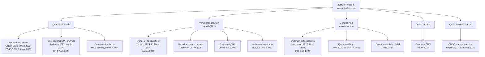
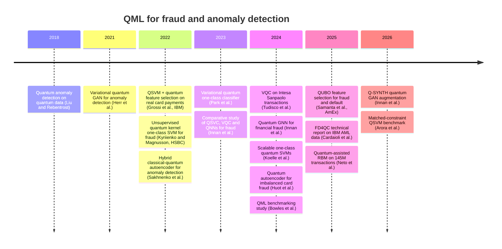
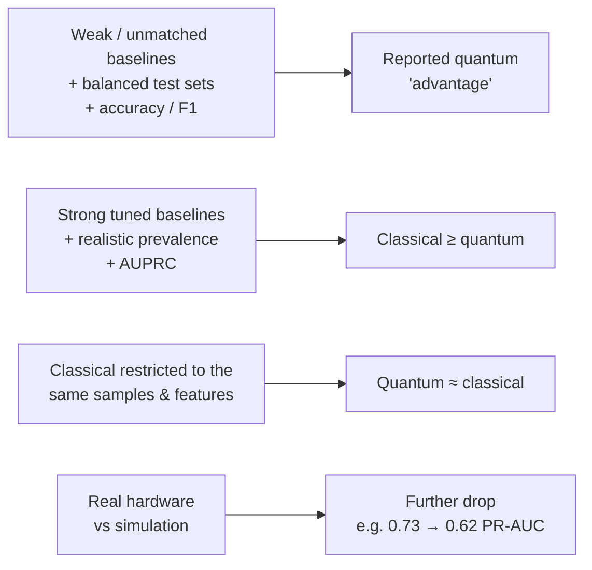
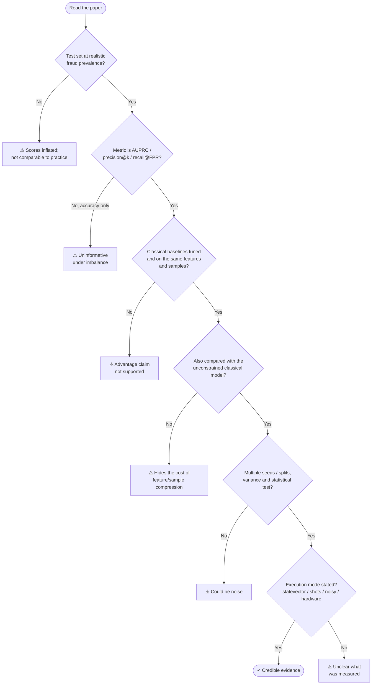

# 05 · QML for Anomaly & Fraud Detection — Literature Review

> **Goal of this document:** map the published work on Quantum Machine Learning applied to fraud detection and anomaly detection: which approaches have been tried, on which data, against which baselines, with which results, and how much each result can be trusted. It ends with the **research gaps** a master thesis can target.
>
> Prerequisites: [03 · Fraud detection](03-fraud-detection.md) and [04 · QML foundations](04-qml-foundations.md).

> **How this review was compiled (October 2026):** searches on arXiv, IEEE Xplore, Google Scholar-indexed venues and publisher pages for *quantum* + *fraud* / *anomaly detection* / *AML*, followed by reading abstracts and, for the key papers, the full text. Each entry below states what the authors claim. **Numbers come from abstracts unless marked otherwise.** Read the full paper before quoting any number in the thesis, and re-run the search before submission, because this field publishes monthly.

---

## Table of contents

1. [Overview](#1-overview)
2. [Supervised quantum kernel methods](#2-supervised-quantum-kernel-methods)
3. [Unsupervised and one-class quantum methods](#3-unsupervised-and-one-class-quantum-methods)
4. [Variational classifiers and hybrid quantum neural networks](#4-variational-classifiers-and-hybrid-quantum-neural-networks)
5. [Quantum autoencoders and generative models](#5-quantum-autoencoders-and-generative-models)
6. [Quantum graph models](#6-quantum-graph-models)
7. [Quantum optimisation for feature selection](#7-quantum-optimisation-for-feature-selection)
8. [Surveys and benchmarking studies](#8-surveys-and-benchmarking-studies)
9. [Master comparison table](#9-master-comparison-table)
10. [Cross-cutting findings](#10-cross-cutting-findings)
11. [How to assess a QML fraud paper](#11-how-to-assess-a-qml-fraud-paper)
12. [Research gaps and thesis opportunities](#12-research-gaps-and-thesis-opportunities)
13. [Recommended reading order](#13-recommended-reading-order)
14. [References](#14-references)

---

## 1. Overview

### 1.1 Taxonomy of approaches

### 1.2 Timeline

### 1.3 The literature in one paragraph

Work on QML for fraud began around 2021–22 with industrial collaborations (IBM with payment partners, HSBC, Intesa Sanpaolo) and has grown into a steady stream of mostly simulation-based papers. Nearly all experiments use **≤ 20 qubits**, **a few hundred to a few thousand samples**, and very often the **ULB credit-card dataset**. Papers reporting large gains usually compare against weak or unmatched baselines, or evaluate on balanced subsets with accuracy/F1. The most careful recent studies (Arora et al., 2026; the 2026 *Electronics* noise-robustness study; FD4QC, 2025) find that **quantum models do not beat well-tuned classical models**. At best they are **competitive when the classical model is restricted to the same tiny sample and feature budget**. The most interesting positive signal is in **unsupervised one-class quantum kernels** (Kyriienko & Magnusson, 2022), which has not yet been reproduced at realistic scale.

---

## 2. Supervised quantum kernel methods

### Grossi et al. (2022) — QSVM with quantum feature selection on real card payments
*IEEE Transactions on Quantum Engineering*, 3. IBM with IRIS Analytics. arXiv:2208.07963.

- **What:** end-to-end QSVM pipeline for card-payment fraud on **real transaction data** from IBM Safer Payments, run on IBM quantum hardware via Qiskit. Introduces a feature-selection method that exploits the QSVM feature map.
- **Baselines:** human rule-based decisions, Random Forest, XGBoost. Also a classical + quantum **ensemble**.
- **Claims:** results depend heavily on feature selection. The QSVM explores the feature space in a complementary way and the ensemble improves accuracy, **on a reduced dataset sized for current hardware**.
- **Why it matters:** the best-known industrial reference. It frames QML as a **complement** in an ensemble, not a replacement.

### Innan, Khan & Bennai (2023) — comparative study of four QML models
*International Journal of Quantum Information* (DOI 10.1142/S0219749923500442). arXiv:2308.05237.

- **What:** QSVC, VQC, Estimator QNN and Sampler QNN on a fraud dataset.
- **Claims:** QSVC best, with F1 ≈ 0.98 for both classes.
- **Caveat:** an F1 of 0.98 on both classes suggests a **balanced** evaluation set. Treat it as a model-comparison result within QML, not as evidence against classical methods.

### Metcalf, Andrés-Martínez & Fitzpatrick (2024) — quantum kernels at scale with MPS simulation
SC24. arXiv:2411.09336.

- **What:** matrix-product-state simulation of quantum kernels, used on a 165-feature classification task (the **Elliptic** Bitcoin AML data) with **6,400 training points**. CPU vs GPU benchmarking.
- **Claims:** kernel performance improves with feature dimension and training size.
- **Why it matters:** shows how to run quantum-kernel experiments **beyond statevector limits**, a practical tool for a thesis. Since MPS simulation is efficient only for limited entanglement, such kernels are also classically simulable, which you should discuss.

### Cardaioli et al. (2025) — FD4QC technical report
arXiv:2507.19402.

- **What:** behavioural feature engineering, then LogReg / DT / RF / XGBoost vs QSVM / VQC / hybrid QNN on the **IBM AML synthetic dataset**. Proposes a "classical-first, quantum-enhanced" system architecture with fallbacks.
- **Results:** **Random Forest best** (≈ 97.3 % accuracy, ≈ 87 % F-measure). Quantum models trail significantly. QSVM is the best quantum model (≈ 77 % precision, 1.36 % FPR) but has lower recall and a high compute cost.
- **Why it matters:** an honest negative result with good feature engineering, and a realistic architecture view.

### Arora, Swarnkar & Cherukuri (2026) — QSVM under matched NISQ constraints
arXiv:2610.17027 (preprint, October 2026).

- **What:** Angle, ZZ and IQP feature maps in QSVMs on ULB. SMOTE applied inside the Gram-matrix workflow. Best model also run on hardware.
- **Results (PR-AUC):** classical on full data with 30 features **0.983**. Classical restricted to 500 samples and 4 PCA features **0.750**. Best quantum (IQP, 150 samples) **0.730** simulated, **0.62** on hardware.
- **Why it matters:** the clearest demonstration of the **"matched-constraints" effect**. Quantum ≈ constrained classical, and both are far below the unconstrained classical model. The bottlenecks are Gram-matrix scaling and information loss from compressing to few qubits.

### *Electronics* (2026) — noise robustness of quantum kernels and VQCs for fraud
"Comparative Analysis and Noise Robustness Study of Quantum Kernel Methods and Variational Quantum Classifiers for Financial Fraud Detection", *Electronics* 15(11), 2489. DOI 10.3390/electronics15112489.

- **What (from the publisher abstract; full text not checked):** QSVM and VQC on the full ULB dataset with a noise-robustness study.
- **Results:** at 4 qubits, AUPRC **0.240 (QSVM)** and **0.494 (VQC)**, versus **0.68–0.74** for tuned classical models. No quantum advantage claimed.
- **Why it matters:** one of the few studies evaluating at **realistic prevalence** with AUPRC.

---

## 3. Unsupervised and one-class quantum methods

### Kyriienko & Magnusson (2022) — unsupervised QML for fraud detection
arXiv:2208.01203 (preprint). University of Exeter with HSBC. *Details below checked against the full text.*

- **Data:** ULB credit-card dataset, subsampled to **≈ 500 samples with 25 frauds (5 %)**. PCA to $N$ features = $N$ qubits, $N$ up to **20**.
- **Models:** IQP-style quantum kernel with **data re-uploading** ($d = 3$). Supervised QSVC and **unsupervised one-class SVM**. Classical baselines: logistic regression, RBF SVC, RBF one-class SVM. Metric: **average precision**.
- **Results:** unsupervised RBF OC-SVM saturates at **AP ≈ 0.55** around 15 features. Quantum OC-SVM reaches **AP ≈ 0.7 at 20 qubits** (≈ 15-point gap). Supervised quantum kernels reach AP ≈ 0.9 at 5–10 features, while RBF degrades beyond 10 features.
- **Caveats:** a single small subsample at 5 % prevalence, not 0.17 %. The RBF degradation with more features may reflect **bandwidth tuning** (see [04 §8.4](04-qml-foundations.md#84-exponential-concentration)). Only RBF baselines are reported for the unsupervised task (no Isolation Forest / ECOD).
- **Why it matters:** **the most cited positive result** in QML fraud detection, and the natural starting point for a reproduction study.

### Kölle et al. (2024) — efficient one-class quantum SVMs
ICAART 2024. arXiv:2312.09174.

- **What:** tackles the $O(n^2)$ kernel cost of quantum OC-SVMs with **randomized-measurement kernel estimation** and **variable-subsampling ensembles**.
- **Results:** up to 95 % less training time and 25 % less inference time. Randomized measurements gave higher AP than RBF, but **unstable across runs**.
- **Why it matters:** the main scalability lever for one-class quantum kernels.

### Park, Huh & Park (2023) — Variational Quantum One-Class Classifier (VQOCC)
*Machine Learning: Science and Technology*, 4, 015006. arXiv:2210.02674.

- Trains a PQC on normal data only. Comparable to OC-SVM and kernel PCA on MNIST / Fashion-MNIST, with parameters growing only logarithmically in data size. Not applied to fraud, which is an **open gap**.

### Oh & Park (2024) — Quantum Support Vector Data Description (QSVDD)
*Machine Learning: Science and Technology*, 5, 035052. arXiv:2310.06375.

- A shallow variational circuit learns a minimum-volume hypersphere around normal data (quantum Deep SVDD). It beats a quantum autoencoder and deep baselines on MNIST / Fashion-MNIST under similar training conditions. Also **not yet applied to fraud**.

### Wang, Jiang & Coveney (2025) — PEQAD on a superconducting processor
*Physical Review Research*, 7, 043094. arXiv:2412.16867.

- Parameter-efficient quantum anomaly detection on images. Over 90 % accuracy in emulation, and over 80 % on real hardware with only 16 parameters. A useful **hardware reference**, but on images.

### Background
- Liu & Rebentrost (2018), *Phys. Rev. A* 97 — quantum anomaly detection for **quantum** data (kernel PCA / one-class SVM on density matrices). Fault-tolerant, theoretical.

---

## 4. Variational classifiers and hybrid quantum neural networks

### Tudisco et al. (2024) — VQC on Intesa Sanpaolo transactions
*IEEE Access*, 12, 102918–102940. DOI 10.1109/ACCESS.2024.3432312. Politecnico di Torino with Intesa Sanpaolo.

- **Data:** **real bank transactions** (≈ 500k transactions, 15 features), reduced with PCA in both samples and features to fit simulators.
- **Baselines:** LogReg, RF, XGBoost, SVM, neural networks.
- **Claims:** better **recall**. The authors call the results preliminary but encouraging for highly unbalanced tasks.
- **Why it matters:** one of the few papers on **real, private bank data**, and an Italian industrial collaboration (possible contact point). Check whether recall gains hold at matched precision.

### El Alami, Innan, Shafique & Bennai (2024/25) — VQC vs Sampler QNN vs Estimator QNN
arXiv:2412.19441 (under review).

- Varies feature maps and ansätze on two fraud datasets. **VQC best (F1 ≈ 0.88)**, EQNN struggles. Statistical testing (ANOVA) and five noise models.
- **Why it matters:** a design-space exploration of encodings and ansätze within QML. It has no strong classical baseline.

### Abbou et al. (2025) — encoding and entanglement study for VQC
arXiv:2509.25245.

- Three encodings, several entanglement patterns and depths. ZZ encoding best (≈ 94.3 % accuracy). Circular entanglement (93.3 %) beats full (92.0 %) and linear (90.7 %).
- **Caveat:** reports **accuracy only**, which is uninformative under imbalance unless the data was balanced.

### Innan, Marchisio, Bennai & Shafique (2025) — QFNN-FFD, federated QNN
IEEE QSW 2025. arXiv:2404.02595.

- Quantum + **federated learning** for privacy-preserving fraud detection across clients. Precision consistently above 95 %, ≈ 80 % accuracy under noise.
- **Why it matters:** opens the **privacy / federated** angle, which matters for banks that cannot share data.

### Ubale et al. (2025) — hybrid quantum LSTM
arXiv:2505.00137.

- LSTM + variational circuit trained jointly (parameter-shift for quantum parameters) on sequential card data. Competitive improvements over a classical LSTM. No metric values in the abstract, and the data was balanced.
- **Why it matters:** the only line of work addressing the **sequential** nature of fraud.

---

## 5. Quantum autoencoders and generative models

| Paper | Model | Data | Claim | Notes |
|-------|-------|------|-------|-------|
| **Sakhnenko et al. (2022)**, *Quantum Machine Intelligence* 4(2), 27 | Classical AE with a **PQC in the bottleneck**, then a standard outlier detector | Benchmark AD datasets + gas-turbine predictive maintenance | PQC improves precision, recall and F1 over the classical AE; ansatz comparison | Hybrid design that is easy to reproduce on fraud data |
| **Huot et al. (2024)**, *IEEE Access* 12, 169671–169682 | **QAE-FD**: quantum autoencoder for fraud | Imbalanced credit-card dataset | G-mean 0.946, AUC 0.947 | Report AUPRC as well when reproducing |
| **El Alami et al. (2025)**, arXiv:2512.12689 | **FiD-QAE**: compress with a VQC, flag anomalies by **SWAP-test fidelity** | Credit-card fraud | Stable across imbalance levels; robust under noise; consistent on IBM hardware | No quantitative classical comparison in the abstract |
| **Herr, Obert & Rosenkranz (2021)**, *Quantum Sci. Technol.* 6(4) | Variational quantum **GAN** for anomaly detection (AnoGAN-style) | Synthetic / benchmark data | Proof of concept | Background for generative AD |
| **Innan et al. (2026)**, arXiv:2605.21164 | **Q-SYNTH**: PQC generator + classical discriminator for minority oversampling | Credit-card fraud (tabular) | Better distribution matching than a classical GAN; **classical GAN still gives the best downstream detection** in several settings, SMOTE best feature-wise similarity | Honest result: quantum generation helps fidelity, not detection |
| **Neto, Amaral & Temporão (2025)**, arXiv:2512.17660 | **Quantum-assisted RBM** (annealer sampling) | **≈ 145 M real transactions** from Stone (Brazilian fintech) | Better than classical in most figures of merit, even on noisy annealers | By far the largest real dataset in this literature. Check exactly which parts run on quantum hardware |

---

## 6. Quantum graph models

### Innan et al. (2024) — Quantum Graph Neural Networks for financial fraud
*Quantum Machine Intelligence*, 6, 7. DOI 10.1007/s42484-024-00143-6. arXiv:2309.01127.

- QGNN built from variational circuits, compared with classical GNNs on a real financial fraud dataset. Reported **AUC 0.85**, above the classical GNNs tested.
- **Caveats:** check the strength of the classical GNN baselines (CARE-GNN / PC-GNN / GraphSAGE with tuning) and whether AUPRC is reported.
- **Gap:** no QML work found on **Elliptic / IBM AML graphs** with graph-native quantum models and strong GNN baselines. That is a possible thesis direction (see [§12](#12-research-gaps-and-thesis-opportunities)).

---

## 7. Quantum optimisation for feature selection

| Paper | Method | Data | Claim |
|-------|--------|------|-------|
| **Grossi et al. (2022)**, *IEEE TQE* | Feature selection driven by QSVM feature-map properties | Real card payments | Results depend heavily on the selected features |
| **Samanta et al. (2025)**, *AAAI Symposium Series* 7(1), 390–397 (American Express) | **Parametric QUBO feature selection** solved on quantum annealers | Fraud and credit-default data | Quantum feature selection consistently better than the classical methods tested |
| **Long & Liang (2025)**, arXiv:2509.11110 | QUBO feature selection by annealing + QNN | German Credit (credit risk, not fraud) | Adjacent domain; useful for method design |

**Why this matters for a thesis:** feature selection is the step where every QML pipeline is forced to compress to $q$ features. A QUBO formulation (see [04 §9](04-qml-foundations.md#9-other-qml-models)) is easy to build, can run on D-Wave / QAOA / simulated annealing, and is directly comparable to classical selectors (mutual information, mRMR, L1, SHAP-based). Any claimed advantage must be checked against **classical solvers of the same QUBO** (simulated annealing, Gurobi), since otherwise the gain may come from the formulation rather than the quantum solver.

---

## 8. Surveys and benchmarking studies

| Reference | Type | Use it for |
|-----------|------|------------|
| Egger et al. (2020), *IEEE TQE* 1 | Survey: quantum computing for finance | Context, IBM perspective |
| Herman et al. (2023), *Nature Reviews Physics* 5 | Survey: quantum computing for finance | Authoritative overview incl. ML and fraud |
| Doosti et al. (2026), *Mach. Learn.: Sci. Technol.* 7, 021002 (arXiv:2407.12618) | Brief review of QML for financial services | Recent, covers fraud, credit scoring, risk |
| **Bowles, Ahmed & Schuld (2024)**, arXiv:2403.07059 | Benchmark: 12 QML models × 160 datasets | **Mandatory.** Classical models generally win; removing entanglement often does not hurt |
| Belghachi (2024), SSRN 4792054 | Survey of QML algorithms for fraud | Quick overview (not peer-reviewed) |

---

## 9. Master comparison table

| Paper | Year | Task | Quantum model | Data | Train size | Qubits | Metric(s) | Classical baseline | Reported outcome |
|-------|------|------|---------------|------|-----------|--------|-----------|--------------------|------------------|
| Grossi et al. | 2022 | Supervised | QSVM + quantum FS | Real card payments (IBM Safer Payments) | Reduced | small (hardware) | Acc, recall, FPR | RF, XGBoost, rules | Complementary; ensemble helps |
| Kyriienko & Magnusson | 2022 | Unsupervised + supervised | IQP re-uploading kernel, OC-SVM / SVC | ULB | ≈ 500 (5 % fraud) | up to 20 | AP | RBF SVC / OC-SVM, LogReg | **Quantum OC-SVM AP ≈ 0.70 vs 0.55** |
| Innan, Khan & Bennai | 2023 | Supervised | QSVC, VQC, QNNs | Fraud dataset | small | small | F1 | — | QSVC F1 ≈ 0.98 |
| Tudisco et al. | 2024 | Supervised | VQC | Intesa Sanpaolo (real) | Reduced from 500k | small | Recall etc. | LR, RF, XGB, SVM, NN | Better recall (preliminary) |
| Innan et al. | 2024 | Graph | QGNN | Real financial fraud | — | small | AUC | Classical GNNs | AUC 0.85, above GNNs |
| Huot et al. | 2024 | Unsupervised | Quantum AE | Imbalanced credit card | — | small | G-mean, AUC | — | G-mean 0.946, AUC 0.947 |
| Kölle et al. | 2024 | Unsupervised | OC-SVM, randomized-measurement kernels | Fraud / AD data | — | — | AP, runtime | RBF OC-SVM | Faster; AP higher but unstable |
| Metcalf et al. | 2024 | Supervised | MPS-simulated kernel | Elliptic | 6,400 | 165 features | — | — | Scales; improves with size |
| El Alami et al. | 2024/25 | Supervised | VQC, SQNN, EQNN | 2 fraud datasets | — | small | F1 | — | VQC F1 ≈ 0.88 |
| Samanta et al. | 2025 | Feature selection | QUBO on annealer | Fraud + default | — | annealer | Downstream perf. | Classical FS | Quantum FS better |
| Cardaioli et al. (FD4QC) | 2025 | Supervised | QSVM, VQC, HQNN | IBM AML | — | small | Acc, F, precision, FPR | LR, DT, **RF**, XGB | **Classical much better** |
| Abbou et al. | 2025 | Supervised | VQC (encoding study) | Fraud dataset | — | small | Accuracy | — | 94.3 % acc (ZZ) |
| Neto et al. | 2025 | Supervised / generative | Quantum-assisted RBM | **145M real tx** (Stone) | large | annealer | Several | Classical | Better in most metrics |
| *Electronics* study | 2026 | Supervised | QSVM, VQC + noise | ULB (full) | — | 4 | **AUPRC** | Tuned classical | **0.24 / 0.49 vs 0.68–0.74** |
| Innan et al. (Q-SYNTH) | 2026 | Oversampling | Quantum GAN generator | Credit card | — | small | KS, Wasserstein, downstream | GAN, SMOTE | Better fidelity; GAN better downstream |
| Arora et al. | 2026 | Supervised | QSVM (Angle/ZZ/IQP) + hardware | ULB | 150 | ≈ 4 | **PR-AUC** | Matched + full classical | **0.73 (sim), 0.62 (hw) vs 0.75 matched / 0.98 full** |

"—" = not reported in the abstract or not checked. Fill these cells in from the full texts as you read them.

---

## 10. Cross-cutting findings

1. **The evaluation regime decides the conclusion.** Papers with balanced subsets and accuracy/F1 report near-perfect quantum scores. Papers with realistic prevalence and AUPRC report quantum models well below tuned classical ones.
2. **"Matched constraints" is the fair comparison, and also the limit.** With 4 features and ~150–500 samples, quantum ≈ classical. But that regime throws away most of the signal: the full classical model is at 0.98 PR-AUC on ULB.
3. **Unsupervised one-class quantum kernels are the most promising line.** The only sizeable positive gap on a credible metric (AP) is Kyriienko & Magnusson's quantum OC-SVM. It has not been reproduced at true prevalence, with tuned bandwidth, or against Isolation Forest / ECOD.
4. **Feature compression is the main bottleneck,** more than the model. Grossi et al. and Arora et al. both point to feature selection / compression as decisive, which motivates work on **quantum or QUBO feature selection** and on **encodings that fit more features per qubit**.
5. **Scalability limits everything.** $O(n^2)$ Gram matrices restrict training to hundreds to thousands of points. Randomized measurements, subsampling ensembles (Kölle et al.) and MPS simulation (Metcalf et al.) are the mitigations.
6. **Hardware results are rare and worse.** Few papers run on real devices. When they do, performance drops (Arora et al.) or the tasks are tiny.
7. **Reproducibility is weak.** Many papers lack code, seeds, exact subsampling procedures or hyperparameter search details.
8. **Industrial data is the exception.** Grossi (IBM Safer Payments), Tudisco (Intesa Sanpaolo) and Neto (Stone) use real data. Most others use ULB, which has anonymised PCA features and covers only 2 days, so there is no drift and no out-of-time evaluation.

---

## 11. How to assess a QML fraud paper

Use this checklist on every paper you read. Record the answers in the comparison table.

Extra questions:

- Was preprocessing (scaling, PCA, SMOTE) fit **on training data only**?
- Was the **bandwidth / feature scaling** of the quantum kernel tuned, and the RBF $\gamma$ tuned too?
- Is the split **temporal**, or at least stratified and repeated?
- Is code available? Are package versions given?
- Does the paper discuss **classical simulability** of the proposed circuit?

---

## 12. Research gaps and thesis opportunities

| # | Gap in the literature | Possible thesis research question | Difficulty |
|---|-----------------------|-----------------------------------|-----------|
| G1 | The headline positive result (quantum OC-SVM, Kyriienko & Magnusson 2022) has not been independently reproduced at realistic prevalence | *Does the quantum one-class SVM advantage survive true prevalence, tuned bandwidth, multiple subsamples and strong unsupervised baselines (IForest, ECOD, AE)?* | ★★ — **strong default choice** |
| G2 | Variational one-class models (VQOCC, QSVDD) have only been tested on images | *Do VQOCC / QSVDD transfer to tabular fraud data, and how do they compare with quantum-kernel OC-SVM and Deep SVDD?* | ★★ |
| G3 | Few studies report **concentration / trainability diagnostics** alongside fraud results | *How do kernel concentration, bandwidth and qubit count jointly determine fraud-detection performance?* (geometric difference, kernel variance, alignment) | ★★ |
| G4 | Almost no **out-of-time / drift** evaluation (ULB covers 2 days) | *Are quantum kernel models more or less robust to concept drift than classical ones?* Use the Le Borgne simulator or BAF | ★★★ |
| G5 | Feature selection is decisive but rarely compared fairly | *Does QUBO feature selection (annealing / QAOA) beat classical selectors and classical QUBO solvers for downstream fraud detection, quantum or classical?* | ★★ |
| G6 | Quantum scores are rarely used as **features inside a strong classical model** | *Does adding a quantum-kernel or QAE anomaly score as a feature to a GBDT improve AUPRC?* (hybrid, Grossi-style ensembles) | ★ |
| G7 | Graph-native QML on **Elliptic / IBM AML** with strong GNN baselines is missing | *Can quantum graph kernels / QGNNs match tuned GraphSAGE / CARE-GNN on AML graphs?* | ★★★ |
| G8 | Little work on **explainability** of quantum fraud models | *Can SHAP / kernel-based attribution explain quantum fraud scores, and do explanations match classical ones?* | ★★ |
| G9 | Hardware evaluation is rare | *How much does real-hardware noise degrade quantum fraud detectors, and does error mitigation recover it?* | ★★ (depends on access) |

**A possible thesis combining G1 + G3 (+ G6 as an extension):**
reproduce and extend the unsupervised quantum-kernel OC-SVM for fraud with a rigorous protocol (true prevalence, AUPRC/precision@k, tuned bandwidths, strong baselines, multiple seeds). Analyse *why* it works or fails through concentration diagnostics, and test whether the quantum score adds value inside a classical GBDT. Doc **06** will turn this into a concrete benchmarking protocol.

---

## 13. Recommended reading order

1. **Bowles, Ahmed & Schuld (2024)**: how to benchmark QML honestly.
2. **Kyriienko & Magnusson (2022)**: the key positive result for unsupervised fraud detection.
3. **Arora, Swarnkar & Cherukuri (2026)**: matched-constraint QSVM benchmark on ULB.
4. **Grossi et al. (2022)**: industrial QSVM pipeline + feature selection.
5. **Tudisco et al. (2024)**: VQC on real Intesa Sanpaolo data.
6. **Kölle et al. (2024)**: making one-class quantum kernels scale.
7. **Cardaioli et al. (2025), FD4QC**: negative result with good feature engineering on AML data.
8. **Oh & Park (2024)** and **Park, Huh & Park (2023)**: variational one-class models.
9. **Sakhnenko et al. (2022)**: hybrid quantum autoencoder for AD.
10. **Innan et al. (2024)**: QGNN for fraud.
11. **Herman et al. (2023)**: quantum finance survey, for the introduction chapter.

---

## 14. References

**Quantum kernels (supervised)**
- Grossi, M., Ibrahim, N., Radescu, V., Loredo, R., Voigt, K., von Altrock, C., & Rudnik, A. (2022). Mixed Quantum–Classical Method for Fraud Detection With Quantum Feature Selection. *IEEE Transactions on Quantum Engineering*, 3. DOI [10.1109/TQE.2022.3213474](https://doi.org/10.1109/TQE.2022.3213474) · [arXiv:2208.07963](https://arxiv.org/abs/2208.07963)
- Innan, N., Khan, M. A.-Z., & Bennai, M. (2023). Financial Fraud Detection: A Comparative Study of Quantum Machine Learning Models. *International Journal of Quantum Information*. DOI [10.1142/S0219749923500442](https://doi.org/10.1142/S0219749923500442) · [arXiv:2308.05237](https://arxiv.org/abs/2308.05237)
- Metcalf, M., Andrés-Martínez, P., & Fitzpatrick, N. (2024). Realizing Quantum Kernel Models at Scale with Matrix Product State Simulation. *SC24*. [arXiv:2411.09336](https://arxiv.org/abs/2411.09336)
- Cardaioli, M. et al. (2025). FD4QC: Application of Classical and Quantum-Hybrid Machine Learning for Financial Fraud Detection — A Technical Report. [arXiv:2507.19402](https://arxiv.org/abs/2507.19402)
- Arora, H., Swarnkar, M., & Cherukuri, A. K. (2026). Benchmarking Quantum Kernel SVMs for Credit Card Fraud Detection: Performance Realities Under NISQ Constraints. [arXiv:2610.17027](https://arxiv.org/abs/2610.17027)
- Comparative Analysis and Noise Robustness Study of Quantum Kernel Methods and Variational Quantum Classifiers for Financial Fraud Detection (2026). *Electronics*, 15(11), 2489. DOI [10.3390/electronics15112489](https://doi.org/10.3390/electronics15112489) — *authors to be added from the publisher page*

**Unsupervised / one-class**
- Kyriienko, O., & Magnusson, E. B. (2022). Unsupervised quantum machine learning for fraud detection. [arXiv:2208.01203](https://arxiv.org/abs/2208.01203)
- Kölle, M., Ahouzi, A., Debus, P., Müller, R., Schuman, D., & Linnhoff-Popien, C. (2024). Towards Efficient Quantum Anomaly Detection: One-Class SVMs using Variable Subsampling and Randomized Measurements. *ICAART 2024*. [arXiv:2312.09174](https://arxiv.org/abs/2312.09174)
- Park, G., Huh, J., & Park, D. K. (2023). Variational quantum one-class classifier. *Machine Learning: Science and Technology*, 4, 015006. [arXiv:2210.02674](https://arxiv.org/abs/2210.02674)
- Oh, H., & Park, D. K. (2024). Quantum support vector data description for anomaly detection. *Machine Learning: Science and Technology*, 5, 035052. DOI [10.1088/2632-2153/ad6be8](https://doi.org/10.1088/2632-2153/ad6be8) · [arXiv:2310.06375](https://arxiv.org/abs/2310.06375)
- Wang, M., Jiang, J., & Coveney, P. V. (2025). A Parameter-Efficient Quantum Anomaly Detection Method on a Superconducting Quantum Processor. *Physical Review Research*, 7, 043094. [arXiv:2412.16867](https://arxiv.org/abs/2412.16867)
- Liu, N., & Rebentrost, P. (2018). Quantum machine learning for quantum anomaly detection. *Physical Review A*, 97.

**Variational / hybrid QNNs**
- Tudisco, A. et al. (2024). Evaluating the Computational Advantages of the Variational Quantum Circuit Model in Financial Fraud Detection. *IEEE Access*, 12, 102918–102940. DOI [10.1109/ACCESS.2024.3432312](https://doi.org/10.1109/ACCESS.2024.3432312)
- El Alami, M., Innan, N., Shafique, M., & Bennai, M. (2024). Comparative Performance Analysis of Quantum Machine Learning Architectures for Credit Card Fraud Detection. [arXiv:2412.19441](https://arxiv.org/abs/2412.19441)
- Abbou, F. M. et al. (2025). Comprehensive Analysis of VQC for Financial Fraud Detection: A Comparative Study of Quantum Encoding Techniques and Architectural Optimizations. [arXiv:2509.25245](https://arxiv.org/abs/2509.25245)
- Innan, N., Marchisio, A., Bennai, M., & Shafique, M. (2025). QFNN-FFD: Quantum Federated Neural Network for Financial Fraud Detection. *IEEE QSW 2025*. DOI [10.1109/QSW67625.2025.00015](https://doi.org/10.1109/QSW67625.2025.00015) · [arXiv:2404.02595](https://arxiv.org/abs/2404.02595)
- Ubale, R., K.K., S., Deshpande, S., & Byrd, G. T. (2025). Toward Practical Quantum Machine Learning: A Novel Hybrid Quantum LSTM for Fraud Detection. [arXiv:2505.00137](https://arxiv.org/abs/2505.00137)

**Autoencoders and generative models**
- Sakhnenko, A. et al. (2022). Hybrid classical–quantum autoencoder for anomaly detection. *Quantum Machine Intelligence*, 4(2), 27. [arXiv:2112.08869](https://arxiv.org/abs/2112.08869)
- Huot, C., Heng, S., Kim, T.-K., & Han, Y. (2024). Quantum Autoencoder for Enhanced Fraud Detection in Imbalanced Credit Card Dataset. *IEEE Access*, 12, 169671–169682. DOI [10.1109/ACCESS.2024.3496901](https://doi.org/10.1109/ACCESS.2024.3496901)
- El Alami, M., Innan, A., Innan, N., Shafique, M., & Bennai, M. (2025). FiD-QAE: A Fidelity-Driven Quantum Autoencoder for Credit Card Fraud Detection. [arXiv:2512.12689](https://arxiv.org/abs/2512.12689)
- Herr, D., Obert, B., & Rosenkranz, M. (2021). Anomaly detection with variational quantum generative adversarial networks. *Quantum Science and Technology*, 6(4).
- Innan, A., El Alami, M., Innan, N., Shafique, M., & Bennai, M. (2026). Q-SYNTH: Hybrid Quantum-Classical Adversarial Augmentation for Imbalanced Fraud Detection. [arXiv:2605.21164](https://arxiv.org/abs/2605.21164)
- Cavalcanti de Albuquerque Neto, J. M., do Amaral, G. C., & Temporão, G. P. (2025). Fraud detection in credit card transactions using Quantum-Assisted Restricted Boltzmann Machines. [arXiv:2512.17660](https://arxiv.org/abs/2512.17660)

**Graph**
- Innan, N. et al. (2024). Financial fraud detection using quantum graph neural networks. *Quantum Machine Intelligence*, 6, 7. DOI [10.1007/s42484-024-00143-6](https://doi.org/10.1007/s42484-024-00143-6) · [arXiv:2309.01127](https://arxiv.org/abs/2309.01127)

**Feature selection / optimisation**
- Samanta, et al. (2025). Parametric Quantum Feature Selection Methods for Fraud and Default Detection. *Proceedings of the AAAI Symposium Series*, 7(1), 390–397. DOI [10.1609/aaaiss.v7i1.36910](https://doi.org/10.1609/aaaiss.v7i1.36910)
- Long & Liang (2025). A Collaborative Framework for Quantum Optimisation and Quantum Neural Networks: Credit Feature Selection and Image Classification. [arXiv:2509.11110](https://arxiv.org/abs/2509.11110)

**Surveys and benchmarking**
- Bowles, J., Ahmed, S., & Schuld, M. (2024). Better than classical? The subtle art of benchmarking quantum machine learning models. [arXiv:2403.07059](https://arxiv.org/abs/2403.07059)
- Herman, D. et al. (2023). Quantum computing for finance. *Nature Reviews Physics*, 5.
- Egger, D. J. et al. (2020). Quantum Computing for Finance: State-of-the-Art and Future Prospects. *IEEE Transactions on Quantum Engineering*, 1.
- Doosti, M., Wallden, P., Hamill, C. B., Hankache, R., Brown, O. T., & Heunen, C. (2026). A Brief Review of Quantum Machine Learning for Financial Services. *Machine Learning: Science and Technology*, 7, 021002. [arXiv:2407.12618](https://arxiv.org/abs/2407.12618)
- Belghachi, M. (2024). A Comprehensive Survey on Quantum Machine Learning Algorithms for Fraud Detection in Financial Sectors. SSRN 4792054.
