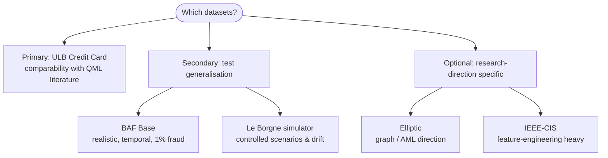
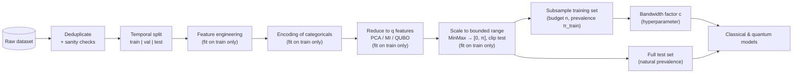
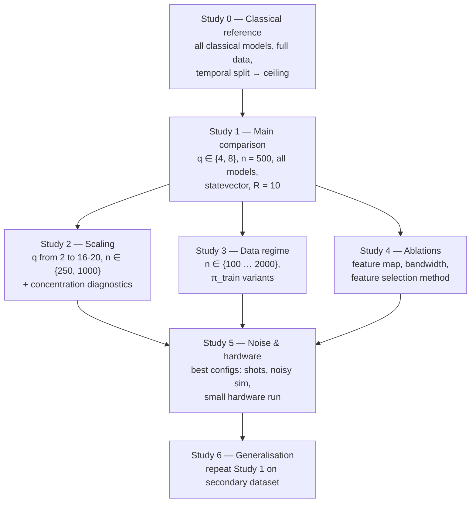
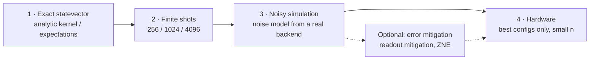

# 06 · Datasets & Benchmarking Protocol

> **Goal of this document:** turn the lessons from [03](03-fraud-detection.md), [04](04-qml-foundations.md) and [05](05-qml-fraud-literature-review.md) into a **concrete, defensible experimental protocol** for comparing quantum and classical fraud detectors: which datasets to use and how to prepare them, how to subsample under qubit and compute budgets without distorting results, which baselines and hyperparameter grids to run, which metrics and statistical tests to report, and how to keep everything reproducible.
>
> The protocol is designed to avoid every weakness listed in the [05 §11 checklist](05-qml-fraud-literature-review.md#11-how-to-assess-a-qml-fraud-paper).

---

## Table of contents

1. [Design principles](#1-design-principles)
2. [Dataset selection](#2-dataset-selection)
3. [Dataset cards](#3-dataset-cards)
4. [Data preparation pipeline](#4-data-preparation-pipeline)
5. [Subsampling under quantum budgets](#5-subsampling-under-quantum-budgets)
6. [Models and hyperparameter grids](#6-models-and-hyperparameter-grids)
7. [Experimental factors and experiment matrix](#7-experimental-factors-and-experiment-matrix)
8. [Metrics](#8-metrics)
9. [Diagnostics](#9-diagnostics)
10. [Statistical analysis](#10-statistical-analysis)
11. [Execution modes and noise](#11-execution-modes-and-noise)
12. [Compute budget](#12-compute-budget)
13. [Reproducibility](#13-reproducibility)
14. [Reference implementation snippets](#14-reference-implementation-snippets)
15. [Pre-registration template](#15-pre-registration-template)
16. [References](#16-references)

---

## 1. Design principles

| # | Principle | Concretely |
|---|-----------|-----------|
| P1 | **Same inputs for everyone** | Classical and quantum models see the same samples, the same reduced features and the same scaling |
| P2 | **Report both matched and unconstrained baselines** | Classical models on the quantum budget (fair comparison) *and* on the full data (practical ceiling) |
| P3 | **Evaluate at realistic prevalence** | Training may be enriched or balanced. The test set always reflects the natural fraud rate, or is reweighted to it |
| P4 | **Precision-oriented metrics** | Primary metric AUPRC. Accuracy is never a headline metric |
| P5 | **Equal tuning effort** | Same number of hyperparameter configurations per model family, tuned on validation data only |
| P6 | **Time-aware splits** | Train on the past, test on the future where timestamps exist |
| P7 | **Repetition and statistics** | ≥ 10 repetitions (subsamples × seeds), confidence intervals, paired tests |
| P8 | **Separate model quality from hardware effects** | Exact statevector → shots → noisy simulation → hardware, reported separately |
| P9 | **Explain, not just rank** | Log diagnostics (kernel concentration, alignment, geometric difference) that explain *why* results look the way they do |
| P10 | **Fix the plan before looking at test results** | Write hypotheses, metrics and grids down first ([§15](#15-pre-registration-template)) |

---

## 2. Dataset selection



| Role | Dataset | Why |
|------|---------|-----|
| **Primary** | ULB Credit Card Fraud | Used by almost every QML fraud paper ([05 §9](05-qml-fraud-literature-review.md#9-master-comparison-table)), so results are directly comparable. Already PCA-reduced, so it fits small qubit budgets |
| **Secondary (pick ≥ 1)** | BAF (Bank Account Fraud), *Base* variant | Realistic, recent, temporal split by month, mixed feature types, fairness attributes |
| | Le Borgne & Bontempi transaction simulator | You control prevalence, fraud scenarios and drift; raw fields allow real feature engineering |
| **Optional** | Elliptic | Only if the thesis includes graph models |
| | IEEE-CIS | Only if feature engineering is a focus; heavy preprocessing |

Avoid using **PaySim** as a main dataset: its balance fields make fraud almost trivially separable, which hides differences between models.

---

## 3. Dataset cards

### 3.1 ULB Credit Card Fraud (primary)

| Field | Value |
|-------|-------|
| Source | Kaggle *Credit Card Fraud Detection* (ULB Machine Learning Group, Worldline). Dal Pozzolo et al., 2015 |
| Content | European cardholders, 2 days of September 2013 |
| Size | 284,807 transactions, **492 frauds (0.172 %)** |
| Features | `Time` (seconds since first transaction, spanning ≈ 48 h), `Amount`, `V1`–`V28` (PCA components of confidential original features), `Class` (1 = fraud) |
| Licence | Check the Kaggle page and cite the required papers |
| Known issues | (1) PCA was fit by the providers on the full data, which is a mild unavoidable leakage; state it. (2) Contains duplicate rows; deduplicate or make sure duplicates do not straddle train/test. (3) Only 2 days, so no real drift; out-of-time testing is weak but still better than random |
| Recommended split | **Temporal**: first ≈ 70 % of `Time` → train/validation (with the last part of it as validation), remaining ≈ 30 % → test. Expect on the order of 150 test frauds; report the exact counts |
| Feature budget | `V1`…`V28` are ordered by explained variance of the original PCA, so "first $q$ components" is a natural reduction. Also compare against supervised selection (mutual information) fit on train only. `Amount` needs a log transform; `Time` → hour-of-day if used |

### 3.2 BAF — Bank Account Fraud, *Base* variant (secondary)

| Field | Value |
|-------|-------|
| Source | Jesus et al., NeurIPS 2022 Datasets & Benchmarks (Feedzai). Available on Kaggle / GitHub |
| Content | Synthetic but realistic bank **account-opening applications**, generated from a real dataset with privacy protection |
| Size | 1,000,000 rows per variant (Base + 5 biased variants) |
| Prevalence | ≈ 1 % fraud (`fraud_bool`) |
| Features | ≈ 30: numeric (income, velocity features, credit risk score…), categorical (payment type, employment status, housing status, OS, source…), protected attributes (age group, …), `month` (0–7) |
| Recommended split | **Temporal by `month`**: months 0–5 train/validation, months 6–7 test (the split used in the BAF paper) |
| Notes | Categorical features must be encoded (one-hot / target encoding fit on train) before reducing to $q$ features. A natural testbed for fairness metrics (e.g. FPR parity across age groups) as an extension |

### 3.3 Le Borgne & Bontempi simulator (secondary)

| Field | Value |
|-------|-------|
| Source | *Reproducible Machine Learning for Credit Card Fraud Detection — Practical Handbook* (ULB, 2022), simulator chapter. Open-source Python code |
| Content | Customers and terminals with spatial locations and spending profiles; transactions generated day by day; injected fraud scenarios (e.g. high amounts, compromised terminals, compromised customers) |
| Size / prevalence | Configurable (e.g. 5,000 customers, 10,000 terminals, 6 months) |
| Advantages | Raw fields → you build the **behavioural features** of [03 §5](03-fraud-detection.md#5-feature-engineering) with point-in-time windows. You can **inject drift** (change scenarios mid-stream) to test robustness (gap G4 in [05 §12](05-qml-fraud-literature-review.md#12-research-gaps-and-thesis-opportunities)) |
| Recommended split | Rolling: train weeks $[t-w, t)$, **delay of 1 week**, test week $t+1$ (as in the handbook) |

### 3.4 Elliptic (optional, graph direction)

| Field | Value |
|-------|-------|
| Source | Weber et al., 2019 (Elliptic, MIT-IBM). Kaggle |
| Content | Bitcoin transaction graph: 203,769 nodes, 234,355 edges, 49 time steps |
| Labels | ≈ 2 % illicit, ≈ 21 % licit, rest unknown |
| Features | 166 per node (94 local + 72 aggregated neighbourhood features) |
| Recommended split | Time steps 1–34 train, 35–49 test (Weber et al.). Use labelled nodes only for evaluation |
| Notes | A dark-market shutdown around time step 43 causes a sharp drift where all models fail. Report results before and after it separately |

---

## 4. Data preparation pipeline



Rules:

1. **Every fitted transformation is fit on the training portion only** and applied to validation/test. Wrap it in a scikit-learn `Pipeline` so this cannot be broken by accident.
2. **Split before subsampling.** Subsample only from the training period; never draw test points into training subsets.
3. **Clip** scaled test features to the training range so they stay inside the encoding's intended interval.
4. **The same reduced and scaled matrix** feeds both classical and quantum models (P1).
5. Keep the **unreduced** training data for the unconstrained classical baselines (P2).

---

## 5. Subsampling under quantum budgets

### 5.1 Why naive subsampling fails

With ULB prevalence (0.172 %), a random subsample of 500 training transactions contains on average **< 1 fraud**. Every QML paper has to choose how to deal with this, and that choice changes the results. Make it an explicit, reported part of the protocol.

### 5.2 Training-set strategies

| Setting | Training sample | Fraud rate in training | Use for |
|---------|-----------------|------------------------|---------|
| **One-class (unsupervised / novelty)** | $n$ genuine transactions only (or $n$ unlabelled with natural contamination) | 0 % (or natural) | OC-SVM (classical & quantum), IForest, AE, QSVDD. **No prevalence distortion in training**, which is a structural advantage |
| **Enriched supervised** | All available train frauds up to $n \cdot \pi_{\text{train}}$, plus genuine to fill $n$ | $\pi_{\text{train}} \in \{5\%, 10\%, 50\%\}$ | QSVM, VQC and classical supervised baselines |
| **Unconstrained classical** | Full training period | natural | Ceiling reference (P2) |

Draw **$R \geq 10$ independent subsamples** per configuration (different seeds), stratified by class, and reuse the *same* subsamples for all models (paired design, [§10](#10-statistical-analysis)).

### 5.3 Test-set strategies

| Option | How | When |
|--------|-----|------|
| **A — Full test set** | Score every test transaction | Preferred. Feasible for statevector simulation with $q \lesssim 12$ and batching ([§12](#12-compute-budget)) |
| **B — Negative subsampling + reweighting** | Keep **all** test frauds and a random fraction $r$ of genuine transactions; weight each kept genuine by $1/r$ when computing metrics | When full scoring is too expensive (shots, noisy sim, hardware). Gives unbiased estimates of precision-based metrics at natural prevalence |
| ~~C — Balanced test set~~ | 50/50 test subset, unweighted | **Do not use** for headline results; it inflates precision and AUPRC |

With option B, use the **same kept test indices** for all models, and repeat with different negative subsamples to capture the extra variance.

---

## 6. Models and hyperparameter grids

Use the same tuning budget per model family (e.g. full grid or a fixed number of Optuna trials), with selection on the **validation period** by AUPRC.

### 6.1 Classical baselines

| Model | Library | Grid (suggested) |
|-------|---------|------------------|
| Logistic regression | scikit-learn | $C \in \{10^{-3}, \dots, 10^{2}\}$, `class_weight` ∈ {None, balanced} |
| SVM, RBF kernel | scikit-learn `SVC` | $C \in \{0.1, 1, 10, 100\}$, $\gamma \in \{10^{-3}, \dots, 10\}$ (log grid), `class_weight=balanced` |
| One-class SVM, RBF | `OneClassSVM` | $\nu \in \{0.01, 0.05, 0.1, 0.2\}$, $\gamma$ log grid |
| Random Forest | scikit-learn | trees ∈ {200, 500}, max_depth ∈ {None, 8, 16}, `class_weight` ∈ {None, balanced_subsample} |
| XGBoost / LightGBM | `xgboost`, `lightgbm` | learning rate {0.03, 0.1}, depth / leaves {3, 6, 31}, `scale_pos_weight` ∈ {1, ratio}, early stopping on validation |
| Isolation Forest | scikit-learn / PyOD | trees ∈ {100, 300}, max_samples ∈ {256, 1024, auto} |
| ECOD | PyOD | No hyperparameters |
| Autoencoder | PyOD / PyTorch | hidden sizes {[q, q/2], [2q, q/2]}, epochs with early stopping |
| TabPFN | `tabpfn` | Default (no tuning); only for $n \le$ its supported size |

### 6.2 Quantum models

| Model | Implementation | Grid (suggested) |
|-------|----------------|------------------|
| **QSVM, fidelity kernel** | PennyLane `qml.kernels` + `SVC(kernel="precomputed")` | Feature map ∈ {angle, IQP/ZZ, angle + entangling layer}; reps $L \in \{1, 2, 3\}$; **bandwidth** $c \in \{0.05, 0.1, 0.2, 0.5, 1.0\}$; $C \in \{0.1, 1, 10, 100\}$ |
| **QSVM, projected kernel** | Single-qubit reduced density matrices → RBF | Same feature maps; $\gamma$ log grid |
| **Quantum OC-SVM** | Fidelity / projected kernel + `OneClassSVM(kernel="precomputed")` | Same feature maps and $c$; $\nu \in \{0.01, 0.05, 0.1, 0.2\}$ |
| **VQC with re-uploading** | PennyLane + PyTorch / Adam | Layers $\{2, 4, 6\}$; local $Z_0$ observable; lr $\{0.01, 0.05\}$; class-weighted loss; early stopping on validation AUPRC |
| *(Optional)* QSVDD / VQOCC | PennyLane | Depth $\{1, 2, 3\}$; learning rate |

**Control model (important):** include the **angle-encoding product-state kernel** $k(x,x') = \prod_j \cos^2\!\big(\tfrac{c\,(x_j - x'_j)}{2}\big)$. It is a "quantum" kernel that is classically trivial, so if entangling feature maps do not beat it, entanglement is not helping (see Bowles et al., 2024).

---

## 7. Experimental factors and experiment matrix

| Factor | Levels | Purpose |
|--------|--------|---------|
| Dataset | ULB (+ BAF / simulator) | Generalisation |
| Qubits / features $q$ | {2, 4, 6, 8, 10, 12, (16, 20)} | Scaling; onset of concentration |
| Training size $n$ | {100, 250, 500, 1000, 2000} | Data-regime effect |
| Training prevalence $\pi_{\text{train}}$ | one-class; {5 %, 10 %, 50 %} for supervised | Sensitivity to the enrichment choice |
| Feature reduction | first-$q$ PCA; mutual information; (QUBO) | Effect of compression |
| Feature map | angle (control), IQP/ZZ, angle + entangler | Role of entanglement |
| Bandwidth $c$ | {0.05, …, 1.0} | Concentration vs simulability trade-off |
| Execution mode | statevector; shots {256, 1024, 4096}; noisy; hardware | Noise effects |
| Repetitions | $R \ge 10$ subsamples × seeds | Variance, statistics |

A full factorial is too large. Organise the work as **studies**, each varying one or two factors while holding the rest at a default:



---

## 8. Metrics

### 8.1 Primary and secondary metrics

| Role | Metric | Notes |
|------|--------|-------|
| **Primary** | **AUPRC (Average Precision)** at natural prevalence | Random baseline = prevalence (0.0017 on ULB). Report it next to every AUPRC |
| Secondary | Precision@k | $k$ = alert budget, e.g. $k$ = 100 or 0.1 % of test transactions |
| Secondary | Recall at FPR = 0.1 % and 1 % | Operational points |
| Secondary | ROC-AUC | For comparability with the literature, never alone |
| Secondary | F1 / MCC at the threshold chosen on **validation** | Never choose the threshold on test |
| Cost | Wall-clock time, # circuit evaluations, # shots | Needed to discuss practicality |
| Optional | Amount-weighted recall, cost savings ([03 §7](03-fraud-detection.md#71-cost-sensitive-learning)) | ULB has `Amount` |
| Optional | Calibration (Brier score, reliability diagram) | If scores are used as probabilities |

### 8.2 Reweighted metrics (test option B)

When genuine test transactions are subsampled at rate $r$, give weight $w_i = 1$ to frauds and $w_i = 1/r$ to kept genuine transactions. Weighted precision at threshold $t$:

$$
\mathrm{Prec}_w(t) = \frac{\sum_i w_i\, y_i\, \mathbb{1}[s_i > t]}{\sum_i w_i\, \mathbb{1}[s_i > t]}
$$

`sklearn.metrics.average_precision_score` and `precision_recall_curve` accept `sample_weight`, so this is a single argument ([§14.2](#142-reweighted-metrics)).

---

## 9. Diagnostics

Logged for every quantum configuration, and for the classical RBF kernel where applicable:

| Diagnostic | Definition | What it tells you |
|------------|-----------|-------------------|
| **Off-diagonal kernel variance** | $\mathrm{Var}_{i \ne j}[K_{ij}]$ | Exponential decay with $q$ means **concentration** ([04 §8.4](04-qml-foundations.md#84-exponential-concentration)) |
| Mean off-diagonal kernel value | $\mathbb{E}_{i\ne j}[K_{ij}]$ | Near 0 → kernel close to identity (memorisation). Near 1 → too smooth |
| **Kernel–target alignment** | $A(K, y)$ ([04 §8.4](04-qml-foundations.md#84-exponential-concentration)) | How well the kernel geometry matches the labels; useful for tuning $c$ |
| **Geometric difference** | $g(K_C \Vert K_Q) = \sqrt{\lVert \sqrt{K_Q}\, K_C^{-1} \sqrt{K_Q} \rVert_\infty}$ (Huang et al., 2021) | If $g$ is small, a classical kernel can match the quantum one on this data; a large $g$ is necessary (not sufficient) for a quantum advantage |
| Effective rank / spectrum of $K$ | Eigenvalue decay | Model capacity |
| Gradient variance (VQC) | $\mathrm{Var}[\partial_\theta \mathcal{L}]$ at initialisation vs $q$ | Barren plateaus |
| Shot-noise ratio | Std of estimated $K_{ij}$ / spread of true $K_{ij}$ | Whether the shot budget can resolve the kernel |

These diagnostics are what turn a leaderboard into an explanation (P9), and they answer the reviewer's question "why does it work or not work?".

---

## 10. Statistical analysis

### 10.1 Design

- **Paired:** every model is evaluated on the same $R$ subsamples/seeds, so comparisons are paired per repetition.
- **Uncertainty from two sources:** variation across training subsamples (repetitions), and finite test set (bootstrap over test transactions).

### 10.2 What to report

| Comparison | Procedure |
|------------|-----------|
| Single model | Mean ± std over $R$ repetitions; 95 % CI (bootstrap of the mean, or t-interval) |
| Test-set uncertainty | Stratified bootstrap of the test set (≥ 1,000 resamples) for one fixed model → CI on AUPRC |
| Two models, one dataset | **Wilcoxon signed-rank test** on the $R$ paired AUPRC differences; report the median difference and effect size |
| Many models, several settings/datasets | **Friedman test + Nemenyi post-hoc**, shown as a **critical-difference diagram** (Demšar, 2006) |
| Many comparisons | Holm–Bonferroni correction |
| "Equivalence" claims | Equivalence test (TOST) with a pre-declared margin, e.g. ±0.02 AUPRC. A non-significant difference is **not** evidence of equivalence |

### 10.3 Reporting format

Results table per study:

| Model | $q$ | $n$ | Mode | AUPRC (mean ± std) | 95 % CI | P@100 | Recall@0.1 %FPR | ROC-AUC | Time (s) | Circuits |
|-------|-----|-----|------|--------------------|---------|-------|------------------|---------|----------|----------|

Plus figures: AUPRC vs $q$ (one line per model, shaded CI); AUPRC vs $n$; kernel variance vs $q$ (log scale); PR curves of the best configurations; critical-difference diagram.

---

## 11. Execution modes and noise



- Run **all studies in mode 1**. Use modes 2–4 only for the best configurations from Studies 1–4 (Study 5).
- Noisy simulation: `qiskit-aer` noise models built from a real backend's calibration data (e.g. `NoiseModel.from_backend`), or PennyLane noise channels. Record the backend name and calibration date.
- Hardware: kernel experiments cost $O(n^2)$ circuits, so keep $n$ small (e.g. 50–150 training points) and use test option B. Record backend, date, transpiler optimisation level, qubit layout, shots and mitigation.
- Report the **drop from mode 1 to each later mode** as its own result.

---

## 12. Compute budget

Rough planning numbers for **statevector** simulation (order of magnitude; measure on your machine early):

| Item | Count | Example |
|------|-------|---------|
| Training Gram matrix | $n(n+1)/2$ kernel evaluations | $n = 1000$ → ≈ 500k |
| Test kernel matrix (option A) | $n_{\text{test}} \times n$ | ULB test ≈ 85k × 1000 → ≈ 85M |
| Test kernel matrix (option B, $r = 0.1$) | $\approx (0.1\, n_{\text{test}} + \#\text{frauds}) \times n$ | ≈ 8.5k × 1000 → ≈ 8.5M |
| Configurations | feature maps × $c$ × $q$ × $R$ | 3 × 5 × 2 × 10 = 300 Gram matrices for Study 1 |

Ways to keep it feasible:

1. **Compute states once, kernels as inner products.** For fidelity kernels in exact simulation, simulate $|\psi(x_i)\rangle$ once per point ($n + n_{\text{test}}$ simulations), then $K = |\Psi_{\text{test}}^\dagger \Psi_{\text{train}}|^2$ is one complex matrix multiplication. This is orders of magnitude faster than running $U^\dagger(x')U(x)$ circuits per pair, and mathematically identical in mode 1. With $q = 12$ (4,096 amplitudes), 100k states use ≈ 6.5 GB in complex128; batch if needed.
2. Reuse Gram matrices across $C$ / $\nu$ values (only the SVM is refit).
3. The OC-SVM needs only the **genuine** training points, and only support vectors matter at test time ($n_{\text{SV}} \ll n$).
4. Use GPU simulators for $q \gtrsim 16$, and MPS simulators (Metcalf et al., 2024) beyond statevector limits.
5. Run shot-based, noisy and hardware modes only on the best configurations.

---

## 13. Reproducibility

| Item | Practice |
|------|----------|
| Environment | `pyproject.toml` / `requirements.txt` with **exact pinned versions**; record Python, OS, CPU/GPU |
| Data | Store the dataset SHA-256 hash; never commit raw data; keep scripts that download and prepare it |
| Splits & subsamples | Save the **indices** of every split and subsample to disk (`.npy` / parquet) and reuse them |
| Seeds | One master seed per repetition, propagated to NumPy, PyTorch, PennyLane, scikit-learn |
| Configuration | One YAML config per experiment (e.g. Hydra); results reference the config hash |
| Tracking | MLflow or Weights & Biases: params, metrics, diagnostics, runtime, artefacts (PR curves, Gram matrices) |
| Results | Append-only results table (CSV/parquet), one row per (model, config, repetition) |
| Code | Public repository at submission; tag the commit used for the thesis results |

### Suggested repository layout

```text
fraud-detection/
├── docs/                    # this knowledge base
├── configs/                 # YAML experiment configs (one per study)
├── data/
│   ├── raw/                 # downloaded datasets (git-ignored)
│   └── processed/           # splits, subsample indices, hashes
├── src/qfd/
│   ├── data/                # loaders, splits, subsampling, preprocessing pipelines
│   ├── models/
│   │   ├── classical.py     # baselines
│   │   └── quantum/         # feature maps, kernels, VQC, OC-SVM wrappers
│   ├── eval/                # metrics (incl. reweighted), diagnostics, statistics
│   └── run.py               # entry point: config → results row
├── notebooks/               # exploration only, never the source of reported numbers
├── results/                 # results tables, figures
└── pyproject.toml
```

---

## 14. Reference implementation snippets

### 14.1 Temporal split and enriched subsampling (ULB)

```python
import numpy as np
import pandas as pd

def temporal_split(df: pd.DataFrame, train_frac=0.6, val_frac=0.1):
    df = df.drop_duplicates().sort_values("Time").reset_index(drop=True)
    t1, t2 = df["Time"].quantile([train_frac, train_frac + val_frac])
    return df[df.Time < t1], df[(df.Time >= t1) & (df.Time < t2)], df[df.Time >= t2]

def enriched_subsample(y: np.ndarray, n: int, fraud_rate: float, rng: np.random.Generator):
    """Indices of a training subsample of size n with the requested fraud rate."""
    pos, neg = np.flatnonzero(y == 1), np.flatnonzero(y == 0)
    n_pos = min(int(round(n * fraud_rate)), len(pos))
    idx = np.concatenate([rng.choice(pos, n_pos, replace=False),
                          rng.choice(neg, n - n_pos, replace=False)])
    return rng.permutation(idx)

def one_class_subsample(y: np.ndarray, n: int, rng: np.random.Generator):
    """Genuine-only training subsample for novelty detection."""
    return rng.choice(np.flatnonzero(y == 0), n, replace=False)
```

### 14.2 Reweighted metrics

```python
import numpy as np
from sklearn.metrics import average_precision_score, roc_auc_score

def negative_subsample_weights(y_test: np.ndarray, r: float, rng: np.random.Generator):
    """Keep all frauds and a fraction r of genuine; return kept indices and weights."""
    pos, neg = np.flatnonzero(y_test == 1), np.flatnonzero(y_test == 0)
    kept_neg = rng.choice(neg, int(round(r * len(neg))), replace=False)
    idx = np.concatenate([pos, kept_neg])
    w = np.where(y_test[idx] == 1, 1.0, 1.0 / r)
    return idx, w

def evaluate(y, scores, w=None):
    return {
        "auprc": average_precision_score(y, scores, sample_weight=w),
        "roc_auc": roc_auc_score(y, scores, sample_weight=w),
        "prevalence": np.average(y, weights=w),   # AUPRC random baseline
    }
```

### 14.3 Fast exact fidelity kernel from statevectors

```python
import numpy as np
import pennylane as qml

def make_state_fn(n_qubits: int, reps: int = 2):
    dev = qml.device("default.qubit", wires=n_qubits)

    @qml.qnode(dev)
    def state(x):
        for _ in range(reps):
            qml.IQPEmbedding(x, wires=range(n_qubits))
        return qml.state()
    return state

def fidelity_kernel(XA, XB, state_fn, bandwidth=1.0, batch=2048):
    """K[i, j] = |<psi(a_i)|psi(b_j)>|^2, computed from simulated statevectors (exact mode only)."""
    def states(X):
        return np.stack([np.asarray(state_fn(bandwidth * x)) for x in X])
    SB = states(XB)
    K = np.empty((len(XA), len(XB)))
    for s in range(0, len(XA), batch):
        SA = states(XA[s:s + batch])
        K[s:s + batch] = np.abs(SA.conj() @ SB.T) ** 2
    return K
```

Use this only in **exact mode**. Shot-based, noisy and hardware modes must estimate each kernel entry from circuits ([04 §12.1](04-qml-foundations.md#121-example-quantum-kernel-svm-in-pennylane)).

### 14.4 Kernel diagnostics

```python
import numpy as np
from scipy.linalg import sqrtm

def offdiag_stats(K):
    m = ~np.eye(len(K), dtype=bool)
    return K[m].mean(), K[m].var()

def target_alignment(K, y):              # y in {-1, +1}
    Y = np.outer(y, y)
    return (K * Y).sum() / (np.linalg.norm(K) * np.linalg.norm(Y))

def geometric_difference(K_classical, K_quantum, reg=1e-6):
    n = len(K_classical)
    Kc = K_classical / np.trace(K_classical) * n   # normalise traces as in Huang et al.
    Kq = K_quantum / np.trace(K_quantum) * n
    sq = np.real(sqrtm(Kq))
    M = sq @ np.linalg.inv(Kc + reg * np.eye(n)) @ sq
    return float(np.sqrt(np.max(np.abs(np.linalg.eigvalsh((M + M.T) / 2)))))
```

### 14.5 Paired comparison

```python
import numpy as np
from scipy.stats import wilcoxon

def compare(auprc_a, auprc_b):
    """auprc_a/b: arrays of length R from the same subsamples/seeds."""
    diff = np.asarray(auprc_a) - np.asarray(auprc_b)
    stat, p = wilcoxon(diff)
    return {"median_diff": float(np.median(diff)), "p_value": float(p)}
```

---

## 15. Pre-registration template

Fill this in **before** running Studies 1–6, and keep it in the repository (`docs/preregistration.md`):

```text
Title:
Date / commit:

Research questions:
  RQ1: …
  RQ2: …

Hypotheses (directional, with metric and margin):
  H1: On ULB at natural test prevalence, quantum OC-SVM (IQP, tuned c) achieves
      AUPRC ≥ classical RBF OC-SVM + 0.02 at q = 8, n = 500 (Wilcoxon, α = 0.05).
  H2: Off-diagonal kernel variance of the IQP kernel decreases exponentially with q
      unless bandwidth c is reduced; tuned c recovers performance.
  H3: Entangling feature maps do not outperform the product-state angle kernel.
  H4: …

Datasets and splits:          (as in §3, exact dates/indices)
Preprocessing:                (as in §4)
Subsampling:                  (n, π_train, R, test option A/B and r)
Models and grids:             (as in §6, tuning budget per family)
Primary metric:               AUPRC at natural prevalence
Secondary metrics:            P@k (k = …), Recall@FPR (…), ROC-AUC, runtime
Statistical tests:            Wilcoxon (paired, Holm-corrected); Friedman + Nemenyi; TOST margin …
Execution modes:              statevector for all; shots/noisy/hardware for best configs
Stopping rules / exclusions:  …
Deviations log:               (filled in during the work)
```

---

## 16. References

- Dal Pozzolo, A. et al. (2015). Calibrating Probability with Undersampling for Unbalanced Classification. *IEEE SSCI*. — ULB dataset
- Jesus, S. et al. (2022). Turning the Tables: Biased, Imbalanced, Dynamic Tabular Datasets for ML Evaluation. *NeurIPS Datasets & Benchmarks*. — BAF
- Le Borgne, Y.-A., Siblini, W., Lebichot, B., & Bontempi, G. (2022). *Reproducible Machine Learning for Credit Card Fraud Detection — Practical Handbook*. Université Libre de Bruxelles. <https://fraud-detection-handbook.github.io/fraud-detection-handbook/> — simulator, delay periods, card precision@k
- Weber, M. et al. (2019). Anti-Money Laundering in Bitcoin: Experimenting with Graph Convolutional Networks for Financial Forensics. *KDD Workshop on Anomaly Detection in Finance*. — Elliptic
- Saito, T., & Rehmsmeier, M. (2015). The Precision-Recall Plot Is More Informative than the ROC Plot When Evaluating Binary Classifiers on Imbalanced Datasets. *PLOS ONE*, 10(3).
- Demšar, J. (2006). Statistical Comparisons of Classifiers over Multiple Data Sets. *JMLR*, 7. — Friedman / Nemenyi, critical-difference diagrams
- Benavoli, A., Corani, G., Demšar, J., & Zaffalon, M. (2017). Time for a Change: a Tutorial for Comparing Multiple Classifiers Through Bayesian Analysis. *JMLR*, 18. — Bayesian alternative to significance tests
- Huang, H.-Y. et al. (2021). Power of data in quantum machine learning. *Nature Communications*, 12. — geometric difference
- Cristianini, N., Shawe-Taylor, J., Elisseeff, A., & Kandola, J. (2001). On Kernel-Target Alignment. *NeurIPS*.
- Hubregtsen, T. et al. (2022). Training quantum embedding kernels on near-term quantum computers. *Physical Review A*, 106.
- Thanasilp, S. et al. (2024). Exponential concentration in quantum kernel methods. *Nature Communications*, 15.
- Bowles, J., Ahmed, S., & Schuld, M. (2024). Better than classical? The subtle art of benchmarking quantum machine learning models. *arXiv:2403.07059*.
- Kyriienko, O., & Magnusson, E. B. (2022). Unsupervised quantum machine learning for fraud detection. *arXiv:2208.01203*.
- Metcalf, M., Andrés-Martínez, P., & Fitzpatrick, N. (2024). Realizing Quantum Kernel Models at Scale with Matrix Product State Simulation. *arXiv:2411.09336*.
- Arora, H., Swarnkar, M., & Cherukuri, A. K. (2026). Benchmarking Quantum Kernel SVMs for Credit Card Fraud Detection: Performance Realities Under NISQ Constraints. *arXiv:2610.17027*.
