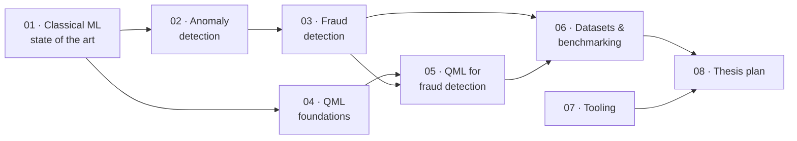

# Thesis Knowledge Base — Quantum Machine Learning for Fraud Detection

This folder collects everything you need to know **before** starting a master thesis on fraud detection with Quantum Machine Learning (QML). The documents build on each other: first the classical foundations, then the quantum side, then the thesis plan itself.

## Reading order

| # | Document | What you get out of it | Status |
|---|----------|------------------------|--------|
| 01 | [State-of-the-art Machine Learning](01-ml-state-of-the-art.md) | The algorithms used today (linear models, kernels, tree ensembles, deep learning, GNNs, tabular foundation models), how to choose between them, and how each maps to a quantum counterpart | ✅ Ready |
| 02 | [Anomaly Detection](02-anomaly-detection.md) | What an anomaly is, label settings, the full taxonomy of methods (statistical, density, isolation, boundary, reconstruction, deep), how to evaluate them | ✅ Ready |
| 03 | [Fraud Detection](03-fraud-detection.md) | Fraud types, why it is harder than plain anomaly detection, production architecture, feature engineering, metrics, public datasets, where QML fits | ✅ Ready |
| 04 | [Quantum Computing & QML Foundations](04-qml-foundations.md) | Qubits, gates, measurement and shot noise, NISQ hardware, data encoding, variational circuits, quantum kernels, barren plateaus and concentration, quantum advantage, simulation budgets, PennyLane/Qiskit examples | ✅ Ready |
| 05 | [QML for Anomaly & Fraud Detection](05-qml-fraud-literature-review.md) | Literature review (to Oct 2026) of quantum kernels, one-class models, VQCs, quantum autoencoders/GANs, QGNNs and QUBO feature selection for fraud; comparison table, assessment checklist, research gaps | ✅ Ready |
| 06 | [Datasets & Benchmarking Protocol](06-datasets-and-benchmarking.md) | Dataset cards (ULB, BAF, simulator, Elliptic), leakage-safe preprocessing, subsampling under qubit budgets, baselines and grids, metrics at realistic prevalence, diagnostics, statistics, compute budget, reproducibility, pre-registration template | ✅ Ready |
| 07 | Tooling & Environment | Covered for now by the repository [README](../README.md) and [AGENTS.md](../AGENTS.md): conda env, PennyLane, Braket / Google / D-Wave extras, configs, tests | 🟡 Partial |
| 08 | Thesis Plan | Research questions, hypotheses, timeline, risks | 🔜 Planned |

## How the topics connect

## Conventions

- Math uses `$…$` / `$$…$$` LaTeX, which renders on GitHub, GitLab, Obsidian and VS Code's Markdown preview.
- Diagrams use [Mermaid](https://mermaid.js.org/). They render natively on GitHub/GitLab and in VS Code with the *Markdown Preview Mermaid Support* extension.
- Each document ends with a **"Bridge to QML"** section (where the classical idea meets its quantum counterpart) and a **References** list.
- References are the standard papers in each area. Check every citation against the original source (Google Scholar / arXiv / DOI) before it goes into the thesis bibliography.
